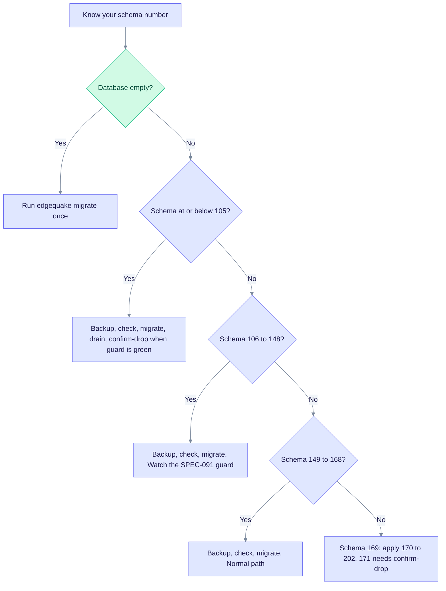
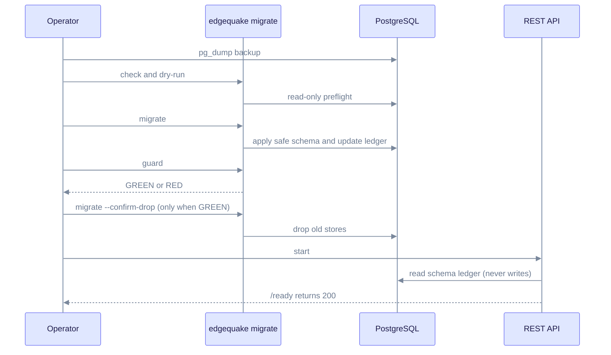
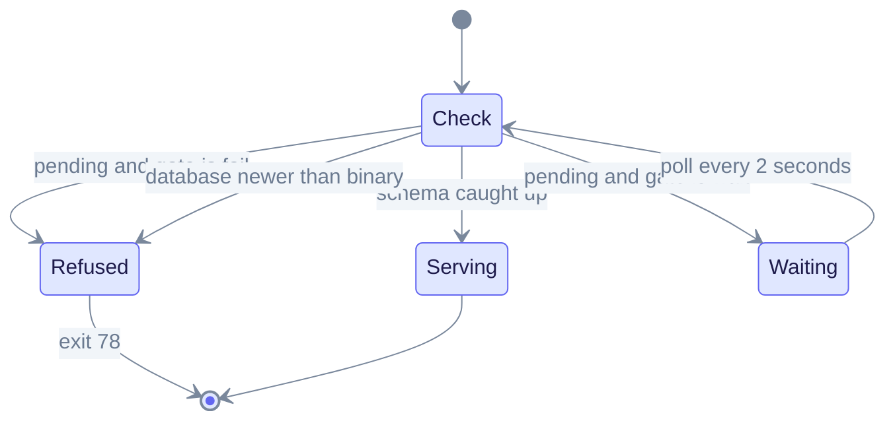

# Upgrading EdgeQuake

This is the canonical guide to database upgrades. It is for operators who run EdgeQuake on their own PostgreSQL. Read it before you start a newer image or binary. Per-release pages (`upgrade-to-0.XX.md`) describe product changes; this page describes the migration process, which works from any published version to HEAD.

> **Schema train today:** migration **212** (`211_relationship_source_chunk_keys.sql` and `212_relationship_source_chunk_keys_backfill.sql`: relationships record the chunk keys that produced them, so document-scoped search can find them; `210_graph_label_typo_search_rls.sql`: owner function for typo label search; `209_graph_ordered_scope_indexes.sql`: ordered graph page indexes; `208_rls_initplan_predicates.sql`: row-security helpers evaluated once per statement). Everything except the `212` backfill is expand-only; `212` is a data migration that fills the new column and is safe to re-run.
> The released product is **v0.35.7** (schema 207, same as v0.35.1). v0.35.0 stopped at **206**. Migration 170 adds plain graph tables. From v0.35.5 the published Postgres image does not include Apache AGE. When `age` is absent from `pg_available_extensions`, `edgequake migrate` records migration 171 in the same run. When the package is installed, 171 still runs only if you pass `--drop-age`. `--confirm-drop` does not answer that question. Migrations 172 through 207 are expand. A v0.35.4 data directory that already loaded AGE cannot open on the v0.35.5, v0.35.6, or v0.35.7 image; drop AGE on the v0.35.4 image first. See [upgrade-to-0.35.7.md](upgrade-to-0.35.7.md).
>
> **One rule:** the API never changes the database schema. Only `edgequake migrate` (or the Compose service or Helm Job that runs it) writes schema.

Design detail: [specs/150-reliable-migration-system/](../../specs/150-reliable-migration-system/).
Short reference: [edgequake/docs/migrations.md](../../edgequake/docs/migrations.md).

---

## 1. Which path do I take?

Read your current schema number first (see [section 2](#2-which-version-am-i-on)), then follow the chart.



How to read it: start at the top, answer each question, and stop at the box that matches you. Every path ends with the verify step in section 3.

| From (schema) | Releases | Risk | What to do |
|---------------|----------|------|------------|
| Empty database | none | S | `edgequake migrate` once. A fresh install needs no drop consent. |
| 105 or lower | before v0.23.0 | XL | Backup, check, migrate, drain, then `--confirm-drop` only when the guard is green. |
| 106 to 148 | v0.23.0 to v0.25.x | M to L | Known checksum variants repair automatically. Watch the SPEC-091 guard. See [#396](https://github.com/raphaelmansuy/edgequake/issues/396). |
| 149 | v0.26.x | S to M | Normal path (150 to 169). Leftover drops may still be pending. |
| 159 to 166 | v0.27 to v0.31 | S | Apply the remaining numbered files. |
| 168 | v0.32.x | S | Apply 169 (`provider_connections`, expand-only). |
| 169 | v0.33.0 / v0.34.0 | S | Apply 170 (plain graph). 171 drops AGE only if you answer yes (`--drop-age`). 172 to 207 are expand. |

Risk assumes a small database. Large graphs take longer (class XL) because some steps rewrite AGE tables or build indexes.
Proof: `make spec150-matrix` (all epochs) and `make spec150-matrix-quick` (key epochs) replay each epoch to HEAD on PG16, PG17 and PG18.

---

## 2. Which version am I on?

Ask the running API. If the API is down, ask the migrate CLI (it needs `DATABASE_URL`).

```bash
# Running API
curl -sf localhost:8080/health | jq '{version, schema}'

# Without the API running (needs DATABASE_URL)
edgequake migrate status    # schema first, then data-engine jobs
edgequake migrate check
```

| Signal | Meaning |
|--------|---------|
| `version` | Binary or image version, for example `0.32.2`. |
| `schema.latest_version` | Highest applied migration, for example `168`. |
| `schema.pending_count` | Safe-schema migrations still missing. |
| `/ready` returns **200** | Safe for traffic. |
| `/ready` returns **503** | Schema or index not ready. Run migrate, or wait. |

Schema number to release. The migration matrix in `scripts/spec150/epochs.toml` replays these release points:

| Schema max | Product releases |
|-----------:|------------------|
| 24 | v0.2.0 to v0.4.1 |
| 105 | v0.22.0 |
| 141 | v0.23.0 |
| 147 | v0.24.4 |
| 148 | v0.25.0 |
| 149 | v0.26.0 to v0.26.10 |
| 159 | v0.27.0 |
| 160 | v0.28.0 to v0.28.2 |
| 161 | v0.28.3 |
| 162 | v0.28.4 to v0.28.5 |
| 163 | v0.29.0 |
| 165 | v0.30.0 |
| 166 | v0.31.0 |
| 168 | v0.32.0 to v0.32.2 |
| 169 | v0.33.0 and v0.34.0 (schema unchanged; SPEC-163 `provider_connections`) |
| 206 | v0.35.0 (SPEC-164 plain graph + RLS query indexes) |
| 207 | v0.35.1 through v0.35.5 (AGE lineage discovery under row security; 0.35.2 through 0.35.5 add no migration) |
| 208 | HEAD (row-security policies wrap `current_*_id()` as InitPlans; rewrites policy text only) |
| 209 | HEAD (graph scope indexes carry the sort key; replaces the two prefix-only scope indexes) |
| 210 | HEAD (typo label search runs in an owner function so trigram indexes work under row security) |
| 211 | HEAD (`relationships.source_chunk_keys` column and GIN index; additive) |
| 212 | HEAD (backfills `source_chunk_keys` from graph edge lineage, about 15 s for 155k relationships) |

---

## 3. The golden path (every upgrade)

Run these steps in order. Use the migrator binary or image that matches or is newer than the API you are about to start. Never point an older migrate image at a newer database.

```bash
# 1. Backup
pg_dump -Fc "$DATABASE_URL" > edgequake-$(date +%F).dump   # or a volume snapshot

# 2. Preflight: extensions, PostgreSQL major, dirty ledger (no writes)
edgequake migrate check

# 3. Preview pending steps (no writes)
edgequake migrate dry-run

# 4. Apply safe schema
edgequake migrate

# 5. Optional: foreground data drain when mid-cutover
edgequake migrate drain

# 6. Check the guard, then drop old tables ONLY when it is green
edgequake migrate guard
edgequake migrate --confirm-drop

# 7. Start the API. Under an orchestrator also set EDGEQUAKE_SCHEMA_GATE=wait

# 8. Verify
curl -sf "$HOST/ready" && curl -sf "$HOST/health" | jq .schema
```

The sequence below shows who writes the schema and in what order. The API only reads the ledger.



Only `edgequake migrate` writes to the database. Steps 1 to 6 happen before the API starts; the API then checks the ledger at boot.

Other `migrate` verbs: `status` (per-job progress), `console [--watch]` (live dashboard), `plan` (ordered runbook), `guard [--family NAME]` (is a flip or drop safe?), `family list|set`, `pause|resume|cancel STEP_ID`. Run `edgequake migrate nonsense` to print the full usage text.

### What you will see

`edgequake migrate check` and `edgequake migrate` print the upgrade path in plain English. A published v0.34.0 database (schema 169) moving onto this train looks like this:

```text
UPGRADE PATH
  database schema : 169 (≈ v0.33.0)
  binary schema   : 207 (v0.35.0 ≈ v0.35.1)
  pending steps   : 38
  irreversible    : 171 (drops Apache AGE after the SPEC-164 plain-graph ledger is ready)

 APPLY INTENT
  pending total:              38
  SAFE SCHEMA (will apply):   37
  DROP OLD (needs confirm):    1 → 171 (drops Apache AGE after the SPEC-164 plain-graph ledger is ready)
  consent: NOT given — will apply SAFE SCHEMA only, leave DROP OLD pending

migrate ok: pending_before=37 latest=207 applied_this_run=37
```

`latest=207` is the highest applied version. An empty ledger prints `latest=none`. Version lists are spans (`172–207`), not Rust debug dumps. When migration 171 is still waiting for consent, that closing line is followed by `VERDICT: OK TO START THE SERVER`.

Measured on PostgreSQL 16 with 80,000 documents, 40,000 chunks, 30,000 conversations, and 80,000 tasks ([v034_large_upgrade.json](../../specs/164-pure-postgres-study/measurements/v034_large_upgrade.json)):

| Step | Time |
|------|------|
| Empty database, migrations 1–169 | 2.008 s |
| Upgrade 170–202 on that corpus | 3.003 s |
| Document page `status=failed` | 0.081 ms |
| Same page with only the workspace status index visible | 0.051 ms |

The slowest index builds on that corpus (196, 184, 200, 194) each finished in under a second. Row counts were unchanged. Apache AGE was gone after migration 171. Migration-guard CI runs this proof as Layer 4.

---

## 4. What happens at API boot

The API checks the schema before it serves traffic. The `EDGEQUAKE_SCHEMA_GATE` setting chooses what it does when migrations are pending.



The API starts in `Check`. If the schema is current it serves. If migrations are pending, `fail` mode exits with code 78, while `wait` mode answers `/live` (200) and `/ready` (503) and polls until migrate finishes. A database that is newer than the binary also exits 78.

| Mode | Set it | Use it for |
|------|--------|------------|
| `fail` (default) | nothing | Bare metal and `make dev`. A missing migrate is a loud error. |
| `wait` | `EDGEQUAKE_SCHEMA_GATE=wait` | Compose and Kubernetes, where migrate and the API start together. |

---

## 5. Platform runbooks

### Docker Compose

Migrate is a one-shot service. The API waits for `service_completed_successfully` and runs with `EDGEQUAKE_SCHEMA_GATE=wait`.

```bash
export EDGEQUAKE_VERSION=0.32.2
docker compose -f docker-compose.quickstart.yml pull
docker compose -f docker-compose.quickstart.yml up -d
# Re-run migrate by hand:
docker compose -f docker-compose.quickstart.yml run --rm migrate
curl -sf localhost:8080/ready
```

### Helm and Kubernetes

- With an external database, the migrate Job is a `pre-install,pre-upgrade` hook.
- With the bundled PostgreSQL, the Job is a normal Job named `edgequake-migrate-r<revision>`, and the API waits (`EDGEQUAKE_SCHEMA_GATE=wait`, startup probe on `/live`).

```bash
EDGEQUAKE_VERSION=0.32.2 make k8s-install
```

### Bare metal or systemd

Run migrate as a oneshot unit that starts before the API:

```bash
# Run migrate as a oneshot unit ordered Before=edgequake.service
sudo -u edgequake DATABASE_URL=... /usr/local/bin/edgequake migrate
sudo systemctl start edgequake
```

### Local development

`make dev` runs `edgequake migrate` before it starts the backend. `make migrate` updates the schema only.

---

## 6. Exit codes

| Code | Meaning | What to do |
|-----:|---------|------------|
| 0 | Success. Also returned when only DROP OLD steps remain pending. | Start or keep serving. |
| 1 | Any other migrate error, including an unknown checksum (`VersionMismatch`). The message names the problem. | Read the message, then follow section 7. |
| 75 | Another migrate holds the advisory lock (`MIGRATE_LOCK_BUSY`). | Wait for it. Check `pg_locks`. |
| 78 | Serve refused by the schema gate. | Run `edgequake migrate`, or upgrade the binary if the database is newer. |

---

## 7. Recovery (symptom, cause, fix)

| Symptom | Likely cause | Fix |
|---------|--------------|-----|
| Migrate fails with `VersionMismatch` (exit 1) | A shipped `NNN_*.sql` was edited, or the database was built from an unlisted variant. | Known variants in `manifest.toml` repair automatically. One time only: `EDGEQUAKE_ALLOW_CHECKSUM_REPAIR=71,78 edgequake migrate`, then unset it. An unknown hash needs a new migration. |
| Migrate stops on a dirty version | A step failed part way. | Inspect `SELECT * FROM public._sqlx_migrations WHERE success = false;`. Fix the DDL or confirm it did not apply, delete the dirty row, rerun `edgequake migrate`. |
| Exit 75 | Two migrates at once, or a crashed session still holds the lock. | Wait up to `EDGEQUAKE_MIGRATE_LOCK_DEADLINE` (60 s). After a crash make sure no session holds `hashtext('edgequake.migrate.run')`. |
| `migrate check` fails | Missing `vector` or `age` extension, unsupported PostgreSQL major, binary older than the database, or a dirty ledger. | The command prints a plain-English fix for each. |
| Need to go back | There are no down-migrations. | Restore from backup. Always take a verified backup before `--confirm-drop`. |
| `public._sqlx_migrations` is missing versions that exist in `ag_catalog` or `edgequake` | An older migrator wrote the ledger into the first schema on `search_path`. The DDL committed. The row is the proof. | Re-run `edgequake migrate`. It copies those rows into `public._sqlx_migrations`, drops the stray tables, and prints `ledger: copied N migration row(s) into public._sqlx_migrations and removed stray copies`. |

---

## 8. Settings for migrate and the gate

Full list: [env-reference.md](env-reference.md). Defaults are read from code.

| Variable | Default | Purpose |
|----------|---------|---------|
| `EDGEQUAKE_SCHEMA_GATE` | `fail` | `wait` serves lite `/live` and `/ready` until migrate catches up. |
| `EDGEQUAKE_SCHEMA_GATE_POLL` | `2` | Seconds between polls in wait mode. |
| `EDGEQUAKE_MIGRATE_LOCK_DEADLINE` | `60` | Seconds to wait for the lock before exit 75. |
| `EDGEQUAKE_MIGRATE_LOCK_TIMEOUT` | `5s` | Session `lock_timeout` for migrate. |
| `EDGEQUAKE_MIGRATE_STATEMENT_TIMEOUT` | unset | Optional override of the session `statement_timeout`. |
| `EDGEQUAKE_ALLOW_CHECKSUM_REPAIR` | unset | Emergency, scoped hash rewrite. Unset it afterwards. |
| `EDGEQUAKE_SERVE_RECONCILE` | unset | One-release escape: allow serve-time support DDL. |
| `EDGEQUAKE_MIGRATION_CONFIRM_DROP` | unset | Same as `--confirm-drop`. Never set it in shared env files. |

---

## 9. Known limits

- **[#396](https://github.com/raphaelmansuy/edgequake/issues/396):** the SPEC-091 guard can stay red on mid-cutover fleets. Do not use `--confirm-drop` until it is green.
- **PostgreSQL itself is not upgraded.** Changing the PG major is a separate cluster migration (`scripts/migrate_postgres_major.sh` or an image rebuild).
- **Large graphs.** Some migrations rewrite graph tables or build indexes (for example 070, 071, 074, 156 and 158, plus HNSW builds). On large graphs they can run for a long time. Plan a maintenance window. The 170–202 index steps on an 80,000-document database finished in under a second each; see the measured times in section 3.
- **`migrations/scripts/reset_migrations.sql`** is for development only. It drops the migration ledger. Never run it in production.
- **`edgequake/docker/init.sql`** is legacy and not mounted. The numbered migrations are the schema source of truth.

---

## 10. Related pages

- This release: [upgrade-to-0.35.5.md](upgrade-to-0.35.5.md). Previous: [upgrade-to-0.35.4.md](upgrade-to-0.35.4.md), [upgrade-to-0.35.3.md](upgrade-to-0.35.3.md), [upgrade-to-0.35.2.md](upgrade-to-0.35.2.md), [upgrade-to-0.35.1.md](upgrade-to-0.35.1.md), [upgrade-to-0.35.0.md](upgrade-to-0.35.0.md).
- Per-release notes: [upgrade-to-0.34.0.md](upgrade-to-0.34.0.md), [upgrade-to-0.33.0.md](upgrade-to-0.33.0.md), [upgrade-to-0.32.2.md](upgrade-to-0.32.2.md) and earlier.
- Release process: [release-and-cd.md](release-and-cd.md).
- Deployment: [deployment.md](deployment.md), [docker-quickstart.md](docker-quickstart.md).
- SPEC-150 runbook: [specs/150-reliable-migration-system/11-ops-runbook.md](../../specs/150-reliable-migration-system/11-ops-runbook.md).
- Incident catalogue: [specs/150-reliable-migration-system/02-incident-catalogue.md](../../specs/150-reliable-migration-system/02-incident-catalogue.md).
