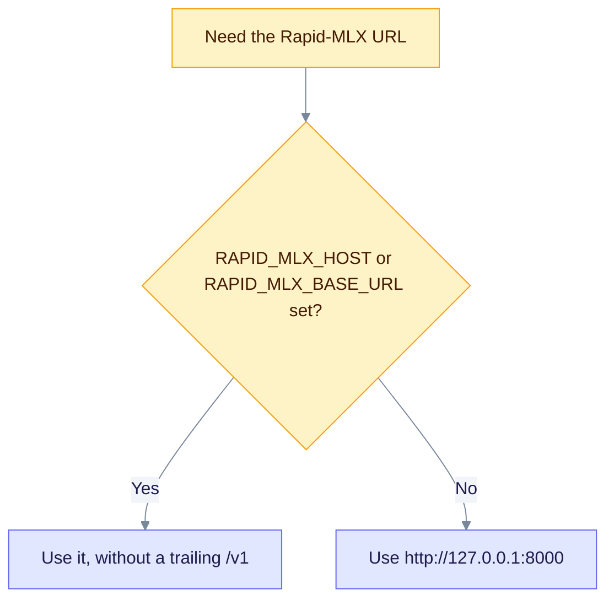

Rapid-MLX serves MLX models on Apple Silicon through an OpenAI-shaped API. With no `--port`, it binds the first free port in 8000–8009. EdgeQuake's client default is `http://127.0.0.1:8000`, and the client adds `/v1`. A key is optional. This page covers the setup and how to check the link.

Upstream: [Rapid-MLX](https://github.com/raullenchai/Rapid-MLX) (Apache-2.0).

## When to use

- You run models on a Mac with Apple Silicon and want no API costs.
- You already run `rapid-mlx serve` and want EdgeQuake to call it.

## Configure

```bash
brew install rapid-mlx
rapid-mlx serve qwen3.5-4b-4bit

export EDGEQUAKE_LLM_PROVIDER=rapid-mlx
export RAPID_MLX_HOST=http://127.0.0.1:8000
export RAPID_MLX_MODEL=qwen3.5-4b-4bit
export EDGEQUAKE_EMBEDDING_PROVIDER=rapid-mlx
export EDGEQUAKE_EMBEDDING_MODEL=<your-embedding-model>
export EDGEQUAKE_EMBEDDING_DIMENSION=768
```

`qwen3.5-4b-4bit` is the upstream example. Copy the id from `GET /v1/models`. The catalog placeholder `default` is not a model Rapid-MLX loads by itself.

| Variable | Purpose |
|----------|---------|
| `RAPID_MLX_HOST` | Server URL. Alias `RAPID_MLX_BASE_URL`. A trailing `/v1` is removed. Default `http://127.0.0.1:8000`. |
| `RAPID_MLX_API_KEY` | Optional Bearer token. Leave it unset when the server was started without `--api-key`. The same name is the server's own key variable. |
| `RAPID_MLX_MODEL` | Chat model id. When unset, `EDGEQUAKE_LLM_MODEL` is used, then `default`. |
| `RAPID_MLX_EMBEDDING_MODEL` | Embedding model id. When unset, `EDGEQUAKE_EMBEDDING_MODEL` is used, then the chat model. |
| `RAPID_MLX_TIMEOUT_SECONDS` | HTTP timeout. Default 600. |
| `EDGEQUAKE_EMBEDDING_DIMENSION` | Vector size. The client shell reports 768 until you set this. It must match the model's real output. |

There is no settings file. EdgeQuake does not read `~/.rapid-mlx`.



Read it top to bottom. The first set variable wins.

## Verify

```bash
curl -sS http://127.0.0.1:8000/health
curl -sS http://127.0.0.1:8000/v1/models
curl -sS http://127.0.0.1:8080/health
```

`GET /health` is unauthenticated and returns `status: healthy` before the model is ready. EdgeQuake's process `/health` uses that route. The Settings test (`POST /api/v1/providers/test`) lists `/v1/models` and sends a short chat request. `/v1/models` and chat require the Bearer token when the server was started with a key.

In Settings → Connections, choose **Rapid-MLX**. The preset base is `http://127.0.0.1:8000/v1`. Leave the key empty unless the server requires one.

`quickstart.sh --yes --provider rapid-mlx --base-url http://host.docker.internal:8000` starts the stack against a server on the Docker host.

## Embeddings

`/v1/embeddings` is an optional Rapid-MLX extra (`rapid-mlx[all]` or the embeddings extra), not the base install. Until that extra is installed the route can 404. After you change the embedding model or `EDGEQUAKE_EMBEDDING_DIMENSION`, rebuild stored vectors ([Roles](roles.md#change-embeddings-with-care)).

## Docker

Inside the container, `127.0.0.1` is the container. When `EDGEQUAKE_LLM_PROVIDER=rapid-mlx` and no host is set, the server sets `RAPID_MLX_HOST=http://host.docker.internal:8000`. A loopback value you did set is rewritten to `host.docker.internal`. Other providers do not get a Rapid-MLX host invented for them.

## Troubleshoot

- **Connection refused on 8000.** Rapid-MLX picks the first free port in 8000–8009 when `--port` is omitted. Set `RAPID_MLX_HOST` to the URL it printed. EdgeQuake does not scan those ports: 8000 is also the URL vLLM-MLX documents, and a scan could attach to the wrong server.
- **`/health` on EdgeQuake is degraded, chat from curl works.** Export `RAPID_MLX_HOST` to the port the server actually bound. `localhost` and `127.0.0.1` are the same loopback address.
- **401 on `/v1/models`.** The server was started with `--api-key`. Set `RAPID_MLX_API_KEY` to that value. `GET /health` stays open without the key.
- **Embeddings 404 or the wrong vector size.** Install the embeddings extra, set `EDGEQUAKE_EMBEDDING_MODEL`, and set `EDGEQUAKE_EMBEDDING_DIMENSION` to the model's real size.

Related: [Providers overview](index.md), [oMLX](omlx.md), [vLLM-MLX](vllm-mlx.md).
