This page lists the highlights of each release from v0.40.3 back to v0.24.0, newest first. Most entries name the schema number, so you can plan a database migration before you upgrade. For the full change list, see the [CHANGELOG](CHANGELOG.md), and for the upgrade steps, see the linked upgrade guide. A plain-English [picture tour](https://edgequake.com/tutorial/) of the UI is on the marketing site.

## Schema train at a glance

The schema number is the highest migration applied by a release. Releases that do not add a migration keep the previous number.

```mermaid
%%{init: {"theme":"base","themeVariables":{"primaryColor":"#E0E7FF","primaryBorderColor":"#6366F1","primaryTextColor":"#1E1B4B","secondaryColor":"#D1FAE5","secondaryBorderColor":"#10B981","secondaryTextColor":"#064E3B","tertiaryColor":"#FEF3C7","tertiaryBorderColor":"#F59E0B","tertiaryTextColor":"#6B7A90","lineColor":"#7A889C","clusterBkg":"rgba(99,102,241,0.07)","clusterBorder":"#A5B4FC","noteBkgColor":"#FEF9C3","noteTextColor":"#422006","textColor":"#6B7A90","titleColor":"#6B7A90","signalColor":"#7A889C","signalTextColor":"#6B7A90","loopTextColor":"#6B7A90","edgeLabelBackground":"#F1F5F9","actorLineColor":"#94A3B8"}}}%%
%% eq-theme:v1
timeline
    title Schema train by release
    v0.23.0 : 141
    v0.24.0 : 142
    v0.25.0 : 148
    v0.26.0 : 149
    v0.29.0 : 163
    v0.30.0 : 165
    v0.31.0 : 166
    v0.32.0 : 168
    v0.32.2 : 168 pinned
    v0.33.0 : 169
    v0.34.0 : 169 pinned
    v0.35.0 : 206
    v0.35.1 : 207
    v0.36.0 : 214
    v0.37.0 : 218
    v0.38.0 : 219
    v0.38.1 : 224
    v0.38.2 : 224 pinned
    v0.38.3 : 224 pinned
    v0.38.4 : 224 pinned
    v0.39.0 : 226
    v0.40.3 : 227
    v0.40.2 : 227
    v0.40.1 : 227
    v0.40.0 : 227
```

The timeline shows the schema number each release leaves the database at, from v0.23.0 through v0.40.3.

Run `edgequake migrate` when you move to a release with a higher number. The [upgrading guide](operations/upgrading.md) covers the steps.

### What's new in 0.40.3

A signed-in admin can save a provider connection, including a Vertex service-account file. Schema stays **227**. `edgequake migrate` is a no-op. See [upgrade-to-0.40.3.md](operations/upgrade-to-0.40.3.md).

- Deployment writes send `?scope=deployment`. A tenant header without that scope still returns `connection_scope_global`.
- `make dev` keeps a stable gitignored secrets key so the saved file can be encrypted. An existing key is never replaced.

### What's new in 0.40.2

A Vertex connection can store its own service-account key file, and three provider endpoints were corrected against current documentation. Schema stays **227**. `edgequake migrate` is a no-op. See [upgrade-to-0.40.2.md](operations/upgrade-to-0.40.2.md).

- Vertex AI stores a service-account JSON or a Vertex API key, encrypted, or uses the server identity. Chat mints a token from the file, so a mismatched ADC no longer matters.
- Hugging Face moved to `router.huggingface.co/v1` (the old host returns 410), Cohere to its Compatibility API, Azure to the Foundry `/openai/v1` route.
- Gemini, Vertex AI, Bedrock and Copilot no longer offer a Base URL the client ignores.
- The saved row names the shape and credential kind instead of printing a base64 fingerprint.

### What's new in 0.40.1

Honest provider settings, a verified Vertex identity for chat and embedding, and a Documents upload zone that no longer clips its own controls. Schema stays **227**. `edgequake migrate` is a no-op. See [upgrade-to-0.40.1.md](operations/upgrade-to-0.40.1.md).

- Provider cards report `Key set` / `Key not set` / `Google Cloud identity` from the connection shape, so Vertex no longer claims a key it cannot use.
- Chat and image embedding share one verified Google Cloud identity. A mismatched ADC no longer 403s every query while embeddings succeed.
- The text-only Documents notice is dismissible per workspace and sits beside the drop zone; the zone picks its layout from measured height.

### What's new in 0.40.0

Default questions come from the corpus, and a Normal workspace drops chunks that do not clear a relevance floor. Schema moves **226 → 227**. Upgrade from 0.39.1 runs migration **227**. It is expand-only: the BM25 triggers stop counting empty image chunks, and existing normal workspaces have those counters recomputed. No column is added. See [upgrade-to-0.40.0.md](operations/upgrade-to-0.40.0.md).

- The Query empty state asks only what the workspace can answer. A graph workspace names real entities. An empty workspace shows no question cards.
- A picture chunk must clear cosine 0.48, and a text chunk 0.10, before it enters the prompt. `relevance_dropped` reports how many candidates the floor removed.
- **SPEC-001 Acc** was not re-scored. The pack measures a graph workspace. The latest valid result remains a statistical tie (EdgeQuake 0.8084, LightRAG 0.7681, delta +0.0403).

### What's new in 0.39.0

Normal RAG workspaces (SPEC-180) and a rebuilt admin surface (SPEC-181). Schema moves **224 → 226**. Upgrade from 0.38.4 runs migrations **225** and **226**. Both are expand-only, so the migration may run ahead of the image bump. Restart replicas after migrate.

- A workspace can be created as `normal`: chunks, dense embeddings and BM25, with no knowledge graph and no chat model at ingest. The profile is permanent. Graph endpoints answer `409` and graph-only modes answer `422`. A multimodal embedding model lets it index images and search by image.
- Creating an organization now grants the creator an owner membership. Before, the row existed with nobody able to administer it. A trigger refuses removing the last owner.
- Deleting an organization purges all nine storage planes. Before, three were purged and six orphaned.
- Quota has one source of truth. Four columns disagreed; `trg_workspace_quota_guard` enforces the plan limit on write.
- The eight-step create wizards are replaced by two three-decision dialogs. A capability catalog backs a single `GET /me/access`, and navigation renders only what that answer allows.
- `make dev` no longer forces Ollama. An exported `OPENAI_API_KEY`, `ANTHROPIC_API_KEY`, `GEMINI_API_KEY` or `XAI_API_KEY` now wins, because `scripts/dev_provider_detect.sh` resolves the provider once and the banner reads the same answer.
- KaTeX `trust: true` is gone, closing a `javascript:` link injection. Dependency advisories fall from **243 to 3 low**.
- SPEC-001 Acc was not re-scored. SPEC-180 adds a workspace profile rather than changing mix retrieval. The pack [`medical-mid-20261024T031725Z`](../specs/001-benchmark/e2e/artifacts/history/medical-mid-20261024T031725Z/) stays the valid score: EdgeQuake **0.8084** vs LightRAG **0.7681**, a statistical tie. EdgeQuake does not claim a win.

Upgrade: **[upgrade-to-0.39.0.md](operations/upgrade-to-0.39.0.md)** · changelog: [CHANGELOG.md](CHANGELOG.md).

### What's new in 0.38.3

Patch on v0.38.2. Schema stays **224**. Upgrade from 0.38.2 applies no new migration. Restart replicas after the image bump.

- Creating a workspace can store the decision-engine model `tev1:0.8b`. That tag stays out of the chat catalog, and the save accepts a valid decision-engine name.
- SPEC-001 Acc was not re-scored. The pack [`medical-mid-20261024T031725Z`](../specs/001-benchmark/e2e/artifacts/history/medical-mid-20261024T031725Z/) stays the valid score: EdgeQuake **0.8084** vs LightRAG **0.7681**, a statistical tie. EdgeQuake does not claim a win.

Upgrade: **[upgrade-to-0.38.3.md](operations/upgrade-to-0.38.3.md)** · changelog: [CHANGELOG.md](CHANGELOG.md).

### What's new in 0.38.2

Patch on v0.38.1. Schema stays **224**. Upgrade from 0.38.1 applies no new migration. Restart replicas after the image bump.

- A live model list that omits the embedding size keeps the known size. `mistral-embed` stays 1024.
- Saving a provider offer reads the revision as a 32-bit integer, so `If-Match` matches.
- The workspace wizard and the model picker follow the eligible set.
- SPEC-001 Acc was not re-scored. The pack [`medical-mid-20261024T031725Z`](../specs/001-benchmark/e2e/artifacts/history/medical-mid-20261024T031725Z/) stays the valid score: EdgeQuake **0.8084** vs LightRAG **0.7681**, a statistical tie. EdgeQuake does not claim a win.

Upgrade: **[upgrade-to-0.38.2.md](operations/upgrade-to-0.38.2.md)** · changelog: [CHANGELOG.md](CHANGELOG.md).

### What's new in 0.38.1

Document clearance, a secret manager, and one model choice from Deployment down to the workspace (SPEC-174 through SPEC-179). Schema moves **219 → 224**. Upgrade from 0.38.0 runs migrations **220** through **224**. All five are expand-only. Restart replicas after migrate.

- Clearance stays off until a workspace owner turns it on. Existing documents stay readable.
- An empty model catalog still runs the previous assignment. The first ceiling row is what constrains a tenant.
- New provider keys need `EDGEQUAKE_SECRETS_KEY`. The server still boots without it. Infisical stays optional.
- Deployment offers providers. The organization and the workspace each take a subset. The default is unconstrained.
- List, save, and run use the same model gate. Withdraw and delete report who breaks and do not retarget those assignments.
- SPEC-001 Acc was not re-scored. The v0.37.0 pack [`medical-mid-20261024T031725Z`](../specs/001-benchmark/e2e/artifacts/history/medical-mid-20261024T031725Z/) stays the valid score: EdgeQuake **0.8084** vs LightRAG **0.7681**, a statistical tie. EdgeQuake does not claim a win.

Upgrade: **[upgrade-to-0.38.1.md](operations/upgrade-to-0.38.1.md)** · changelog: [CHANGELOG.md](CHANGELOG.md).

### What's new in 0.38.0

Agents can upload a PDF through a checksum-bound PUT URL (SPEC-173). Schema moves **218 → 219**. Upgrade from 0.37.0 runs migration **219** only. It does not move original bytes. Restart replicas after migrate.

- S3 and GCS return a presigned PUT. Other modes return a same-origin HMAC PUT.
- The URL lasts at most 900 seconds. A default JWT secret cannot mint the relay URL.
- SPEC-001 Acc was not re-scored. The v0.37.0 pack [`medical-mid-20261024T031725Z`](../specs/001-benchmark/e2e/artifacts/history/medical-mid-20261024T031725Z/) stays the valid score: EdgeQuake **0.8084** vs LightRAG **0.7681**, a statistical tie. EdgeQuake does not claim a win.

Upgrade: **[upgrade-to-0.38.0.md](operations/upgrade-to-0.38.0.md)** · changelog: [CHANGELOG.md](CHANGELOG.md).

### What's new in 0.37.0

Original document bytes can move to a private bucket (SPEC-172). Schema moves **214 → 218**. Upgrade from 0.36.0 runs migrations **215** through **218**. Text, chunks, and the graph stay in Postgres. The code default remains the database. `make dev` uses the bucket.

- PDF bytes, uploads, page images, and extracted markdown.
- `edgequake originals` copies and verifies. `clear --yes` is a separate step after a clean verify.
- A replacement writes a new object key. The previous key is deleted only after the database row commits.
- Keys stay under the configured prefix. The process does not create a bucket.

Operator steps: [originals](operations/originals.md). SPEC-001 Acc on this cut (medical-mid n=200): EdgeQuake **0.8084** vs LightRAG **0.7681** — statistical tie (95% CI [-0.0241, +0.1036] includes 0). EdgeQuake does not claim a win. Archive [`medical-mid-20261024T031725Z`](../specs/001-benchmark/e2e/artifacts/history/medical-mid-20261024T031725Z/).

Upgrade: **[upgrade-to-0.37.0.md](operations/upgrade-to-0.37.0.md)** · changelog: [CHANGELOG.md](CHANGELOG.md).

### What's new in 0.36.0

Members, invitations, and one-time sign-in / password-reset links (SPEC-169). Schema moves **207 → 214**. Upgrade from 0.35.x runs migrations **208** through **214**.

- **Members screen** (`/members`): directory with search, filters, role changes, suspend/restore, and a roles matrix from `GET /roles`.
- **Invitations**: create/resend/delete; public accept flow; 7-day single-use tokens (hash stored only).
- **Magic links**: admin-issued sign-in (15 min) and password-reset (24 h) links; redeem is POST so mail scanners cannot consume them.
- **Change password** from the user menu; shared `PasswordField` with strength rules.
- Guards refuse SSO-pinned, suspended, self, and under-ranked targets as documented in the upgrade guide.

SPEC-001 Acc on this cut (medical-mid n=200): EdgeQuake **0.8240** vs LightRAG **0.8016** — statistical tie (95% CI includes 0). EdgeQuake does not claim a win.

Upgrade: **[upgrade-to-0.36.0.md](operations/upgrade-to-0.36.0.md)** ·
changelog: [CHANGELOG.md](CHANGELOG.md) ·
UI tour: [Members and invites](https://edgequake.com/tutorial/14-members-and-invites/).

### What's new in 0.35.1

Patch on v0.35.0. Schema moves **206 → 207**. After migrate, graph IO stays on the plain tables. `EDGEQUAKE_GRAPH_READ=age` does not move a ready cutover back onto Apache AGE. Lineage lookup uses migration 207. Credentialed CORS echoes the request origin. SPEC-001 Acc is attested from the existing 2026-08-15 medical-mid pack; the key available for this cut returned HTTP 401, so retrieval was not re-scored.

Upgrade: **[upgrade-to-0.35.1.md](operations/upgrade-to-0.35.1.md)** ·
changelog: [CHANGELOG.md](CHANGELOG.md).

### What's new in 0.35.0

Minor: plain PostgreSQL graph for GraphRAG (SPEC-164). Apache AGE is optional.
Schema moves **169 → 206**. Fresh install works on Postgres with pgvector and
without AGE (RDS / Cloud SQL class). Dropping AGE is a migrate question
(`--drop-age`); the default is keep. SPEC-001 Acc is attested from the existing
2026-08-15 medical-mid pack; retrieval was not re-scored.

Upgrade: **[upgrade-to-0.35.0.md](operations/upgrade-to-0.35.0.md)** ·
study: **[SPEC-164](../specs/164-pure-postgres-study/README.md)** ·
changelog: [CHANGELOG.md](CHANGELOG.md).

### What's new in 0.34.0

Minor: a plain-English picture tour of the website, [tutorial/README.md](../tutorial/README.md),
shot on the public demo. Schema stays **169**. From 0.33.0, `edgequake migrate`
is a no-op. SPEC-001 Acc is attested from the existing 2026-08-15 medical-mid
pack; retrieval was not re-scored.

Upgrade: **[upgrade-to-0.34.0.md](operations/upgrade-to-0.34.0.md)** · changelog: [CHANGELOG.md](CHANGELOG.md).

### What's new in 0.33.0

Minor: saved provider connections with encrypted secrets and onboarding
(SPEC-163), explicit progressive schema upgrades (SPEC-150), and MCP agent
ids that round-trip (SPEC-162). Schema train moves **168 → 169**. SPEC-001
Acc is attested from the existing 2026-08-15 medical-mid pack; connections
and schema gating were not re-scored.

Upgrade: **[upgrade-to-0.33.0.md](operations/upgrade-to-0.33.0.md)** · changelog: [CHANGELOG.md](CHANGELOG.md).

### What's new in 0.32.2

Patch: PDF viewer paints the scrollport (no blank “Page N” placeholder on
long docs); SPEC-161 MCP control surface (async ingest/upload/delete/task);
clippy/fmt clean. Schema stays **168**. SPEC-001 Acc is attested from the
existing 2026-08-15 medical-mid pack.

Upgrade: **[upgrade-to-0.32.2.md](operations/upgrade-to-0.32.2.md)** · changelog: [CHANGELOG.md](CHANGELOG.md).

### What's new in 0.32.1

Patch: typed ANN uses the workspace embedding model key with no preferred→env
fallthrough; graph seed admit runs before popular hubs (local + global Mix);
Ask companion `seed_entity_ids`; projection upserts honor payload `model_id`.
Schema stays **168**. SPEC-001 Acc is attested from the existing 2026-08-15
medical-mid pack; ANN/admit was not re-scored.

Upgrade: **[upgrade-to-0.32.1.md](operations/upgrade-to-0.32.1.md)** · changelog: [CHANGELOG.md](CHANGELOG.md).

### What's new in 0.32.0

Minor: tenant-scoped data access (schema **166 → 168**), scoped query
deadlines and incremental RAG streaming, and PDF convert retries until
`max_retries`. SPEC-001 Acc is attested from the existing 2026-08-15
medical-mid pack; query and graph-read changes in this cut were not
re-scored.

Upgrade: **[upgrade-to-0.32.0.md](operations/upgrade-to-0.32.0.md)** · changelog: [CHANGELOG.md](CHANGELOG.md).

### What's new in 0.31.0

Minor: **SPEC-160** decision extraction as a **preview** (local Ollama System One
model, default `tev1:0.8b`). Chat-LLM extraction stays the default. Schema train
moves **165 → 166**. Gate presets stay **Uncalibrated**. SPEC-001 Acc is attested
from the existing 2026-08-15 medical-mid pack; decision mode is unscored.

Upgrade: **[upgrade-to-0.31.0.md](operations/upgrade-to-0.31.0.md)** · changelog: [CHANGELOG.md](CHANGELOG.md).

### What's new in 0.30.0

Minor: **SPEC-158** enterprise SSO (Keycloak Organizations as tenants, BFF session, opaque handoff). Schema train moves **163 → 165**. A Keycloak image publishes beside the API on the same tag. `make dev` stays auth-off; SSO is opt-in.

Upgrade: **[upgrade-to-0.30.0.md](operations/upgrade-to-0.30.0.md)** · changelog: [CHANGELOG.md](CHANGELOG.md).

### What's new in 0.29.0

Minor: **SPEC-157** side-by-side query companion (citation PDF + answer graph
docked beside chat), **SPEC-155** documents docking workspace + query composer,
**SPEC-156** ingestion fan-out honesty, and `edgeparse-ocr` (Tesseract harvested
into the distroless API image). Schema train moves **162 → 163** (message
feedback columns). Crates.io: `edgequake-llm` **0.10.9**, `edgeparse-core`
**0.3.2**, `edgequake-pdf2md` **0.9.11**.

Upgrade: **[upgrade-to-0.29.0.md](operations/upgrade-to-0.29.0.md)** · changelog: [CHANGELOG.md](CHANGELOG.md).

### What's new in 0.26.4

Patch: SPEC-144 Next.js **16.3.3** Active LTS (August Critical RCEs) + proxy SSOT; SPEC-140/141 list completeness; SPEC-122 bulk-ingest honesty; health poll off by default; distroless API. **No new migration** (schema stays **149**). Pull GHCR `0.26.4` for the patched frontend image.

Upgrade: **[upgrade-to-0.26.4.md](operations/upgrade-to-0.26.4.md)** · changelog: [CHANGELOG.md](CHANGELOG.md).

### What's new in 0.26.3

Patch: SPEC-139 mid-cutover engine (iw2 21000, W3 coverage-sum, KV remainder after 119-before-122); Langfuse 3.22/3.225 isolated OTLP stacks. **No new migration** (schema stays **149**). Pull GHCR `0.26.3` — do not stay on `0.26.1` for leftover DROP OLD copy.

Upgrade: **[upgrade-to-0.26.3.md](operations/upgrade-to-0.26.3.md)** · changelog: [CHANGELOG.md](CHANGELOG.md).

### What's new in 0.26.2

Patch: Langfuse 3.1.x ingestion fallback (SPEC-124), Kubernetes Helm/kind (SPEC-138), SSE/conversation restore, workspace `include_stats`. **No new migration** (schema stays **149**). Pull GHCR `0.26.2`.

Upgrade: **[upgrade-to-0.26.2.md](operations/upgrade-to-0.26.2.md)** · changelog: [CHANGELOG.md](CHANGELOG.md).

### What's new in 0.26.1

Patch: SPEC-137 migrate honesty (`--drop-confirm` alias, unknown apply flags fail-closed, classified DROP abort hints). **No new migration** (schema stays **149**). Pull GHCR `0.26.1` — the `0.26.0` image still has the old CLI.

Upgrade: **[upgrade-to-0.26.1.md](operations/upgrade-to-0.26.1.md)** · leftover 091: [upgrade-to-0.26.0.md](operations/upgrade-to-0.26.0.md) · changelog: [CHANGELOG.md](CHANGELOG.md).

### What's new in 0.26.0

Minor: PDF pack-to-budget (SPEC-135), manuscript page-as-unit convert (SPEC-134), Langfuse dev sibling (SPEC-124), wizard persist honesty (SPEC-101), and reliability (#377, #383–#386 + mig **149**). Crates.io: `edgequake-llm` **0.10.8**, `edgequake-pdf2md` **0.9.11**, `edgequake-sdk` **0.4.0**.

Upgrade: **[upgrade-to-0.26.0.md](operations/upgrade-to-0.26.0.md)** · changelog: [CHANGELOG.md](CHANGELOG.md).

### What's new in 0.25.0

Minor: Langfuse OTLP/HTTP (SPEC-124), structure-aware markdown pack (SPEC-125), provider KV / prompt cache (SPEC-126), PDF layout overlay (SPEC-128 + mig **148**), omit-temperature / Responses API (SPEC-131 / #379), multi-PDF admit honesty (#378), document status CHECK SSOT (#381), fleet-mirror UUID + target-`->` parse (#380 / SPEC-133). Crates.io deps: `edgequake-llm` **0.10.8**, `edgequake-pdf2md` **0.9.11**.

Upgrade: **[upgrade-to-0.25.0.md](operations/upgrade-to-0.25.0.md)** · changelog: [CHANGELOG.md](CHANGELOG.md).

### What's new in 0.24.0

#### Database migration (read this first)

**The API never migrates the database.** Schema changes are an explicit operator step. The current train is on the [upgrading guide](operations/upgrading.md).

| Situation | What to run |
|-----------|-------------|
| **Fresh install** | `edgequake migrate` once, then start the API (`make dev` does this for you) |
| **Any upgrade** | Backup → `migrate check` → `migrate dry-run` → `migrate` → (optional) `migrate drain` → `migrate --confirm-drop` when guard GREEN → start API |
| **Server exits 78** | Schema behind or newer than the binary — run migrate, then restart |

Irreversible drops (**125** KV, **126**/**131** vectors) need `--confirm-drop` and a backup; rollback after that is restore-only. Migration **142** asserts empty leftovers (aborts if rows remain; deferred while residue exists).

**Canonical guide:** **[Upgrading EdgeQuake](operations/upgrading.md)** (works from any published version).  
Legacy cutover notes: [Migrate to v0.23.0+](operations/migrate-to-0.23.md) · [SPEC-091 upgrade runbook](operations/spec091-upgrade-from-v0.22.0.md).

#### Highlights

- **SPEC-104 production data-layer monitors** — StorageInspector uses `workspace_id` + `PostgresConfig` AGE graph SSOT; no `42703` / `42P01` probes; INV-03 dual-read; tenant create **201/200/409**.
- **SPEC-105 legacy cutover assert** — census SSOT; unknown `VECTOR_BACKEND` → typed; migration **142**; mid-upgrade deferral so expandables soft-exit while residue remains.
- **Schema** — migrations through **142** (0.23.0 stopped at **141**).

Also in **0.23.0**: SPEC-091 relational cutover (106–141), LD-15 boot gate, SPEC-094 parse API, SPEC-103 LLM cache, wizard/UX. **0.22.0**: SPEC-090 multi-pool + migrate CLI.
