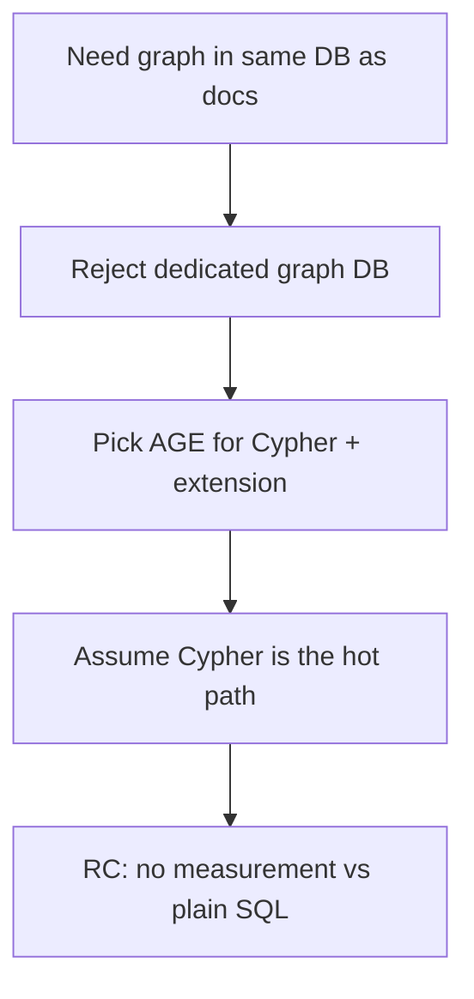
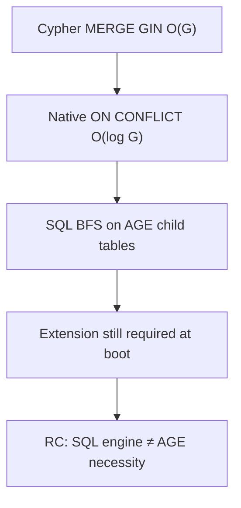
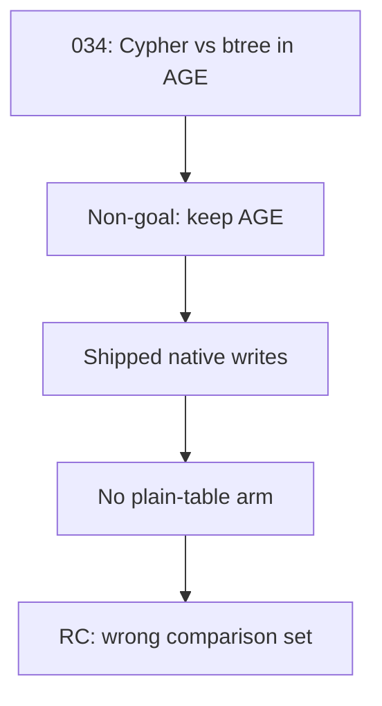
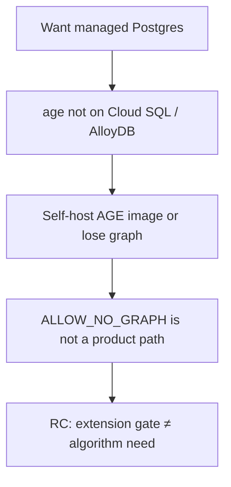
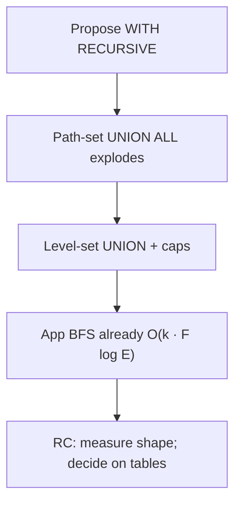

# SPEC-164 — Five Whys

Five independent chains. Each ends in a root cause that this study measures or falsifies. Stable ids: `WHY-164-01` … `WHY-164-05`.

---

## WHY-164-01 — Why was Apache AGE chosen?

| Step | Question | Answer |
|------|----------|--------|
| 1 | Why a graph store in Postgres? | Entities and relationships are first-class RAG context; they must share transactions with documents, chunks, and vectors. |
| 2 | Why not Neo4j / Neptune? | Dual systems of record, dual backup, dual auth, no transactional join to `documents`. |
| 3 | Why AGE specifically? | openCypher + in-process extension; Apache-2.0; property graph labels as tables. |
| 4 | Why did clarity of Cypher dominate? | Early code assumed `MATCH …-[*1..n]-…` and `MERGE` as the product API. |
| 5 | **Root** | AGE was chosen for **Cypher ergonomics and co-location**, not because a complexity proof showed recursive SQL or batched SQL BFS could not meet hop caps. |

**Cross-ref:** [zz-reference AGE five-whys](../../zz-reference/002-apache-age/001-why/001-five-whys.md) · [01-first-principles](01-first-principles.md) LAW-164-05.

---

## WHY-164-02 — Why did the request path leave Cypher?

| Step | Question | Answer |
|------|----------|--------|
| 1 | Why was Cypher slow? | `MERGE {node_id}` compiled to GIN `@>` — O(G) per entity (SPEC-034: 5.6 ms vs 0.081 ms btree). |
| 2 | Why not fix the AGE planner? | Product owns indexes and SQL; AGE Cypher property MATCH does not push btree expressions reliably. |
| 3 | Why native SQL on AGE heaps? | Child tables `"Node"` / `"EDGE"` are ordinary heaps; `INSERT ON CONFLICT` and indexed `IN` lists work. |
| 4 | Why keep the extension? | Boot still `CREATE EXTENSION age`; label DDL and `graphid` / `agtype` remain the physical layout. |
| 5 | **Root** | Cypher left the **hot path**, but AGE remained the **physical authority** — so “we already use SQL” does not answer “do we still need the extension?” |

**Cross-ref:** [SPEC-034](../034-graph-storage-improvement/) · IMP-031 · [`expand.rs`](../../edgequake/crates/edgequake-storage/src/adapters/postgres/graph/query_ops/expand.rs).

---

## WHY-164-03 — Why SPEC-034 cannot answer SPEC-164

| Step | Question | Answer |
|------|----------|--------|
| 1 | What did 034 measure? | Cypher vs btree **on the same AGE tables**. |
| 2 | What was the non-goal? | “Do not replace Apache AGE” (034-001). |
| 3 | What shipped? | Native writes default on; edge text-cast indexes; index consolidation. |
| 4 | What was never timed? | Wall-clock ingest; recursive CTE; plain adjacency tables without `agtype`. |
| 5 | **Root** | 034 optimized **within** AGE. A decision to leave AGE needs a new baseline: ARM-A (current) vs ARM-B (plain). |

---

## WHY-164-04 — Why managed Postgres is blocked

| Step | Question | Answer |
|------|----------|--------|
| 1 | Why host on Cloud SQL / AlloyDB? | Managed ops, backups, HA without compiling AGE. |
| 2 | Why can’t they be sole DB? | Official extension lists include `pgvector`, not `age` (SPEC-148 LAW-148-1). |
| 3 | Why does that matter for AGE? | `shared_preload_libraries` / allow-list; product fail-closed without AGE unless `EDGEQUAKE_ALLOW_NO_GRAPH=1`. |
| 4 | Why not wait for AGE on GCP/AWS? | Allow-list lag is years; Azure is the outlier with AGE. |
| 5 | **Root** | **Hosting optionality** is a first-class product constraint. If plain SQL meets hop SLOs, LAW-148-1 can flip without waiting for AGE on Cloud SQL. |

**Cross-ref:** [SPEC-148](../148-gcloud-hosting/00-why.md) · RDS/Neon/Supabase landscape (industry 2026: AGE rare on managed).

---

## WHY-164-05 — Why a CTE is not automatically the replacement

| Step | Question | Answer |
|------|----------|--------|
| 1 | Why do people say “use WITH RECURSIVE”? | Adjacency lists + recursive CTEs are standard SQL for k-hop. |
| 2 | Why can CTEs explode? | Path-set `UNION ALL` materializes duplicate paths; hubs blow worktables (published: tens of seconds vs level-set `UNION`). |
| 3 | Why does EdgeQuake’s BFS avoid that? | Application BFS keeps a visited set; one indexed incident batch per hop; caps at depth 3 / 500 nodes. |
| 4 | Why still test CTEs? | One round-trip level-set may beat multi-hop app BFS on sparse graphs; must measure on Hub. |
| 5 | **Root** | Storage decision is **indexed adjacency tables**. CTE vs iterative BFS is a **query shape** over that storage — measured as ARM-C, not as the authority model. |

**Cross-ref:** [05-complexity-proof](05-complexity-proof.md) · [06-experiment-protocol](06-experiment-protocol.md) H-164-03 / H-164-04.
