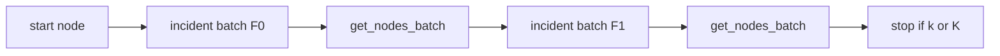

# SPEC-164 — First Principles

Laws are binding for this study. They are not slogans: each has a falsifier in the measurement protocol.

---

## LAW-164-01 — Traversal authority is the indexed adjacency relation

A graph hop is: given frontier node ids, return incident edges whose endpoints match, then fetch neighbor nodes. Any store that presents that relation with btree (or equivalent) indexes on both endpoints implements traversal. Label inheritance, `graphid`, and Cypher are incidental unless a measured op requires them.

**Falsifier:** An op on the production request path that cannot be expressed as SQL over `(node_id)` / `(source_id, target_id)` without AGE functions, excluding DDL bootstrap.

---

## LAW-164-02 — Product hop bounds are invariants

Default query depth is **2**; neighbor expand clamps depth to **1..=3** and neighbors to **500** ([`expand.rs`](../../edgequake/crates/edgequake-storage/src/adapters/postgres/graph/query_ops/expand.rs)). Complexity arguments that assume unbounded `[*1..n]` or whole-graph algorithms do not bind the product.

**Falsifier:** A shipped HTTP/query path that issues unbounded variable-length Cypher or uncapped recursive walk.

---

## LAW-164-03 — Identity is text `node_id`

AGE vertices are keyed by property / denormalized `eq_node_id` text. Relational `entities.id` UUID is a different keyspace (CQRS projection). A pure-SQL graph must keep text `node_id` as the traversal key or prove a lossless mapping.

**Falsifier:** A migration plan that uses `entities.id` as the BFS key without a proven bijection to `node_id`.

---

## LAW-164-04 — Tenant and workspace predicates must be sargable

Isolation is `tenant_id` / `workspace_id` equality. On AGE they live in `agtype` and are indexed as expressions. On plain tables they should be real columns so btree/RLS need no `agtype_to_json`.

**Falsifier:** A candidate schema that filters only via JSONB containment without a supporting btree/expression index for the hot path.

---

## LAW-164-05 — An extension is justified only by an algorithm the product executes

`CREATE EXTENSION age` is mandatory at boot (fail-closed). It is justified if and only if some **used** algorithm or type cannot be replaced at equal or better measured cost. Unused Cypher, unused AGE algos, and unused `graph_nodes` fallback do not justify it.

**Falsifier:** A request-path measurement where ARM-A is more than 2× faster than ARM-B at scale M, or a correctness mismatch that only AGE can express.

---

## LAW-164-06 — Estimates are not results

SPEC-034’s 69× is `EXPLAIN ANALYZE` on one database day. Projected “4.6 s → 480 ms” ingest is labeled estimate. This study files only medians from [`measurements/results.json`](measurements/results.json).

**Falsifier:** A decision paragraph that cites a number absent from `results.json` without the word “estimate”.

---

## Complexity bound (analytic)

Notation:

- `G` = |nodes|, `E` = |edges|
- `k` = hop depth ≤ 3
- `Fᵢ` = frontier size at hop i (≤ 500 after product cap)
- Indexes: btree on node PK and on both edge endpoints

Per hop (indexed incident batch):

\[
T_{\text{hop}} = O(|F| \log E + e_F)
\]

where `e_F` is edges touching the frontier. Full expand:

\[
T_{\text{expand}} = O\left(\sum_{i=1}^{k} (|F_i| \log E + e_{F_i}) + K \log G\right)
\]

with `K ≤ 500` node fetches. This is the same class for AGE child tables and plain adjacency tables. AGE adds cast/decode constants (`agtype_to_json`, `graphid::text`); plain SQL removes them. The study measures those constants.

---

## Decision rule (binding)

| Outcome | Condition |
|---------|-----------|
| **Migrate feasible** | ARM-B median ≤ 2× ARM-A for every OP-164-* at scale M; correctness pass; Hub level-set CTE does not timeout relative to protocol budget |
| **Keep AGE** | Any OP-164-* at M where ARM-B > 2× ARM-A, or correctness fail that only AGE layout fixes |
| **Migrate reads only** | Reads pass the 2× rule; batch upsert writes fail the 2× rule |

CTE (ARM-C) never alone decides storage; it only chooses the preferred query shape over the winning tables.
