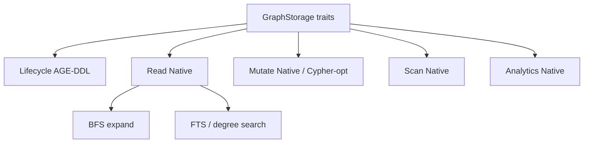

# SPEC-164 — Current GraphStorage Contract

Inventory of `PostgresAGEGraphStorage` as of HEAD. Engine legend:

- **Native** — SQL against AGE child tables (`"Node"` / `"EDGE"`)
- **Cypher-opt** — Cypher only when `EDGEQUAKE_NATIVE_GRAPH_WRITES` is off
- **AGE-DDL** — `create_graph` / `create_vlabel` / `create_elabel` / `LOAD 'age'`
- **Plain PG** — no AGE types

Dispatcher: [`graph_storage_impl.rs`](../../edgequake/crates/edgequake-storage/src/adapters/postgres/graph/graph_storage_impl.rs).

---

## Lifecycle

| Method | File | Engine | Plain-SQL equivalent |
|--------|------|--------|----------------------|
| `namespace` | `lifecycle_ops.rs` | in-memory | unchanged |
| `initialize` | `lifecycle_ops.rs` | AGE-DDL + index SQL | `CREATE TABLE` nodes/edges + indexes |
| `finalize` | `lifecycle_ops.rs` | no-op | no-op |
| advisory community lock | `graph/mod.rs` | Plain PG | same |

---

## Reads (all Native today — no Cypher)

| Method | File | Hot SQL idea | Plain-SQL equivalent |
|--------|------|--------------|----------------------|
| `has_node` / `get_node` | `nodes_ops/read.rs` | batch get via `eq_node_id` / agtype `node_id` | `SELECT … WHERE node_id = $1` |
| `get_nodes_by_ids` / `get_nodes_batch` | `nodes_ops/read.rs` | `UNNEST` + join | same on text PK |
| `node_degree` / `node_degrees_batch` | `nodes_ops/read.rs` | `COUNT` on `"EDGE"` | `COUNT` on `edges` |
| `get_all_nodes` | `nodes_ops/read.rs` | admin scan | admin scan (still forbidden on HTTP) |
| `has_edge` / `get_edge` | `edges_ops.rs` | endpoint + rel | unique key lookup |
| `get_node_edges` / `get_incident_edges_batch` | `edges_ops.rs` | `eq_source_id`/`eq_target_id` IN list OR | `source_id IN (…) OR target_id IN (…)` |
| `get_edges_for_nodes_batch` | `nodes_ops/read.rs` | join Node↔EDGE via graphid text | FK join on text ids |
| `get_knowledge_graph` / `get_neighbors` | `query_ops/expand.rs` | app BFS | same loop or level-set CTE |
| `get_edges_for_node_set` | `query_ops/expand.rs` | property/eq filters | `source_id = ANY AND target_id = ANY` |
| search / popular labels | `query_ops/search.rs` | FTS / trigram / degree | same on jsonb + columns |

---

## Scans (Native)

| Method | File | Notes |
|--------|------|-------|
| `list_nodes_filtered` / `list_edges_filtered` | `scan_ops.rs` | tenant/ws filters |
| `scan_nodes_after` / `scan_edges_after` | `scan_ops.rs` | keyset for community |
| `find_*_by_source_prefixes` | `scan_ops.rs` | GIN `@>` on lineage |
| `find_edge_by_relationship_id` | `scan_ops.rs` | property lookup |

---

## Mutates

| Method | File | Default | Opt-out |
|--------|------|---------|---------|
| `upsert_node(s)` | `nodes_ops/mutate.rs` | Native `ON CONFLICT` + `eq_merge_graph_properties` | Cypher `MERGE` |
| `delete_node(s)` / scoped | `nodes_ops/mutate.rs` | `DELETE` Node/EDGE | Cypher `DETACH DELETE` |
| `upsert_edge(s)` | `edges_ops.rs` | Native `ON CONFLICT` | Cypher `MERGE` |
| `delete_edge(s)` / scoped | `edges_ops.rs` | Native `DELETE` | Cypher |
| `clear` / `clear_workspace` | `analytics_ops.rs` | Native only | — |

---

## Analytics (Native)

| Method | Notes |
|--------|-------|
| `node_count` / `edge_count` | `COUNT` on parent `_ag_label_*` or child |
| `*_fast` | `pg_class.reltuples` via `pg_inherits` |
| workspace / type / source-prefix counts | property or GIN SQL |
| `ping` | `SELECT 1` from `"Node"` |

`cypher_query_count` in `helpers/cypher_exec.rs` has **no callers**.

---

## Physical AGE layout (dependency)

| Object | Role | Plain replacement |
|--------|------|-------------------|
| `eq_{ns}_graph` schema | one graph per namespace | schema `eq_{ns}` or shared tables with `namespace` column |
| `"Node"(id graphid, properties agtype, eq_node_id text)` | vertex | `nodes(node_id text PK, …, properties jsonb)` |
| `"EDGE"(id, start_id, end_id graphid, properties, eq_*)` | edge | `edges(source_id, target_id, rel_type, …)` |
| `eq_next_node_id` / `eq_next_edge_id` | graphid mint | `gen_random_uuid()` or bigserial (optional) |
| Expression indexes on agtype | tenant/ws/source | real columns + btree |
| GIN on properties / lineage | search / source prefix | GIN on jsonb arrays |

**Isolation:** property (or column) equality; optional RLS via `EDGEQUAKE_AGE_RLS` still JSON-predicates on AGE.

---

## Algorithms the product does **not** ask AGE for

- Variable-length Cypher paths  
- Shortest path  
- AGE PageRank / community algos (community is in-process over keyset scans; PPR is in-process on fetched edges)

Therefore LAW-164-05 asks: if every row above maps to plain SQL, what remains for the extension besides DDL and types?
