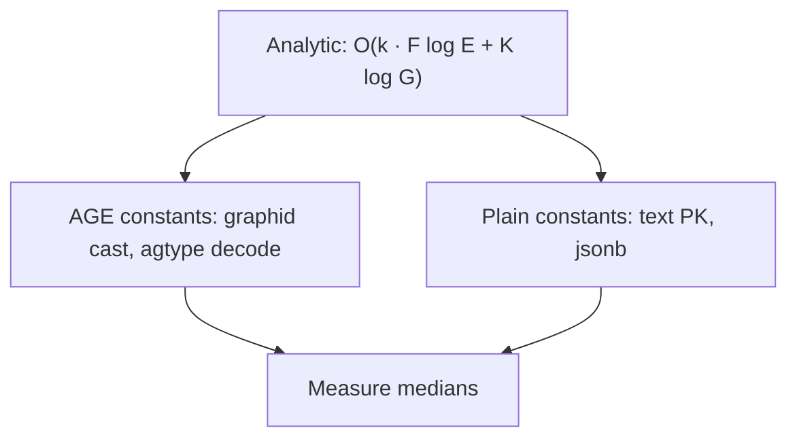

# SPEC-164 — Complexity Proof

## 1. Claim

For EdgeQuake’s actual request-path ops (bounded BFS, point get, incident batch, degree batch, batch upsert), Apache AGE does **not** change the asymptotic class relative to plain adjacency tables with btree indexes on both edge endpoints. AGE may change **constants** (cast, decode, inheritance). Constants are measured; asymptotics are argued here.

## 2. Model

| Symbol | Meaning | Product bound |
|--------|---------|---------------|
| \(G\) | nodes in store | SCALE-M: \(2\cdot10^5\) |
| \(E\) | edges in store | SCALE-M: \(5\cdot10^5\) |
| \(k\) | hop depth | \(k \le 3\) |
| \(K\) | max nodes returned | \(K \le 500\) |
| \(F_i\) | frontier at hop \(i\) | \(F_i \le K\) after cap |
| \(e_F\) | edges incident to frontier | data-dependent |

Indexes assumed: PK / unique on `node_id`; btree on `source_id` and `target_id` (AGE: `eq_*` or expression equivalents after migrations 072/086).

## 3. Per-operation bounds

### OP-164-01 Point get

\[
T = O(\log G)
\]

AGE pays `agtype_to_json` on the hit row. Plain pays jsonb/heap. Same class.

### OP-164-02..04 Incident batch

\[
T = O(|F|\log E + e_F)
\]

BitmapOr of two index scans (product comment in `edges_ops.rs`). Same class on both arms.

### OP-164-05 Degree batch

\[
T = O(|F|\log E + e_F)
\]

or two index-only counts. Same class.

### OP-164-06..07 Expand

\[
T_{\text{expand}} = \sum_{i=1}^{k} O(|F_i|\log E + e_{F_i}) + O(K\log G)
\]

With \(k\le 3\) and \(K\le 500\), work is **bounded by a constant times** the cost of scanning edges touching at most a few hundred hubs — not \(O(G)\) and not \(O(E)\) full scans.

### OP-164-08 Batch upsert

Native path: one `INSERT … SELECT UNNEST … ON CONFLICT` →

\[
T = O(N\log G + N\cdot I)
\]

where \(I\) is index maintenance per row. Cypher MERGE was \(O(N\cdot G)\) via GIN (SPEC-034). ARM-A already uses the log path. ARM-B should match within constants if unique indexes exist.

## 4. Recursive CTE shapes

| Shape | Semantics | Complexity risk |
|-------|-----------|-----------------|
| Level-set `UNION` | distinct nodes per depth | ≈ iterative BFS; worktable holds frontier |
| Path-set `UNION ALL` | all walks | can be \(\Theta(\text{paths})\); Hub explodes |
| Unrolled 2-hop | two joins | \(O(e_{F0} + e_{F1})\) fixed |

Postgres recursive executor does not maintain an arbitrary visited hash across iterations the way application BFS does; level-set `UNION` approximates that for node ids. H-164-04 expects path-set to lose badly on SCALE-HUB.

## 5. What would break the “same class” claim

1. Seq scan on edges because of a cast that defeats indexes (historical AGE `start_id::text` before 072).  
2. Property-only filters without expression indexes.  
3. Unbounded recursion without depth/node caps.  
4. Cypher planner ignoring btree (historical MERGE).

ARM-A today claims to have fixed (1)–(4) for the hot path. The measurement checks that ARM-B does not reintroduce them and that AGE constants are not somehow *negative* (i.e. AGE magically faster by >2×).

## 6. After measurement (filled 2026-10-11)

From [`measurements/results.json`](measurements/results.json) — SCALE-M medians:

| Op | ARM-A ms | ARM-B ms | Ratio B/A |
|----|---------:|---------:|----------:|
| OP-164-01 | 0.582 | 0.425 | 0.730 |
| OP-164-02 | 0.655 | 0.558 | 0.852 |
| OP-164-03 | 1.494 | 1.184 | 0.793 |
| OP-164-04 | 3.533 | 2.450 | 0.693 |
| OP-164-05 | 1.725 | 1.875 | 1.087 |
| OP-164-06 | 1.112 | 1.033 | 0.929 |
| OP-164-07 | 1.754 | 1.462 | 0.834 |
| OP-164-08 | 13.476 | 3.856 | 0.286 |

Constants favor plain SQL (B/A ≤ 1.087). Analytic class claim holds; AGE did not buy asymptotic advantage.
