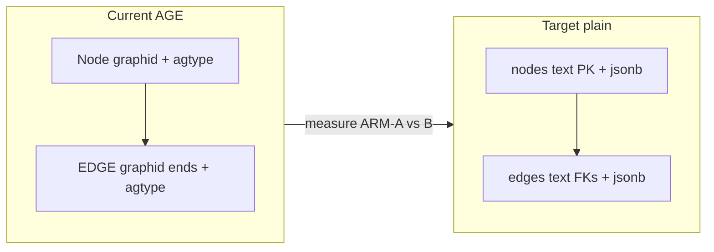

# SPEC-164 — Target Relational Model (candidate)

Scratch schema used by the harness. **Not** a production migration. Names match ARM-B / ARM-C.



---

## DDL (harness)

```sql
CREATE SCHEMA IF NOT EXISTS spec164;

CREATE TABLE spec164.nodes (
  node_id      text PRIMARY KEY,
  tenant_id    text NOT NULL,
  workspace_id text NOT NULL,
  entity_type  text,
  properties   jsonb NOT NULL DEFAULT '{}'::jsonb
);

CREATE TABLE spec164.edges (
  source_id    text NOT NULL REFERENCES spec164.nodes(node_id) ON DELETE CASCADE,
  target_id    text NOT NULL REFERENCES spec164.nodes(node_id) ON DELETE CASCADE,
  rel_type     text NOT NULL DEFAULT '',
  tenant_id    text NOT NULL,
  workspace_id text NOT NULL,
  weight       double precision,
  properties   jsonb NOT NULL DEFAULT '{}'::jsonb,
  PRIMARY KEY (source_id, target_id, rel_type)
);

CREATE INDEX idx_spec164_edges_source ON spec164.edges (source_id);
CREATE INDEX idx_spec164_edges_target ON spec164.edges (target_id);
CREATE INDEX idx_spec164_nodes_tenant_ws ON spec164.nodes (tenant_id, workspace_id);
CREATE INDEX idx_spec164_edges_tenant_ws ON spec164.edges (tenant_id, workspace_id);
```

Scale partitions of the experiment use `spec164.nodes_s` / `edges_s`, `nodes_m` / `edges_m`, etc., with the same shape (see harness).

---

## Mapping from AGE

| AGE | Plain | Notes |
|-----|-------|-------|
| `eq_node_id` / `properties.node_id` | `node_id` | LAW-164-03 |
| `eq_source_id` / `eq_target_id` | `source_id` / `target_id` | FK-able |
| `eq_rel_type` | `rel_type` | multigraph (SPEC-098) |
| `properties` agtype | `properties` jsonb | decode once at write |
| `tenant_id` / `workspace_id` in agtype | real columns | LAW-164-04 |
| `graphid` / `start_id`/`end_id` | dropped | no `::text` cast tax |
| `_ag_label_*` parents | dropped | no inheritance |
| `create_graph` | `CREATE TABLE` | no extension |

---

## What stays out of ARM-B

| Object | Reason |
|--------|--------|
| `entities` / `relationships` | CQRS UUID keyspace; SPEC-149 D4 |
| `graph_nodes` / `graph_edges` | Dead 013 fallback; do not revive without rewrite |
| Cypher / `agtype` | Explicit non-goal of ARM-B |
| SQL/PGQ (PG19) | Product pin PG18 |

---

## RLS (candidate, not measured for latency)

```sql
ALTER TABLE spec164.nodes ENABLE ROW LEVEL SECURITY;
CREATE POLICY tenant_ws ON spec164.nodes
  USING (tenant_id = current_setting('app.tenant_id', true)
     AND workspace_id = current_setting('app.workspace_id', true));
-- same for edges
```

AGE optional RLS still uses JSON predicates. Column RLS is a behavior upgrade; cross-tenant tests are a migration gate, not this study’s latency gate.

---

## Query shapes over the target

1. **Iterative BFS (product default)** — same as `pg_bfs_expand`: per hop `WHERE source_id = ANY($1) OR target_id = ANY($1)`.  
2. **Level-set CTE** — `UNION` + depth + visited via distinct node id.  
3. **Unrolled 2-hop** — two joins for the common `graph_depth=2` case.  
4. **Path-set CTE** — negative control only.

See [06-experiment-protocol.md](06-experiment-protocol.md).
