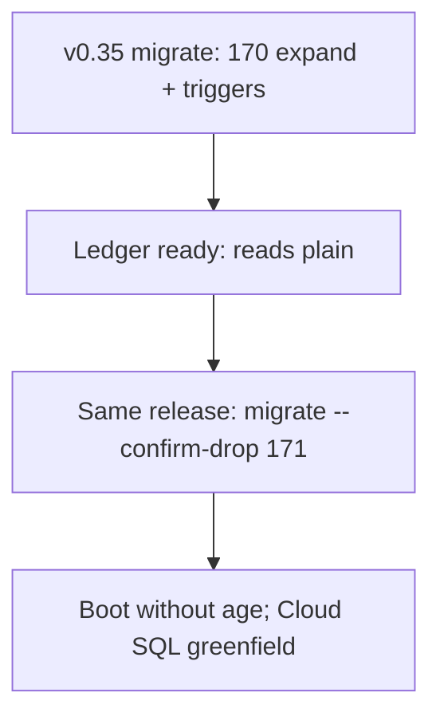

# SPEC-164 — Migration Feasibility (not implemented)

This study proves **migrate is feasible** on latency and correctness ([09-decision.md](09-decision.md)). The release-scoped plan is one version, v0.35, with expand migration 170 and confirm-drop migration 171. Detail and edge cases: [12-v035-migration-plan.md](12-v035-migration-plan.md). **No production code is changed in SPEC-164.**

---

## File / component map

| Area | Paths | Change |
|------|-------|--------|
| Graph adapter | `edgequake-storage/.../graph/**` (~8k LOC) | New `PostgresPlainGraphStorage` or rewrite heaps; keep trait |
| Boot fail-closed | `connection.rs` `CREATE EXTENSION age` | Gate on feature / env; remove when AGE gone |
| Lifecycle | `helpers/graph_lifecycle.rs` | Replace `create_graph` / vlabel / elabel with table DDL |
| Cypher fallback | `helpers/cypher_exec.rs`, mutate opt-out | Delete after dual-write window |
| Namespace naming | `namespace_tables.rs` `age_graph_name_for_namespace` | Plain schema/table prefix |
| Migrations | `013`, `067`–`086`, `167` AGE RLS, etc. | Expand: plain tables; contract: drop AGE objects |
| Docker Postgres | `Dockerfile.postgres*` | Stop compiling AGE; keep pgvector |
| Compose / Helm | `docker-compose.yml`, deploy charts | Image without AGE |
| Tests | `e2e_spec060_*`, `e2e_spec054_*`, cypher contracts | Retarget plain; retire cypher-only tests |
| Docs | `docs/data-layer/age.md`, SPEC-091 LD-04 | Rewrite authority |
| Hosting law | SPEC-148 LAW-148-1 | Flip inside v0.35 after migration 171, not a later version |

---

## Expand / contract sketch

All of this is v0.35. Authoritative sequence: [12-v035-migration-plan.md](12-v035-migration-plan.md).

1. **170 expand:** plain tables, column RLS, mirror triggers on AGE `"Node"` / `"EDGE"`.
2. **Backfill + shadow** while v0.34 may still be rolling. Triggers catch old writers.
3. **Ledger `ready`:** v0.35 reads plain. AGE still installed.
4. **171 `--confirm-drop`:** drop graphs and `DROP EXTENSION age` only when the guard is green.
5. **Boot** skips `CREATE EXTENSION age` after 171. Greenfield with no extension never needs it.

---

## Risks that remain after this study

| Risk | Mitigation |
|------|------------|
| Production degree distribution ≠ synthetic | Re-run harness on a cloned prod snapshot before cutover |
| CQRS `entities`/`relationships` key mismatch | Keep projection separate (SPEC-149 D4); do not use as traversal |
| RLS behavior change | Column RLS + cross-tenant e2e (existing `e2e_spec091_cross_tenant_graph_leak`) |
| Community full-scan cost | Unchanged by engine; still keyset over all edges |
| App pool RTT vs harness single session | Re-measure expand through Rust pool before claiming p95 SLO |

---

## Explicit non-work in SPEC-164

- No PR to `PostgresAGEGraphStorage`  
- No migration numbered for plain graph  
- No Docker image change  
- No flip of LD-04 in SPEC-091 text until an implementation spec lands

---

## Pre-migrate quick win (from inventory measurement)

**Q-GRAPH-006** (`pg_get_edges_for_node_set`) measured **165 ms** on AGE parent `_ag_label_edge` + `agtype_to_json` vs **0.78 ms** on plain btree at 200k nodes. Even while AGE remains, rewrite that function to use `"EDGE"` + `eq_source_id`/`eq_target_id` = ANY (same pattern as `pg_get_incident_edges_batch`). That closes every BFS today without waiting for dual-write.

**Q-GRAPH-020** list OFFSET showed the same class of tax (183 ms vs 0.56 ms) when filtering tenant/ws via agtype — prefer `eq_*` / real columns or expression indexes already used elsewhere.
