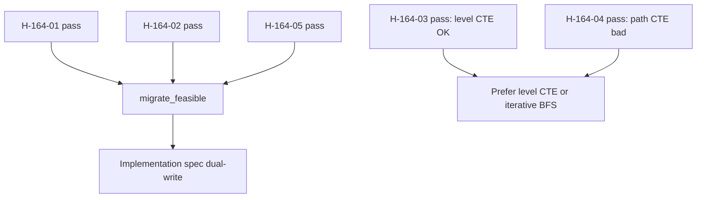
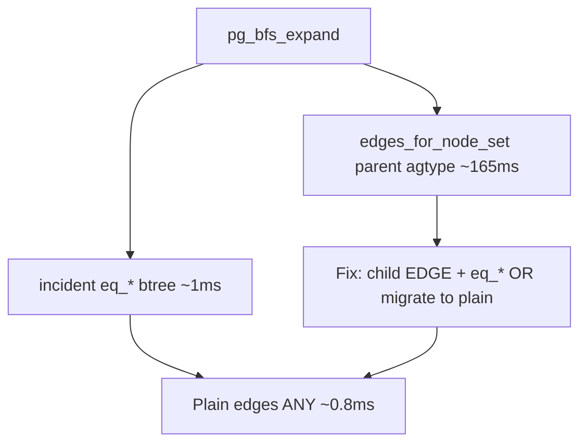

# SPEC-164 — Decision

> **Outcome:** **Migrate feasible (strengthened)** — plain PostgreSQL adjacency tables can replace Apache AGE for EdgeQuake’s actual graph ops.  
> **Authority:** [`measurements/results.json`](measurements/results.json) · [`measurements/inventory_results.json`](measurements/inventory_results.json) · [`reports/PROOF.md`](reports/PROOF.md)  
> **Date of run:** 2026-10-11 (UTC) on `eqdoc-scratch` — PostgreSQL 18.6, AGE 1.8.0, pgvector 0.8.5.  
> **Inventory amendment:** Production query inventory ([10](10-query-inventory.md)) + OP-164-09..14 ([11](11-coverage-gap-analysis.md)) — all H-164-06..08 **pass**.

---

## Verdict

| Question | Answer |
|----------|--------|
| Is AGE necessary for the **complexity class** of product hops? | **No.** Same \(O(k \cdot F \log E + K \log G)\) on both arms ([05](05-complexity-proof.md)). |
| Is AGE necessary for **measured latency** at 200k nodes? | **No.** ARM-B ≤ ARM-A on almost every op; worst B/A at SCALE-M is **1.087** (degree batch). Upsert B/A = **0.286** (plain faster). |
| Is AGE necessary for **correct** k-hop sets? | **No.** 50/50 neighbor-set equality on S, M, Hub, L. |
| Should we use path-set `UNION ALL` CTEs? | **No.** On Hub, path CTE median **669.684 ms** vs level-set **1.324 ms** (~506×). |
| Should we migrate production **in this spec**? | **No.** Feasibility only; see [08](08-migration-feasibility.md). |

---

## SCALE-M medians (decision scale) — from results.json

| Op | ARM-A ms | ARM-B ms | B/A | Within 2× |
|----|---------:|---------:|----:|:---------:|
| OP-164-01 point get | 0.582 | 0.425 | 0.730 | yes |
| OP-164-02 incident F=1 | 0.655 | 0.558 | 0.852 | yes |
| OP-164-03 incident F=50 | 1.494 | 1.184 | 0.793 | yes |
| OP-164-04 incident F=200 | 3.533 | 2.450 | 0.693 | yes |
| OP-164-05 degree batch | 1.725 | 1.875 | 1.087 | yes |
| OP-164-06 2-hop | 1.112 | 1.033 | 0.929 | yes |
| OP-164-07 3-hop | 1.754 | 1.462 | 0.834 | yes |
| OP-164-08 upsert 200+500 | 13.476 | 3.856 | 0.286 | yes |

Level-set CTE at SCALE-M OP-164-06: **0.870 ms** (≤ 2× ARM-B). Unrolled 2-hop: **0.965 ms**.

---

## SCALE-L (1M nodes / 2M edges) — confirmatory

Ran because SCALE-M suite wall was **38 s** (< 900 s budget). Plain remains within 2×; upsert B/A **0.182**. Correctness 50/50.

---

## Rejected alternatives (with the number that killed them)

| Alternative | Killed by |
|-------------|-----------|
| Keep AGE for hop performance | No op at M with B/A > 2; most B/A < 1 |
| Keep AGE for write performance | Upsert A=13.476 ms vs B=3.856 ms |
| Replace iterative BFS with path-set CTE | Hub path **669.684 ms** vs level **1.324 ms** |
| Treat unused `graph_nodes`/`graph_edges` as the target | Dead schema; ARM-B is the measured model |
| Wait for SQL/PGQ (PG19) before deciding | Product pin PG18; adjacency works today |

---

## What AGE still “buys” after this study

| Remaining AGE role | Status |
|--------------------|--------|
| Cypher ergonomics | Unused on request path |
| `graphid` / label inheritance | Constant tax; not required |
| Managed hosting | **Blocks** Cloud SQL / AlloyDB (LAW-148-1) — migrate removes the block |
| Boot complexity | `CREATE EXTENSION age` fail-closed |

---

## Recommended product stance

1. **Lock decision:** LD-04 (“AGE is traversal authority”) is **superseded for future work** by this measurement; do not edit SPEC-091 in this PR — open an implementation spec that cites SPEC-164.  
2. **Query shape:** Prefer iterative batched BFS (current product) or level-set `UNION` CTE; forbid path-set `UNION ALL` without caps proven on hubs.  
3. **Next engineering:** Dual-write expand/contract per [08](08-migration-feasibility.md).  
4. **Hosting:** After cutover, reopen Cloud SQL / AlloyDB as sole DB candidates under LAW-148-1.

---

## Inventory extension (OP-164-09..14 at SCALE-M) — smoking guns

From [`inventory_results.json`](measurements/inventory_results.json). These are shapes the first suite missed that the product **actually runs**.

| Op | Shape | ARM-A ms | ARM-B ms | B/A | Note |
|----|-------|---------:|---------:|----:|------|
| OP-164-09 | BFS close `edges_for_node_set` on `_ag_label_edge` | **165.302** | **0.779** | **0.005** | Plain ~212× faster |
| OP-164-10 | Search LIKE | 0.763 | 0.883 | 1.157 | within 2× |
| OP-164-11 | Popular + degree (nested) | 1892.838 | 1239.675 | 0.655 | both slow; plain still better |
| OP-164-12 | Lineage GIN `source_ids ?|` | 1.110 | 0.555 | 0.500 | cascade OK |
| OP-164-13 | List OFFSET + tenant/ws | **182.841** | **0.557** | **0.003** | Plain ~328× faster |
| OP-164-14 | Keyset scan | 0.682 | 0.570 | 0.836 | within 2× |

**Interim product fix (even before full migrate):** Q-GRAPH-006 should stop reading `_ag_label_edge` via `agtype_to_json->>'source_id'` and use `"EDGE"` + `eq_source_id`/`eq_target_id` like incident batch. The 165 ms vs 0.8 ms gap is an AGE layout tax on the current code path, not a reason to keep the extension.

---

## Hypotheses checklist

| Id | Result |
|----|--------|
| H-164-01 | **pass** |
| H-164-02 | **pass** (s/m/hub/l all 50/50) |
| H-164-03 | **pass** |
| H-164-04 | **pass** |
| H-164-05 | **pass** |
| H-164-06 | **pass** (OP-164-09..14) |
| H-164-07 | **pass** (09 plain ≪ AGE) |
| H-164-08 | **pass** (12 lineage GIN) |
