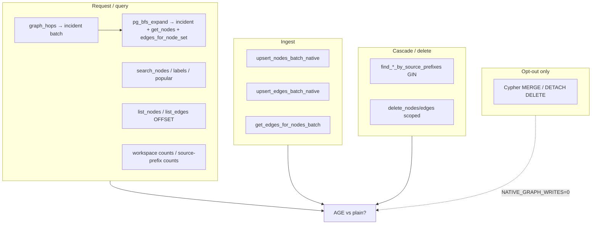

# SPEC-164 — Production Graph Query Inventory

Code-verified inventory of every distinct graph query shape EdgeQuake runs. Stable ids: `Q-GRAPH-*`. Cross-ref: [04](04-cross-ref-matrix.md) · coverage: [11](11-coverage-gap-analysis.md).

---

## A. Hot-path native AGE SQL

| Id | Method | File | Callers | Pattern |
|----|--------|------|---------|---------|
| Q-GRAPH-001 | `pg_get_nodes_batch` | `nodes_ops/read.rs` | query local/global, seed admit, helpers, pipeline | `UNNEST` + `eq_node_id` / agtype `node_id` |
| Q-GRAPH-002 | `pg_node_degrees_batch` | `nodes_ops/read.rs` | local/global, relation_select, community | COUNT on `"EDGE"` via `eq_*` |
| Q-GRAPH-003 | `pg_get_incident_edges_batch` | `edges_ops.rs` CHUNK=200 | `graph_hops`, BFS, neighborhood, relation_select | `(eq_src IN (…) OR eq_tgt IN (…))` + tenant |
| Q-GRAPH-004 | `pg_bfs_expand` | `query_ops/expand.rs` | API traversal/stream, get_neighbors | Compose 003→001→006; depth ≤3, K≤500 |
| Q-GRAPH-005 | `pg_get_edges_for_nodes_batch` | `nodes_ops/read.rs` | pipeline relationship merge | both endpoints in set via `graphid::text` |
| Q-GRAPH-006 | `pg_get_edges_for_node_set` | `query_ops/expand.rs` | **closes every BFS** | `_ag_label_edge` props `source_id/target_id = ANY($1)` |
| Q-GRAPH-007 | `pg_get_edge` / `has_edge` | `edges_ops.rs` | merge helpers | endpoints (+ rel) LIMIT 1 |
| Q-GRAPH-008 | `pg_search_nodes` | `query_ops/search.rs` | API graph search | `LIKE '%q%'` on node_id/description + degree join |
| Q-GRAPH-009 | `pg_search_labels` | `query_ops/search.rs` | autocomplete | FTS → trigram → ILIKE cascade |
| Q-GRAPH-010 | `pg_get_popular_nodes_with_degree` | `query_ops/search.rs` | stream / fallback | filtered Node + out-degree ORDER BY |
| Q-GRAPH-011 | `pg_get_nodes_with_degrees_batch` | `nodes_ops/read.rs` | available | vids + in/out via graphid text |
| Q-GRAPH-012 | `pg_upsert_nodes_batch_native` | `nodes_ops/mutate.rs` | ingest (default) | `INSERT ON CONFLICT (eq_node_id)` |
| Q-GRAPH-013 | `pg_upsert_edges_batch_native` | `edges_ops.rs` | ingest (default) | `ON CONFLICT (eq_source,eq_target,eq_rel)` |
| Q-GRAPH-014 | `pg_delete_nodes_batch` | `mutate.rs` | compensate / cascade | DELETE EDGE then Node by id ANY |
| Q-GRAPH-015 | `pg_delete_nodes_scoped_batch` | `mutate.rs` | entity API | tenant/ws fence + detach |
| Q-GRAPH-016 | `pg_delete_edge*` | `edges_ops.rs` | cascade rebuild | DELETE by endpoints |
| Q-GRAPH-017 | `pg_find_nodes_by_source_prefixes` | `scan_ops.rs` | document cascade | GIN `?|` / probes CTE on `source_ids` |
| Q-GRAPH-018 | `pg_find_edges_by_source_prefixes` | `scan_ops.rs` | cascade | same on `"EDGE"` |
| Q-GRAPH-019 | `pg_node_counts_by_source_prefixes*` | `analytics_ops.rs` | doc list reconcile | GIN probes, batch≤32, timeout 300ms |
| Q-GRAPH-020 | `pg_list_nodes_filtered` | `scan_ops.rs` | entity list, community_global | OFFSET/LIMIT + filters |
| Q-GRAPH-021 | `pg_list_edges_filtered` | `scan_ops.rs` | relationships API | OFFSET/LIMIT |
| Q-GRAPH-022 | `pg_scan_nodes_after` / edges | `scan_ops.rs` | community detection | keyset `ORDER BY id::text` |
| Q-GRAPH-023 | `pg_find_edge_by_relationship_id` | `scan_ops.rs` | rel detail | props id / concat |
| Q-GRAPH-024 | workspace / type counts | `analytics_ops.rs` | dashboard | COUNT with workspace filter |
| Q-GRAPH-025 | `pg_node_count` / `edge_count` | `analytics_ops.rs` | admin | COUNT parent labels — **forbidden hot HTTP** |
| Q-GRAPH-026 | `*_count_fast` | `analytics_ops.rs` | UI poll | `pg_class.reltuples` |
| Q-GRAPH-027 | `get_all_nodes` / `edges` | read/edges | **forbidden** request | full scan |
| Q-GRAPH-028 | `clear` / `clear_workspace` | `analytics_ops.rs` | admin wipe | DELETE |

---

## B. Cypher opt-out (`EDGEQUAKE_NATIVE_GRAPH_WRITES=0`)

| Id | Method | Pattern |
|----|--------|---------|
| Q-GRAPH-C01..C04 | upsert node/edge (±batch) | `MERGE` / `UNWIND MERGE` |
| Q-GRAPH-C05..C07 | delete node/edge scoped | `DETACH DELETE` / `DELETE r` |
| Q-GRAPH-C08 | `cypher_exec` wrapper | `cypher(graph, $$…$$)` |

**Not default.** Not part of migrate decision (ARM-A is native SQL).

---

## C. Session / DDL

| Id | Role |
|----|------|
| Q-GRAPH-S01..S08 | `LOAD 'age'`, search_path, statement_timeout, eq_* probe, advisory lock, index DDL, ping |

---

## D. Call-site map (product)

| Layer | Shapes used |
|-------|-------------|
| `edgequake-query` `graph_hops` | **003** per hop |
| query local/global / seed admit | **001, 002**, expand **003/004** |
| `relation_select` | **003, 002** |
| `community_global` | **001, 020** |
| API graph search/traversal/stream | **008, 004, 010** |
| API entities / relationships | **008, 020, 021, 015** |
| document cascade / delete | **017, 018, 014, 012, 013, 016** |
| pipeline merger | **001, 005, 012, 013** |
| community Louvain/LPA | **022** then in-process |

---

## E. Indexes assumed

| Index family | Shapes |
|--------------|--------|
| `eq_node_id` unique / prop node_id | 001, 012, 013 JOINs |
| `eq_source_id` / `eq_target_id` | 002, 003, 014–016 |
| `eq_source_target_rel` unique | 013 |
| lineage GIN `source_ids` / `source_chunk_ids` | 017–019 |
| tenant/workspace expr | scoped filters, 020–024 |
| `start_id::text` / `end_id::text` | 005, 011 |
| FTS / trigram on label | 009 |
| props GIN | Cypher opt-out only |
