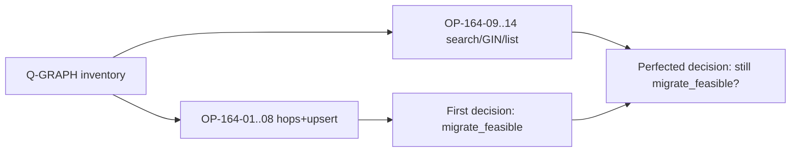

# SPEC-164 — Coverage Gap Analysis (inventory vs measurement)

Compares [10-query-inventory.md](10-query-inventory.md) to original OP-164-01..08 and the extended measurement set OP-164-09..14.

## Original coverage

| OP | Shape | Status after first run |
|----|-------|------------------------|
| 01 | Q-GRAPH-001 point get | Measured — pass |
| 02–04 | Q-GRAPH-003 incident tiers | Measured — pass |
| 05 | Q-GRAPH-002 degree | Measured — pass |
| 06–07 | Q-GRAPH-004 BFS | Measured (compose) — pass |
| 08 | Q-GRAPH-012/013 upsert | Measured — pass |

## Gaps that can change the migrate decision

These shapes hit **agtype expression indexes**, **parent `_ag_label_edge`**, or **GIN jsonb** — different constants than btree `eq_*` hops.

| Gap | Shape | Why it matters | Extended OP |
|-----|-------|----------------|-------------|
| BFS close | Q-GRAPH-006 | Runs after every expand; uses `_ag_label_edge` + `agtype_to_json->>'source_id'` | **OP-164-09** |
| Search | Q-GRAPH-008 | Request-hot; `LIKE` on agtype text vs plain columns | **OP-164-10** |
| Popular | Q-GRAPH-010 | Request fallback / stream | **OP-164-11** |
| Lineage GIN | Q-GRAPH-017 | Cascade delete/reprocess; GIN `?|` on source_ids | **OP-164-12** |
| List OFFSET | Q-GRAPH-020 | Entity list / community_global | **OP-164-13** |
| Keyset scan | Q-GRAPH-022 | Community detection load | **OP-164-14** |

## Gaps deferred (document only — not decision-blocking)

| Shape | Reason deferred |
|-------|-----------------|
| Q-GRAPH-005 ingest edge-set join | Same class as 006; ingest-only |
| Q-GRAPH-009 FTS/trigram cascade | Needs mig-015 indexes; LIKE arm covered by 10 |
| Q-GRAPH-015/016/028 deletes | Plain `DELETE` trivially maps; cardinality same as 08 inverse |
| Q-GRAPH-019 count probes | Same GIN as 017; timeout-bounded already |
| Q-GRAPH-021 list edges | Mirror of 020 |
| Q-GRAPH-023..027 | Admin / forbidden / estimates |
| Q-GRAPH-C* Cypher | Opt-out; not product default |

## Extended hypotheses (registered before inventory bench)

| Id | Claim |
|----|-------|
| H-164-06 | ARM-B ≤ 2× ARM-A on OP-164-09..14 at SCALE-M |
| H-164-07 | OP-164-09 (edges_for_node_set) plain uses child `edges` btree — expected **faster** than AGE parent `_ag_label_edge` agtype path |
| H-164-08 | OP-164-12 lineage GIN: plain `jsonb ?|` within 2× of AGE agtype→jsonb GIN path |

## Decision impact rule

If any OP-164-09..14 at SCALE-M has B/A > 2 → amend [09-decision.md](09-decision.md) to **migrate with caveat** or **keep AGE for that subsystem**.  
If all pass → strengthen migrate_feasible; note GIN/search as dual-write Wave-1 must-haves.

---

## Results (2026-10-11 inventory bench) — all pass

Artifact: [`measurements/inventory_results.json`](measurements/inventory_results.json).  
`decision_amendment`: **strengthen_migrate_feasible**.

| Op | B/A | Pass |
|----|----:|:----:|
| 09 edges_for_node_set | 0.005 | yes — plain 212× faster |
| 10 search LIKE | 1.157 | yes |
| 11 popular | 0.655 | yes (both ~1–2 s; algorithm debt) |
| 12 lineage GIN | 0.500 | yes |
| 13 list OFFSET | 0.003 | yes — plain 328× faster |
| 14 keyset | 0.836 | yes |

H-164-06, H-164-07, H-164-08: **pass**.
