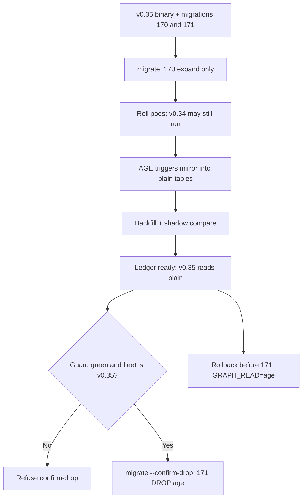

# SPEC-164 — Next-release migration plan (code-grounded)

> **Product today:** v0.34.0, schema **169** ([`edgequake/Cargo.toml`](../../edgequake/Cargo.toml) `workspace.package.version`; [`docs/operations/upgrading.md`](../../docs/operations/upgrading.md)).  
> **Authority:** measurement in [09-decision.md](09-decision.md) and [11-coverage-gap-analysis.md](11-coverage-gap-analysis.md).  
> **This document is the implementation plan for one release: v0.35.0.** It does not change production code.

The whole cutover ships in **v0.35**. Expand and contract are two migrations in that release, using the guard this repo already has: contract rows set `confirm_drop` ([`edgequake-migrate-manifest` `MigrationEntry.confirm_drop`](../../edgequake/crates/edgequake-migrate-manifest/src/lib.rs)) and apply only with `edgequake migrate --confirm-drop` after the guard is green ([`docs/operations/upgrading.md`](../../docs/operations/upgrading.md)). `edgequake migrate` alone never drops AGE.



---

## 1. What the code does today (do not re-model)

| Fact | Code |
|------|------|
| One AGE graph per namespace | [`namespace_tables.rs`](../../edgequake/crates/edgequake-storage/src/namespace_tables.rs) `age_graph_name_for_namespace` → `eq_{prefix}_graph` (`default` → `eq_eq_default_graph`) |
| Labels created at runtime, not by migration 013 | [`graph_lifecycle.rs`](../../edgequake/crates/edgequake-storage/src/adapters/postgres/graph/helpers/graph_lifecycle.rs) `create_graph` / `create_vlabel` / `create_elabel` |
| Boot requires AGE unless `EDGEQUAKE_ALLOW_NO_GRAPH=1` | [`connection.rs` L273–310](../../edgequake/crates/edgequake-storage/src/adapters/postgres/connection.rs) |
| Writes default to native SQL | [`graph/mod.rs` L445–464](../../edgequake/crates/edgequake-storage/src/adapters/postgres/graph/mod.rs) `native_graph_writes_enabled` |
| Node identity is text `eq_node_id` | [`mutate.rs` L574–606](../../edgequake/crates/edgequake-storage/src/adapters/postgres/graph/nodes_ops/mutate.rs) `ON CONFLICT (eq_node_id)` |
| Edge identity is `(source, target, rel)` | [`edges_ops.rs` L802+](../../edgequake/crates/edgequake-storage/src/adapters/postgres/graph/edges_ops.rs) `normalize_rel_type` + unique arbiter |
| Property merge unions lineage arrays | [`090_eq_merge_graph_properties.sql` L48–80](../../edgequake/migrations/090_eq_merge_graph_properties.sql); Replace mode must not merge ([`mutate.rs` L577–588](../../edgequake/crates/edgequake-storage/src/adapters/postgres/graph/nodes_ops/mutate.rs)) |
| Request BFS is app loop, depth ≤ 3, cap 500 | [`expand.rs`](../../edgequake/crates/edgequake-storage/src/adapters/postgres/graph/query_ops/expand.rs) `pg_bfs_expand` / `pg_get_neighbors` |
| Incident batch uses child `"EDGE"` + `eq_*` | [`edges_ops.rs` L574–655](../../edgequake/crates/edgequake-storage/src/adapters/postgres/graph/edges_ops.rs) |
| BFS **close** still scans parent `_ag_label_edge` via agtype | [`expand.rs` L197–235](../../edgequake/crates/edgequake-storage/src/adapters/postgres/graph/query_ops/expand.rs) `pg_get_edges_for_node_set` — measured 165 ms vs 0.78 ms plain |
| Tenant filter is agtype text, two modes | [`vertex_filter.rs` L42–70](../../edgequake/crates/edgequake-storage/src/adapters/postgres/graph/helpers/vertex_filter.rs) Strict vs `LegacyNullAsWildcard` |
| Optional AGE RLS is JSON predicate per label | [`167_tenant_access_rls.sql` L90–107](../../edgequake/migrations/167_tenant_access_rls.sql) `install_graph_tenant_rls` |
| Inspector lists graphs from `ag_catalog.ag_graph` | [`storage_inspector.rs` L484–499](../../edgequake/crates/edgequake-api/src/storage_inspector.rs) |
| Dead fallback `graph_nodes` / `graph_edges` | [`013_add_age_graph.sql` L105–141](../../edgequake/migrations/013_add_age_graph.sql) — UUID keys, **not** the target |
| CQRS `entities` / `relationships` | Different key (UUID). SPEC-149 D4. Do not use as traversal |

Query inventory of every shape: [10-query-inventory.md](10-query-inventory.md).

---

## 2. One release, two migrations

v0.35.0 contains both steps. They are not a second product version.

| Migration | Phase | When it runs | Effect |
|-----------|-------|--------------|--------|
| **170** | expand | `edgequake migrate` (automatic) | Create `eq_graph_nodes` / `eq_graph_edges`, indexes, column RLS, mirror triggers on existing AGE label tables. No drop |
| **171** | contract, `confirm_drop = true` | `edgequake migrate --confirm-drop` only when the guard is green | `drop_graph` for every `ag_catalog.ag_graph` row, drop dead `graph_nodes` / `graph_edges` if unused, `DROP EXTENSION age` |

Manifest rules already enforced in code: `confirm_drop` requires `phase = contract` ([`lib.rs` L140–142](../../edgequake/crates/edgequake-migrate-manifest/src/lib.rs)). 171 sets `serving_floor` to the v0.35 schema so a v0.34 binary is refused after the drop ([`MigrationEntry.serving_floor`](../../edgequake/crates/edgequake-migrate-manifest/src/lib.rs)). Until 171, `compat` still allows v0.34 to serve on schema 170.

### Safety laws (binding)

| Law | Rule |
|-----|------|
| S1 | `migrate` without `--confirm-drop` does not drop AGE, graphs, or `agtype` columns |
| S2 | v0.35 reads stay on AGE until ledger `eq_graph_cutover.status = ready` (backfill + shadow). A flag cannot skip the ledger |
| S3 | Mirror triggers on `"Node"` and `"EDGE"` copy the **committed** AGE row into plain tables. v0.34 writes are not lost during the roll |
| S4 | v0.35 app writes are idempotent with those triggers: plain `ON CONFLICT` replaces with the same post-merge jsonb, it does not union twice |
| S5 | A plain-write failure aborts the transaction, so AGE does not commit alone ([same chunk functions as today](../../edgequake/crates/edgequake-storage/src/adapters/postgres/graph/nodes_ops/mutate.rs)) |
| S6 | `--confirm-drop` is refused unless: every `ag_graph` is backfilled, shadow sets match, cutover status is `ready`, and the operator has drained v0.34 pods. The binary cannot see other pods; the guard checks data, the runbook checks the fleet |
| S7 | After 171, boot does not call `CREATE EXTENSION age` ([today it does, `connection.rs` L273–310](../../edgequake/crates/edgequake-storage/src/adapters/postgres/connection.rs)). v0.34 against that database fails closed. Rollback is the backup taken before confirm-drop ([`upgrading.md`](../../docs/operations/upgrading.md): no down-migrations) |
| S8 | Greenfield with no AGE extension: 170 still creates plain tables, backfill is a no-op, ledger goes `ready` immediately, 171 is a no-op. Cloud SQL empty install works in this release |

The v0.35 Postgres image **still contains** the AGE library so an upgrade can backfill. After 171 the server does not load it. Rebuilding a slimmer image is optional and is not a second product release.

---

## 3. Target tables (do not revive migration 013)

`graph_nodes.id` is UUID and `tenant_id` is UUID ([013 L111–122](../../edgequake/migrations/013_add_age_graph.sql)). Product keys are text (`eq_node_id`, string tenant). New names:

```text
eq_graph_nodes (
  namespace    text NOT NULL,          -- same string as PostgresAGEGraphStorage.namespace
  node_id      text NOT NULL,          -- LAW-164-03
  tenant_id    text NOT NULL DEFAULT '',
  workspace_id text NOT NULL DEFAULT '',
  entity_type  text,
  properties   jsonb NOT NULL,
  PRIMARY KEY (namespace, node_id)
)
eq_graph_edges (
  namespace    text NOT NULL,
  source_id    text NOT NULL,
  target_id    text NOT NULL,
  rel_type     text NOT NULL,          -- normalize_rel_type
  tenant_id    text NOT NULL DEFAULT '',
  workspace_id text NOT NULL DEFAULT '',
  properties   jsonb NOT NULL,
  PRIMARY KEY (namespace, source_id, target_id, rel_type)
)
```

Indexes: btree `(source_id)`, `(target_id)`, `(tenant_id, workspace_id)`, GIN `(properties->'source_ids')`, GIN `(properties->'source_chunk_ids')`.

RLS predicate becomes column equality, same GUCs as [`167`](../../edgequake/migrations/167_tenant_access_rls.sql) (`current_tenant_id()`, `current_workspace_id()`).

`eq_merge_graph_properties(jsonb, jsonb)` already takes jsonb ([090 L48](../../edgequake/migrations/090_eq_merge_graph_properties.sql)). Plain upsert calls it directly. No `::agtype` cast.

---

## 4. v0.35 implementation sequence

1. **Fix Q-GRAPH-006 in place** (AGE still authority). Change [`expand.rs` L228–233](../../edgequake/crates/edgequake-storage/src/adapters/postgres/graph/query_ops/expand.rs) from `_ag_label_edge` + `agtype_to_json->>'source_id'` to `"EDGE"` + `eq_source_id` / `eq_target_id` = ANY, matching [`edges_ops.rs` L651–655](../../edgequake/crates/edgequake-storage/src/adapters/postgres/graph/edges_ops.rs). Ship behind the same release; measure with `run_inventory_bench.sh` OP-164-09.
2. **Migration 170** creates the two tables, indexes, RLS policies. Expand-only. No `DROP`.
3. **Dual-write** inside the existing native chunk functions:
   - [`pg_upsert_nodes_batch_native_chunk`](../../edgequake/crates/edgequake-storage/src/adapters/postgres/graph/nodes_ops/mutate.rs)
   - [`pg_upsert_edges_batch_native_chunk`](../../edgequake/crates/edgequake-storage/src/adapters/postgres/graph/edges_ops.rs)
   - delete paths in the same files (`pg_delete_nodes_*`, `pg_delete_edge*`)
   - [`pg_clear` / `pg_clear_workspace`](../../edgequake/crates/edgequake-storage/src/adapters/postgres/graph/analytics_ops.rs)
   One transaction: AGE statement then plain statement. Plain failure rolls back AGE.
4. **Refuse Cypher opt-out** when dual-write is on. [`native_graph_writes_enabled`](../../edgequake/crates/edgequake-storage/src/adapters/postgres/graph/mod.rs) returning false must error at graph init, not silently skip plain rows.
5. **Backfill task** (not DDL): for each name in `ag_catalog.ag_graph` ([inspector query L486–492](../../edgequake/crates/edgequake-api/src/storage_inspector.rs)), copy `"Node"` / `"EDGE"` using `COALESCE(eq_node_id, agtype->>'node_id')`. Idempotent `INSERT … ON CONFLICT DO UPDATE` with `eq_merge_graph_properties` for MergeSources rows. Orphans (edge endpoint missing) logged and skipped.
6. **Shadow reads**: sample 50 starts per namespace, compare neighbor sets (H-164-02). Gate file written by the job.
7. **Install mirror triggers in 170**, on each graph’s `"Node"` and `"EDGE"` (created by [`graph_lifecycle.rs` `create_graph`](../../edgequake/crates/edgequake-storage/src/adapters/postgres/graph/helpers/graph_lifecycle.rs)). `AFTER INSERT OR UPDATE` upserts the plain row from `NEW` properties (`agtype_to_json` once). `AFTER DELETE` deletes the plain key. Triggers cover v0.34 writers. v0.35’s own plain write uses the same final jsonb (S4).
8. **Shadow, then ledger.** Sample 50 starts per graph (H-164-02). Set `eq_graph_cutover.status = ready` only if every graph matches. [`graph_storage_impl.rs`](../../edgequake/crates/edgequake-storage/src/adapters/postgres/graph/graph_storage_impl.rs) reads plain only when that row is `ready`. Query code stays on the trait ([`graph_hops.rs`](../../edgequake/crates/edgequake-query/src/graph_hops.rs)).
9. **Confirm-drop 171** after the fleet is v0.35-only and the guard is green. Drops graphs, then `DROP EXTENSION age`. Boot path in [`connection.rs`](../../edgequake/crates/edgequake-storage/src/adapters/postgres/connection.rs) treats a missing extension as success once 171 is applied. Inspector stops querying `ag_catalog.ag_graph` ([`storage_inspector.rs` L486–492](../../edgequake/crates/edgequake-api/src/storage_inspector.rs)) on that same binary via “extension present?”.

---

## 5. Edge-case register

Each row is a behavior the current code has. The migration must preserve it or name the break.

| Id | Edge case | Where the code does it | v0.35 rule |
|----|-----------|------------------------|------------|
| EC-01 | Rolling deploy: v0.34 pods write AGE only | Boot + `create_graph` | Triggers from 170 mirror those writes. Re-backfill is safe and idempotent. Do not confirm-drop until v0.34 pods are gone |
| EC-02 | Rollback to AGE reads | Ledger + flag | Before 171: set ledger back to `age` (and `EDGEQUAKE_GRAPH_READ=age`). After 171: restore the pre-confirm-drop backup. No down-migration |
| EC-03 | `EDGEQUAKE_NATIVE_GRAPH_WRITES=0` | [`mod.rs` L456–464](../../edgequake/crates/edgequake-storage/src/adapters/postgres/graph/mod.rs) | Boot error if plain dual-write is enabled. Cypher MERGE would not fill plain tables |
| EC-04 | `EDGEQUAKE_ALLOW_NO_GRAPH=1` | [`connection.rs` L299–309](../../edgequake/crates/edgequake-storage/src/adapters/postgres/connection.rs) | Greenfield: skip AGE, create plain tables, reads=plain. Upgrade: do not set this until backfill finished |
| EC-05 | Many namespaces | `age_graph_name_for_namespace` | Backfill loops `ag_graph`, not only `default` |
| EC-06 | `eq_*` columns missing on an old graph | `eq_columns_present` used in read/scan/delete | Backfill uses `COALESCE(eq_*, agtype->>'…')`. Boot still runs `ensure_eq_id_columns` before copy |
| EC-07 | Duplicate `node_id` groups | Migration 074/083 unique; DISTINCT ON in upsert [`mutate.rs` L599–604](../../edgequake/crates/edgequake-storage/src/adapters/postgres/graph/nodes_ops/mutate.rs) | Backfill `DISTINCT ON (node_id)` keep latest; fail the namespace if conflict remains |
| EC-08 | Relation type cardinality / accents | `normalize_rel_type` [`edges_ops.rs` L818](../../edgequake/crates/edgequake-storage/src/adapters/postgres/graph/edges_ops.rs); SPEC-098 tests | Plain PK uses the same normalizer. Empty rel is `''`, not NULL |
| EC-09 | Replace vs merge | LAW-098-12 [`mutate.rs` L577–588](../../edgequake/crates/edgequake-storage/src/adapters/postgres/graph/nodes_ops/mutate.rs) | Plain `ON CONFLICT` calls `eq_merge_graph_properties` only for `MergeSources`. `Replace` assigns `EXCLUDED.properties` |
| EC-10 | Concurrent source_ids union | `eq_merge_graph_properties` is the race control (SPEC-059 tests) | Both arms call that function inside one transaction |
| EC-11 | `graphid` has no `=` | SPEC-106; joins use `::text` | Backfill never joins on `graphid`. Endpoints come from `eq_source_id` / `eq_target_id` |
| EC-12 | Orphan edges | AGE can hold an edge whose node row was deleted outside the API | Skip, count, do not abort the namespace |
| EC-13 | Strict vs legacy-null tenant | [`vertex_filter.rs` L52–69](../../edgequake/crates/edgequake-storage/src/adapters/postgres/graph/helpers/vertex_filter.rs); expand close uses `LegacyNullAsWildcard` [`expand.rs` L212–221](../../edgequake/crates/edgequake-storage/src/adapters/postgres/graph/query_ops/expand.rs) | Store `''` for missing tenant. SQL: Strict `tenant_id = $1`; legacy `tenant_id = '' OR tenant_id = $1` |
| EC-14 | AGE RLS on, plain tables without policies | [`167` L103](../../edgequake/migrations/167_tenant_access_rls.sql) | Install column RLS in 170 **before** any plain read. Cross-tenant test: `e2e_spec091_cross_tenant_graph_leak` |
| EC-15 | BFS close parent scan | [`expand.rs` L228–233](../../edgequake/crates/edgequake-storage/src/adapters/postgres/graph/query_ops/expand.rs) | Fixed in step 1, still on AGE, before cutover |
| EC-16 | List/search agtype `LIKE` | [`vertex_filter.rs` L78–82](../../edgequake/crates/edgequake-storage/src/adapters/postgres/graph/helpers/vertex_filter.rs) | Plain predicates on `node_id` and `properties->>'description'` with the same `LOWER` / `LIKE` shape |
| EC-17 | Lineage GIN discovery | [`scan_ops.rs` `pg_find_nodes_by_source_prefixes`](../../edgequake/crates/edgequake-storage/src/adapters/postgres/graph/scan_ops.rs); probes in [`source_lineage_sql.rs`](../../edgequake/crates/edgequake-storage/src/adapters/postgres/graph/helpers/source_lineage_sql.rs) | Same probe SQL against `properties->'source_ids'` jsonb. Keep `SOURCE_PREFIX_BATCH_LIMIT` and statement timeouts |
| EC-18 | Community keyset order | [`scan_ops.rs` L367 `pg_scan_nodes_after`](../../edgequake/crates/edgequake-storage/src/adapters/postgres/graph/scan_ops.rs) orders by node id expression | Keyset cursor becomes `node_id` text. Community ids may reshuffle once. Not a read-your-writes bug. Document in release notes |
| EC-19 | `get_all_nodes` / full count | Forbidden on HTTP (SPEC-060 contract) | Plain implementation may exist for admin; HTTP ban stays |
| EC-20 | In-flight ingest at deploy | Pipeline calls batch upsert | Dual-write is in the same functions the pipeline already calls. No second writer |
| EC-21 | Workspace wipe / document cascade | `clear_workspace`, cascade delete in API services | Plain delete in the same transaction as AGE delete |
| EC-22 | Empty graph / zero nodes | `create_graph` still runs | Plain tables exist with zero rows. Neighbor expand returns empty `KnowledgeGraph` ([`expand.rs` L97–98](../../edgequake/crates/edgequake-storage/src/adapters/postgres/graph/query_ops/expand.rs)) |
| EC-23 | Property bag extras (multimodal keys) | `properties` agtype is schemaless | Entire map copied to jsonb. No column per key |
| EC-24 | Inspector + doctor | [`storage_inspector.rs` L484](../../edgequake/crates/edgequake-api/src/storage_inspector.rs) | Same v0.35 binary: list `ag_graph` while the extension exists; after 171 check plain PK + lineage GIN only |
| EC-25 | Helm / migrate lock | SPEC-150 gate; DDL must stay short | 170 is DDL only. Backfill is a task with its own timeout, not inside `edgequake migrate` |
| EC-26 | Backup mid-dual-write | Two copies diverge if restore is partial | Restore the whole database. Do not restore AGE without plain or the reverse during v0.35 |
| EC-27 | Greenfield on Cloud SQL (no AGE) | LAW-148-1; boot fail-closed today [`connection.rs` L306–309](../../edgequake/crates/edgequake-storage/src/adapters/postgres/connection.rs) | v0.35: if `CREATE EXTENSION age` fails **and** `ag_catalog` is absent, continue on plain tables (S8). Upgrades that still have AGE keep the current fail-closed path until 171 |
| EC-28 | `entities` / `relationships` projection | SPEC-149 D4 | Untouched. Not a backfill source |
| EC-29 | Dead `graph_nodes` | [013 L111](../../edgequake/migrations/013_add_age_graph.sql) | 171 drops them only when `reltuples` and a `SELECT EXISTS` probe are empty. Non-empty aborts confirm-drop |
| EC-30 | Search path leak | [`connection.rs` L284–291](../../edgequake/crates/edgequake-storage/src/adapters/postgres/connection.rs) resets `search_path` after AGE | Plain SQL uses `public` only. Do not leave `ag_catalog` first on pooled connections |

---

## 6. Read-path cutover map (trait stays)

`edgequake-query` has no SQL. It calls the trait. Cutover is inside the postgres adapter.

| Trait method | Implementation today | Plain SQL |
|--------------|----------------------|-----------|
| `get_nodes_batch` | [`nodes_ops/read.rs`](../../edgequake/crates/edgequake-storage/src/adapters/postgres/graph/nodes_ops/read.rs) | `WHERE namespace=$1 AND node_id = ANY($2)` |
| `get_incident_edges_batch` | [`edges_ops.rs` L574](../../edgequake/crates/edgequake-storage/src/adapters/postgres/graph/edges_ops.rs) | `source_id = ANY OR target_id = ANY` + tenant mode |
| `get_neighbors` / `get_knowledge_graph` | [`expand.rs` `pg_bfs_expand`](../../edgequake/crates/edgequake-storage/src/adapters/postgres/graph/query_ops/expand.rs) | Same Rust loop, new SQL |
| `get_edges_for_node_set` | [`expand.rs` L197](../../edgequake/crates/edgequake-storage/src/adapters/postgres/graph/query_ops/expand.rs) | Both endpoints `= ANY` on plain edges |
| `node_degrees_batch` | [`nodes_ops/read.rs`](../../edgequake/crates/edgequake-storage/src/adapters/postgres/graph/nodes_ops/read.rs) | `COUNT` on plain edges |
| `search_nodes` / popular / labels | [`query_ops/search.rs`](../../edgequake/crates/edgequake-storage/src/adapters/postgres/graph/query_ops/search.rs) | Column + jsonb; same LIMIT |
| `list_*` / `scan_*_after` | [`scan_ops.rs`](../../edgequake/crates/edgequake-storage/src/adapters/postgres/graph/scan_ops.rs) | Keyset on `node_id` |
| `find_*_by_source_prefixes` | [`scan_ops.rs` L580](../../edgequake/crates/edgequake-storage/src/adapters/postgres/graph/scan_ops.rs) | jsonb `?|` + existing probe CTE |
| upsert / delete | mutate + edges_ops | `ON CONFLICT` + `eq_merge_graph_properties` |

---

## 7. Acceptance gates (v0.35 tag)

| Gate | Proof |
|------|-------|
| G1 | `run_inventory_bench.sh` OP-164-09 on AGE after the Q-GRAPH-006 rewrite is within 2× of plain (today 212× gap) |
| G2 | Shadow job: 50 starts × every namespace, neighbor sets equal |
| G3 | `e2e_spec091_cross_tenant_graph_leak` green with plain RLS |
| G4 | SPEC-059 concurrent merge test green against plain `eq_merge_graph_properties` |
| G5 | SPEC-098 edge cardinality tests green on plain PK |
| G6 | `EDGEQUAKE_NATIVE_GRAPH_WRITES=0` fails boot when dual-write is on |
| G7 | v0.34 binary still boots and writes AGE on schema 170; a mirror trigger lands the row in `eq_graph_nodes` |
| G8 | Before 171: ledger back to `age` returns AGE-backed neighbors. `migrate` without `--confirm-drop` leaves AGE installed |
| G9 | Migrate 170 finishes under the SPEC-150 lock budget (DDL + trigger create only) |
| G10 | `--confirm-drop` refused when shadow is red or any `ag_graph` is unbackfilled |
| G11 | After 171, boot succeeds with no `age` extension; a v0.34 binary is refused by `serving_floor` |
| G12 | Empty database, extension create fails: plain reads and writes succeed (Cloud SQL greenfield) |

---

## 8. Rollback

| When | Action |
|------|--------|
| 170 applied, reads still AGE, plain copy wrong | Leave the ledger at `age`. AGE stays the authority. Fix triggers and re-backfill |
| Ledger `ready`, plain reads wrong, 171 not applied | Set ledger to `age`. Triggers keep copying. Do not run `--confirm-drop` |
| Operator ran `--confirm-drop` (171) | Restore the backup taken immediately before that command. [`upgrading.md`](../../docs/operations/upgrading.md) has no down-migration. Take that backup in the runbook, not as an afterthought |

---

## 9. Explicit non-goals for v0.35

- Rewriting `edgequake-query` hop code ([`graph_hops.rs`](../../edgequake/crates/edgequake-query/src/graph_hops.rs)).
- Using `entities` / `graph_nodes` as the new store.
- SQL/PGQ (PostgreSQL 19). Product image is PG18.
- Changing the HTTP API or SDK graph types (`GraphNode.id` stays a string).
- Community algorithm changes. Only the keyset source table changes (EC-18).
