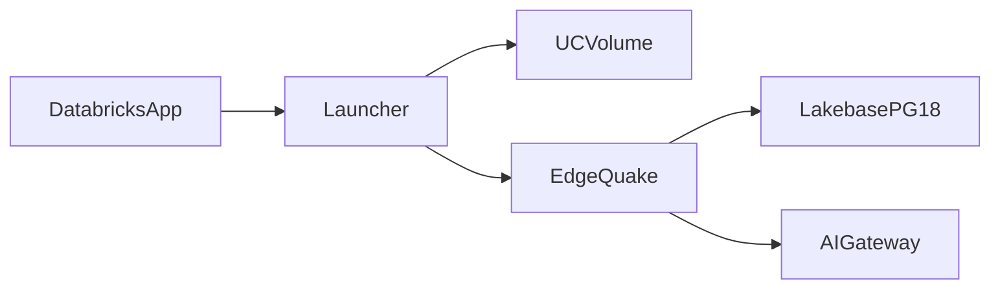

# 05 — Target architecture

Parent: [README](README.md) · Previous: [04 Gap matrix](04-gap-matrix.md) · Next: [06 Implementation plan](06-implementation-plan.md)

v1 adds a credential source, a Gateway profile, and a launcher. It does not add a graph engine or a second HTTP stack.

## Process

1. App starts the launcher (`app.yaml` `command`).
2. Launcher reads `DATABRICKS_APP_PORT`, `DATABRICKS_HOST`, `DATABRICKS_CLIENT_ID`, `DATABRICKS_CLIENT_SECRET`, and the Lakebase `valueFrom` endpoint path.
3. Launcher downloads the linux-gnu server binary from the Volume if the local copy is absent, then execs it.
4. Environment for the server: `HOST=0.0.0.0`, `PORT=$DATABRICKS_APP_PORT`, `EDGEQUAKE_DB_AUTH=lakebase_oauth`, Gateway base URL, embedding model, dimension 1024.

The binary is built on glibc that Ubuntu 22.04 can load (2.35 or older). pdfium stays inside that binary. It is not an App source file.

## Database

`DbCredential` has two implementations.

| Implementation | When | Password |
|----------------|------|----------|
| `StaticUrl` | Default. Docker and current tests | The URL the operator set |
| `LakebaseOAuth` | `EDGEQUAKE_DB_AUTH=lakebase_oauth` | `POST /api/2.0/postgres/credentials` on each new physical connection |

`LakebaseOAuth` exchanges the app client id and secret for a workspace token, then exchanges that token for a database token. `PGUSER` is the client id. `PGHOST`, `PGDATABASE`, `PGPORT`, and `PGSSLMODE=require` come from the App environment. The pool `max_lifetime` stays below the credential TTL. Default 1800 seconds is below a 3600 second token and is not enough if the token was minted only at process start. The connect path mints again. Docker still calls `PgPool::connect(url)`.

Production endpoint: Postgres 18, `no_suspension=true`. The probe project is the opposite on purpose (suspend after 300 seconds) so the study project does not bill all day.

Schema comes from the existing migrate train. Migration 170 creates the plain graph. `setup_extensions` installs `vector`. AGE creation fails, `ag_catalog` is absent, boot continues. That sequence is the one to prove in WP-C. It is not a design to invent.

## Models

| Role | Base | Model | Notes |
|------|------|-------|-------|
| Chat | `https://<host>/ai-gateway/mlflow/v1` | A model whose `content` is a string. Probe: `system.ai.llama-4-maverick` | Bearer refreshed before expiry |
| Embeddings | Same base | `system.ai.gte-large-en` | 1024 dimensions, set on the workspace before ingest |

SPEC-163 connection rows can store the base URL. Extra header `Databricks-Model-Provider-Service` is only for `/ai-gateway/openai/v1`, not for `system.ai.*`.

`EDGEQUAKE_LLM_OMIT_TEMPERATURE` stays available for models that reject `temperature`.

## Identity

Ingest, migrate, and model calls use the app service principal. Request handlers do not read `x-forwarded-access-token` in v1. EdgeQuake tenants stay inside the product.

## What stays untouched

- `eq_graph_*` SQL and the SPEC-164 cutover.
- `edgequake-llm` URL builder.
- Four pool roles and their default sizes (34), while `max_connections` is at least the probe's 225.
- CVE floor 0.8.2.
