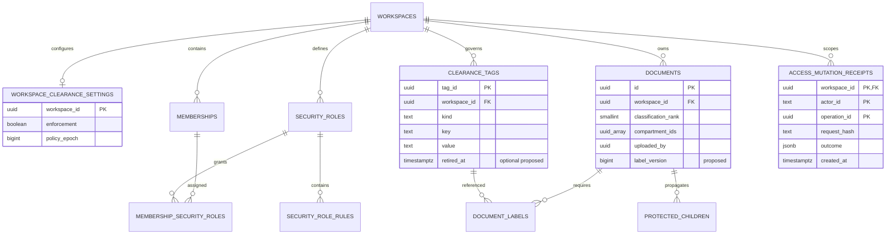

# 08 — Database contract

[Index](README.md) · Source: [migration 220](../../edgequake/migrations/220_spec174_document_clearance.sql) · Interface: [API](07-api-contract.md) · Threats: [Security](10-security-and-sequences.md) · Delivery: [WP-01](13-implementation-plan.md#wp-01)

## Existing model and proposed additions

Existing: workspace settings; clearance vocabulary; security roles/rules; membership-role assignments; `document_labels`; document rank, compartment array and uploader; copied columns on seven protected child tables. Proposed: `documents.label_version bigint NOT NULL DEFAULT 0`, mutation receipts, and tag retirement metadata if retirement is shipped. Existing audit JSONB metadata can carry before/after, reason, source and operation ID; verify active audit schema during implementation rather than adding a second audit system.

`PROTECTED_CHILDREN` is a diagram grouping, not a new table: chunks, document_originals, pdf_documents, document_mm_assets, document_pages, graph_contributions and tasks. Tasks use text `document_id`; contributions use `source_document_id`. Embedding and graph reads require joins/contribution scoping; they cannot be assumed safe simply because the seven copy operations exist.

## Integrity invariants

1. Document label authority is the typed document rank plus canonical `document_labels` membership. `documents.compartment_ids` is a materialized sorted unique projection of the join rows; all three change in one service transaction.
2. Every compartment belongs to the same workspace as its document, is `kind=compartment` and is active for new assignments. UUID uniqueness alone does not enforce scope.
3. Rank is NULL for compatible enforcement-off legacy rows or one of 1–5. Under enforcement, new rows must have non-NULL rank and unverified admission must have a valid actor/uploader.
4. Each child copies the current parent rank/tags/uploader under the concurrency protocol below. Worker metadata is not an access authority.
5. A new admitted document starts at label version 1 and records the current policy epoch without incrementing it. A later effective relabel increments that document's version and the workspace policy epoch in the same transaction. Membership/profile/vocabulary/enforcement changes that affect decisions also increment epoch. Initial admission changes corpus data, not existing authorization policy; normal ingestion invalidation refreshes document lists/retrieval data.
6. Every change has one durable audit record and receipt; change failure writes none of the protected state. Audit-partition failure must roll back and surface a service error.

Strengthen same-workspace links using workspace-aware composite FKs or a narrowly scoped constraint trigger. Because current `document_labels` lacks workspace_id, choose one migration approach and document it: recommended add workspace_id, backfill from parent, validate `(workspace_id, document_id)` and `(workspace_id, tag_id)` FKs plus kind validation. Ensure matching unique constraints exist. Policy arrays also need workspace/kind validation and tag-deletion reference checks. Do not store names as identity or auto-delete tags from policy arrays.

## Transaction and lock protocol

All security mutations share this lock order:

1. Begin transaction; apply the real tenant and clearance session. Acquire the workspace settings row `FOR UPDATE` (create safely if required); verify enforcement/expected epoch. This intentionally serializes security changes in one workspace.
2. Refresh caller membership/roles **inside** this serialized boundary. Every membership/profile/vocabulary change must take the same lock, or the proof fails.
3. For edit/bulk, lock visible parent documents by ascending UUID `FOR UPDATE`; verify caller-provided versions and before-label visibility. Unknown/hidden IDs do not leak partial details.
4. Validate target tag rows in sorted order, with reference-preserving locks; validate exact target labels with existing core evaluator. Broadening requires steward and reason. New documents use create evaluation, not downgrade evaluation.
5. Write join rows, rank, array and version; update all existing children in a fixed table order. Insert audit and finalize receipt; for effective existing-document changes, increment epoch once per transaction, not once per document in a batch. New admission does not increment policy epoch, so sibling file submissions using the same reviewed policy snapshot do not invalidate one another.
6. Commit; only then acknowledge, enqueue via committed outbox, or emit scope-safe invalidation. On deadlock/serialization/timeout, roll back and return retryable status; never split the batch silently.

This deliberately coarse lock provides a tractable first release. Measure contention at 10/50 concurrent mutations. If it misses [R-180-20](03-product-spec.md#r-180-20), design a finer-grained epoch/locking scheme in a separate reviewed change, with the same race tests. Do not weaken atomicity to hit latency.

[PostgreSQL row-lock documentation](https://www.postgresql.org/docs/18/explicit-locking.html) informs locking behavior. Its [RLS documentation](https://www.postgresql.org/docs/18/ddl-rowsecurity.html) explains owner/BYPASSRLS exceptions: acceptance tests must use the actual application role, not superuser convenience sessions.

## Admission and worker races

Initial admission commits the parent, label join and admission audit together before enqueueing or exposing document references. PDF staging is uploader-only unverified from its first row; it is linked to the authoritative parent before enqueue. Database and object-backed PDF writers apply the same request clearance session to that insert transaction. Child triggers derive the saved parent label even on late writes and upserts.

Delivery uses the existing task queue rather than a new outbox. Queue/original storage is not one distributed ACID transaction with the parent: a downstream failure can leave a protected parent or staged PDF requiring the existing ingestion reconciliation/retry path. It cannot leave broadly readable unlabeled content. This is the implemented security boundary; successful downstream extraction and object-store failure recovery are separate operational acceptance targets.

Mutation receipts use the same transaction as protected-state changes and a transaction advisory lock scoped by workspace, actor and operation UUID. Process termination automatically releases an in-flight lock and rolls back uncommitted state. Status distinguishes an active lock (`pending`), a committed receipt (`committed`), and neither (`unknown`), without claiming a failed commit. Receipts are retained without an automatic expiry job, so the 24-hour retry window is a minimum. The compound primary key and forced RLS prevent actor/workspace collisions and receipt disclosure.
Every child writer locks its parent `FOR SHARE` until its insert commits, reads the current label and copies it, rejecting mismatched scope or a deleted parent. Relabel's parent `FOR UPDATE` therefore serializes with child insertion. Lock order is parent before child. For updates/upserts, never accept stale label columns from a worker payload. Replace the graph insert trigger's “copy only when NULL” behavior with authoritative parent derivation and the same lock protocol; audit all other child paths for equivalent guarantees. A label version on children is optional diagnostic data, not a substitute for locking.

Use an internal system worker session only for authorized job scope, never as a general user read bypass. Reingestion/retry preserves parent identity and latest label. A hard delete must fence pending jobs; a canceled job cannot recreate an old label.

## Vocabulary lifecycle

Allow create only to vocabulary managers. Proposed names: trim and NFC-normalize, 1–64 Unicode code points, case-insensitive uniqueness within workspace/kind/key; reject control characters. Render names safely as text. Before applying a normalized unique index, audit collisions such as `HR`/`hr`; require manual resolution without silently merging security identities.

Deletion is blocked for references in documents **or rules**. If retirement ships, keep existing assignments effective and display a Retired marker; exclude retired tags from new assignment, but allow preserving them unchanged or replacing through an authorized downgrade. Removing a retired requirement still requires steward. Tag rename changes display only, not UUID or access. Retire/delete/create and profile edits increment epoch so drafts cannot commit stale vocabulary assumptions.

## Migration, indexing and operational gates

[Migration 225](../../edgequake/migrations/225_spec180_document_access.sql) follows [SPEC-150](../150-reliable-migration-system/README.md), with the manifest and SHA-384 lock updated. Expand first: add version/receipt schema; backfill version=0 without changing labels; detect join/array/scope drift; repair only under an audited administrative procedure; validate constraints; deploy writers; enforce strict contracts last. Never rewrite migration 220 in a deployed installation.

Reuse existing `(workspace_id, classification_rank)` and GIN compartment indexes. Add receipt unique index `(workspace_id, actor_id, operation_kind, idempotency_key)` and expiry index; include tenant context or derive it through a validated workspace FK. Add tag search indexes only after EXPLAIN/real cardinality measurements; bounded prefix/keyset search may be sufficient. Avoid N+1 read-model enrichment. Filter/count/page use the same predicate and authorized snapshot.

Test fixtures: 100,000 documents, 10,000 tags, 5,000 descendants for normal save; 100,000 descendants for large-save safety; 100-document bulk operations with bounded aggregate descendants. Proposed synchronous write cap is 500,000 child rows per transaction: preflight under the parent locks, reject with actionable `ACCESS_CHANGE_TOO_LARGE` (422) and no changes above that cap. Do not acknowledge partially propagated labels; a future async administrative relabel needs its own quarantine design. Measure p50/p95, lock wait, WAL, dead tuples and rollback time.

Rollback disables the new UI features while retaining schema, strict enforcement, parent/child guarantees and audited labels. Do not roll back by turning enforcement off, dropping labels or restoring older access values. See [WP-08](13-implementation-plan.md#wp-08).
