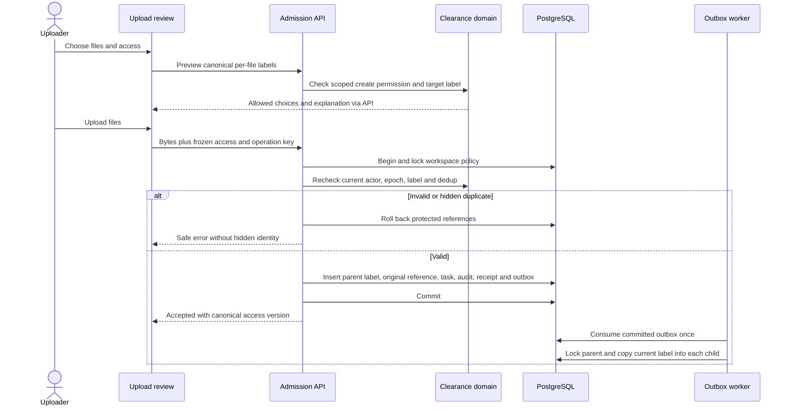
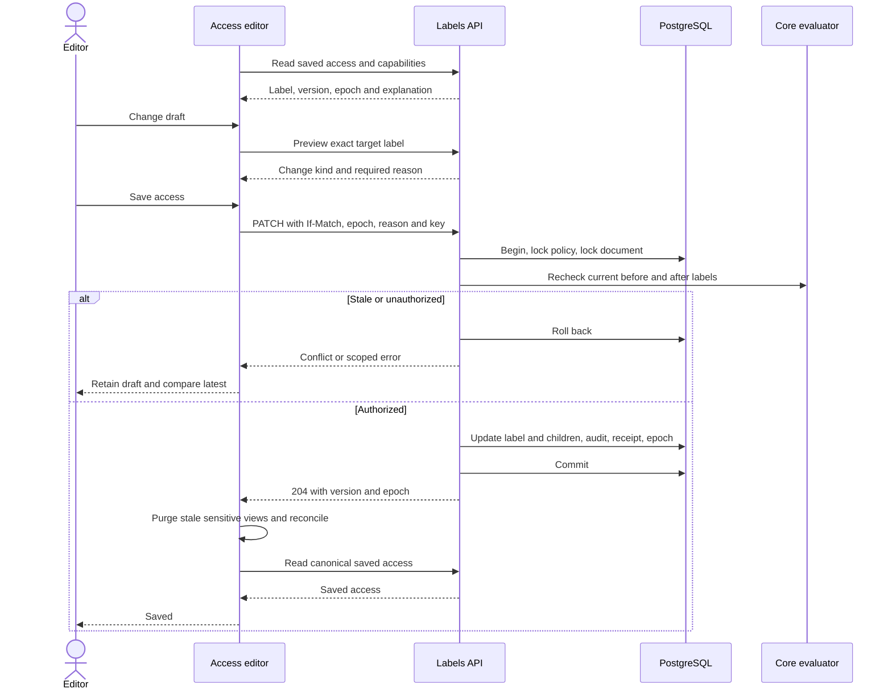
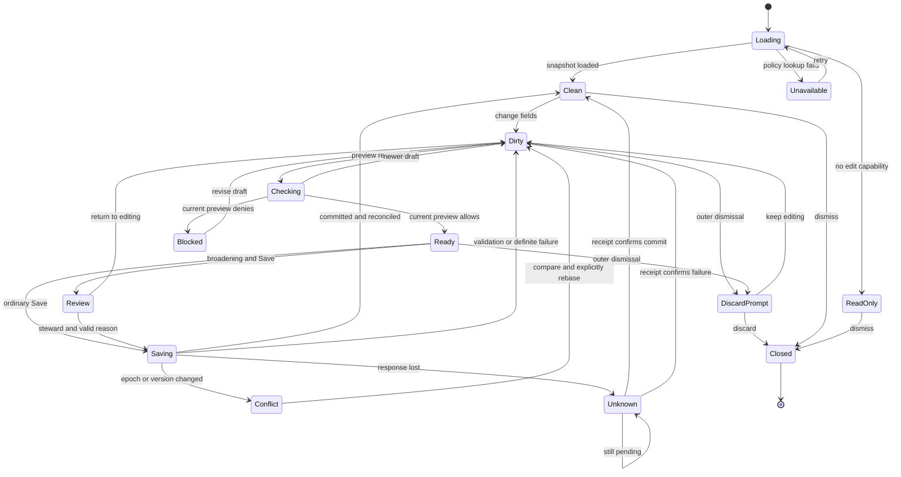
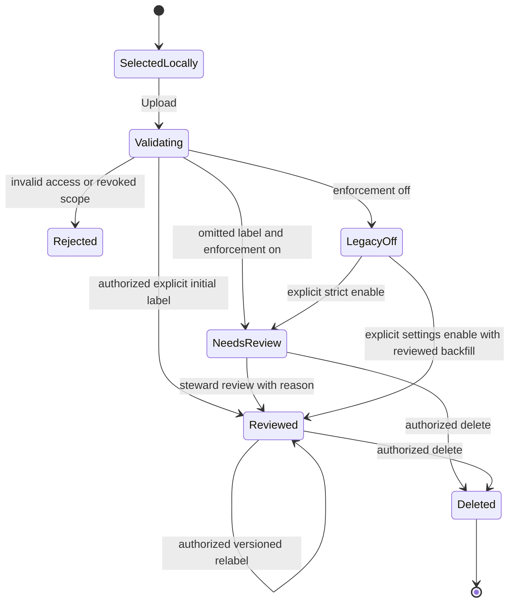

# 10 — Security, sequences and state

[Index](README.md) · Rules: [First principles](01-first-principles.md) / [Policy](04-policy-and-capabilities.md) · Transactions: [DB](08-data-and-db-contract.md) · Failure proof: [Edge cases](11-edge-cases.md) / [Tests](12-e2e-test-matrix.md)

## Upload sequence

MCP uses the same final admission: session creation stores the access snapshot and authorized uploader; byte PUT cannot choose its own actor. Finalization rechecks policy and epoch. An expired/revoked session exposes neither staged bytes nor a partially labeled document. A hidden duplicate uses one generic content-conflict response without ID/title/status; it must not trigger delete/reingest of the hidden object. Timing/size side channels are reviewed separately; this specification does not claim constant-time ingestion.

## Edit sequence

## Editor state machine

Scope/auth change cancels local requests and returns to Loading with a new identity; it cannot auto-replay Saving. During Saving, dismissal may hide the editor but does not cancel the committed server operation; reconcile by operation ID before reopening. An inner picker closes independently without changing this outer state machine.

## Document access lifecycle

Ingestion state (queued/processing/failed/completed) is an independent axis. A completed document can still need security review. A failed document's original and errors remain label-protected. No automatic policy transition is triggered by successful OCR/extraction.

## Threat model and obligations

| Threat | Boundary | Required control / proof |
|---|---|---|
| Browser forges tag/steward/actor | Browser → API | Server capability + exact domain decision; T-180-05/06 |
| Hidden title/member/profile inference | Lookup/preview/dedup | Authorized target lookup, filtered catalogs, safe 404/error shapes; T-180-03/17/24 |
| Lost update permits broadening | Concurrent mutations | Policy lock + document version + recheck inside transaction; T-180-09/10 |
| Worker inserts a stale-labeled child | Relabel → async writes | Parent shared/exclusive lock protocol; T-180-12/28 |
| Stale context/answer leaks after restriction | Retrieval/cache/stream/history | Scope/epoch fencing and descendant checks; T-180-12/29 |
| Cross-workspace association | FK/API validation | Scope-aware constraints and tag-kind checks; T-180-16/30 |
| Tenant-scoped API key exceeds grant | REST/MCP/system | Operation scopes plus clearance and attributed actor; T-180-08/32 |
| XSS or data leakage in names/reasons | Rendering/analytics/logs | Text rendering, bounded strings, content-free analytics, protected audit; T-180-11/23/31 |
| Misleading off/break-glass UI | Capability read model | Explicit status and audit, no protected claim; T-180-13/33 |

## Revocation contract

A read authorized before a label transaction commits may already have sent bytes. Those bytes cannot be recalled. New reads after commit and any buffered response not yet released must evaluate the latest policy epoch. For ongoing query streams, check epoch before each output frame; if changed, cancel generation/retrieval and terminate with a generic policy-changed event. Do not emit new frames based on stale context. Synchronize the final epoch check and frame admission with the workspace policy serialization boundary, or prove an equivalent atomic fence; a best-effort TTL is insufficient.

Revalidate stored conversation context, citations and retrieval handles when fetched; do not replay inaccessible document fragments from history. Clear browser-visible stale text on policy change notice, focus revalidation or access failure. This cannot guarantee removal from screenshots, clipboard or another offline tab; server authorization must never depend on browser cache clearing.

Disable new UX rollout until live tests prove this boundary across REST, MCP, originals, markdown, pages, multimodal assets, tasks, graph contributions, vector retrieval, citations, context handles and saved conversations. See [T-180-24](12-e2e-test-matrix.md#t-180-24), [T-180-29](12-e2e-test-matrix.md#t-180-29) and [WP-07](13-implementation-plan.md#wp-07).
