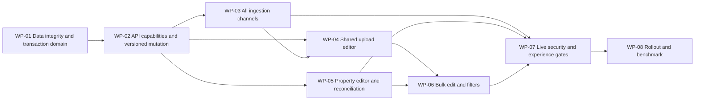

# 13 — Implementation plan

[Index](README.md) · Contract: [Product](03-product-spec.md), [API](07-api-contract.md), [DB](08-data-and-db-contract.md) · Proof: [Tests](12-e2e-test-matrix.md) · Accountability: [Traceability](15-traceability.md)

The dependency plan below guided the delivered implementation. WP-01 through WP-07 now have code and executable evidence under [the E2E runbook](e2e/README.md): migration 225, shared access services and fields, all ingestion transports, deliberate property saves, bulk/filter wiring, and live security/visual tests. The original package exit criteria also contain broader operational targets; the runbook explicitly identifies which were executed. WP-08 production rollout and comparative benchmark remain an operator/research activity, not a claim made by local tests. No production environment was changed.

## Dependency graph



## WP-01

**Data integrity and transaction domain — high complexity.** Owner: Database Expert with Full Stack Developer. Implements R-180-09/11/12/16; EC-180-09/12/16/26/27/30/35/37/38.

- Extend existing [clearance service](../../edgequake/crates/edgequake-api/src/services/clearance.rs) through focused proposed modules `services/document_access/{capabilities,admission,mutation,audit}.rs`; keep the facade delegating to avoid route churn. Keep pure policy in [edgequake-core/clearance](../../edgequake/crates/edgequake-core/src/clearance/mod.rs).
- Add version, receipt schema, scope-aware constraints and drift checks via a **new** migration using [SPEC-150](../150-reliable-migration-system/README.md). Reuse audit metadata; prevent policy-only tag deletion; decide retirement support explicitly.
- Implement one transaction service for canonical label mutation, lock ordering, subject refresh, child propagation, all-change audit and receipt. Preserve old transport facade until API migration lands.
- Inventory every child insert/update path and enforce parent locking/label derivation. Do not call database I/O while holding unrelated in-memory locks.
- Tests: T-180-09/11/12/16/26/27/30/35/37/38. Compare Rust/SQL evaluator outcomes on the same fixture matrix; intentionally fail each write stage.

Exit: constraints validated; two-writer and child-writer race tests pass; application-role RLS proof; migration/rollback rehearsal changes no access. No new UX enabled yet.

## WP-02

**Capability, preview and versioned mutation APIs — high complexity.** Depends WP-01. Owner: Full Stack Developer with Product Owner/Security review. Implements R-180-03/04/05/06/09/10/11/13/16/21/22.

- Add assignment-options and document-access DTOs/endpoints, privacy-safe draft preview, operation-status endpoint and stable error codes in focused proposed handlers, retaining [clearance.rs](../../edgequake/crates/edgequake-api/src/handlers/clearance.rs) as facade where helpful.
- Resolve current UI/API mismatch using [the capability matrix](04-policy-and-capabilities.md#capability-matrix). Writers receive assignable options, not admin vocabulary. No admin-implies-steward shortcut.
- Extend existing PATCH with preconditions/reason/idempotency; revalidate inside transaction. Add CORS header exposure and cache-control contracts. Off-mode mutation and malformed reserved metadata behavior are explicit.
- Regenerate [OpenAPI](../../edgequake/crates/edgequake-api/src/openapi.rs) and [TypeScript schema](../../edgequake_webui/openapi/schema.d.ts); extend [clearanceApi](../../edgequake_webui/src/lib/clearance/api.ts). Use shared fixtures for normalization and response shape.
- Time-bound legacy PATCH compatibility; strict preconditions must be on before final release. Tests T-180-03/04/05/06/09/10/11/13/16/21/22/26/36/37/38.

Exit: hidden/nonexistent parity, capability truthfulness, no stale-authority mutation, no full-directory/catalog leak. Schema contract checks and API tests pass.

## WP-03

**Atomic access admission across transports — high complexity.** Depends WP-01/02. Owner: Full Stack Developer with Database Expert. Implements R-180-07/08/17/21/22.

- Introduce one typed admission access envelope and initial-label service used by [document admission](../../edgequake/crates/edgequake-api/src/handlers/documents/upload/document_admission.rs), [relational shell provisioning](../../edgequake/crates/edgequake-api/src/services/ingest_admission.rs), PDF and MCP finalization.
- Replace post-insert stamping for new paths with atomic initial label persistence; protect original references and task/outbox before exposure. Preserve old omission semantics.
- Reject metadata impersonation, malformed/multiple access fields, missing enforced uploader attribution and invalid initial choices before expensive work.
- Dedup does not name or replace hidden objects. Reingest keeps existing access; changed desired access returns an explicit conflict requiring separate relabel. Retry/recovery never reapplies a stale task label.
- Keep transport adapters small. Do not duplicate PDF/text/MCP authorization, parser constants or projection copy SQL.
- Tests T-180-07/08/17/25/28/32/34/36/40, real object-reference and worker failure injection.

Exit: no visible unlabelled interval, no browser post-upload PATCH, no worker scope bypass or hidden dedup identity disclosure.

## WP-04

**Shared fields, governed picker and upload review — medium complexity.** Depends WP-02/03. Owners: Front Designer, UX/UI Designer, Full Stack Developer. Implements R-180-01/04/06/08/19/20/21.

- Build the proposed modules in [Frontend](09-frontend-architecture.md), using existing primitives. Map gr8r-studio patterns through existing semantic tokens; avoid unrelated application-wide reskinning.
- Change [use-document-dropzone](../../edgequake_webui/src/hooks/use-document-dropzone.ts) accepted-file handoff into local review. Keep file validation and parser/extraction options.
- Implement batch defaults/per-file overrides and freeze scope/label at submission; route [performFileUpload](../../edgequake_webui/src/lib/upload/perform-file-upload.ts) and [PDF FormData](../../edgequake_webui/src/lib/upload/pdf-upload-form-data.ts) through one serializer.
- Keep access summary visible in compact dropzone layouts; stop security-control event propagation to file chooser. Scope changes cannot silently retarget queued files.
- Tests T-180-01/04/06/08/19/20/21/25/26/31/36. Capture W-180-01/02/03/09 and loading/error variants.

Exit: upload tasks complete with keyboard and pointer; all file transports carry identical label intent; no network admission before Upload.

## WP-05

**Explicit property editing and saved-state reconciliation — medium complexity.** Depends WP-02/04 shared fields. Owners: Front Designer with Full Stack Developer. Implements R-180-02/03/10/13/17/18/19/21.

- Replace autosave-on-close in [DocumentAccessControl](../../edgequake_webui/src/components/clearance/document-access-control.tsx). Reuse fields; add deliberate Save/Cancel, broadening review, reason and conflict comparison.
- Render access status even for off/null/unavailable states in [document preview](../../edgequake_webui/src/components/documents/document-preview-panel.tsx). Use shared formatter in [document-table-row](../../edgequake_webui/src/components/documents/document-table-row.tsx).
- Reset on target/scope identity change; preserve dirty drafts on background refresh. Reject stale preview responses. Reconcile canonical server data and purge sensitive caches before refetch.
- Extend existing [clearance query hooks](../../edgequake_webui/src/lib/clearance/use-clearance.ts) through one scoped key/invalidation helper, not duplicated per-screen lists. Inventory query/chat/citation/body caches as well as documents/graph/stats.
- Tests T-180-02/03/09/10/13/17/18/19/21/31/38. Capture W-180-04/05/07/08.

Exit: every dismissal path is mutation-free; failed/unknown save never falsely displays Saved; list/detail/full reload agree.

## WP-06

**Existing-document bulk editing and server filters — high complexity, P1.** Depends WP-01/02/04/05. Owners: Product Owner, Full Stack Developer, Database Expert.

- Add explicit Add/Remove/Replace bulk operations through the same per-document domain service within a single bounded transaction. No giant handler or divergent bulk policy path.
- Add server sensitivity/tag/review filters before count/paging; replace [client-only classification filtering](../../edgequake_webui/src/components/documents/document-manager.tsx). Use one predicate builder for rows, counts and review inventory.
- Preview mixed values, unchanged/blocked rows, version conflicts, maximum 100 selected IDs and aggregate descendant limit. No implicit off-page “select all.”
- Tests T-180-14/15/20/27/39. Capture W-180-06; verify 100-item failure changes none and filtering never reveals hidden count.

Exit: all-or-nothing proof, consistent server pagination/counts and performance bounds. P0 can release earlier without bulk/filter marketing claims; the full SPEC-180 acceptance includes this work.

## WP-07

**Live security, race, accessibility and performance gates — high complexity.** Begins with fixtures after WP-01; final exit depends WP-03/05/06. Owners: Full Stack Developer, Database Expert, UX/UI Designer.

- Implement the [40-test catalog](12-e2e-test-matrix.md), seed personas and unique forbidden canaries. Keep unit, mocked UI and live evidence separate.
- Add explicit @spec180 and @spec180live project matching in [Playwright config](../../edgequake_webui/playwright.config.ts); validate discovered test list. Missing live DB/role/seed fails the job.
- Verify labels on actual originals/text/chunks/pages/assets/tasks/contributions and scoped reads through graph/vector/query/MCP/citations/history. Inspect mock-LLM prompts for forbidden text.
- Fence retrieval/context/answer caches and streaming frame admission under current epoch; preserve no-disclosure guarantees across relabel, membership and role changes. Fix any discovered gap before enabling UX.
- Exercise parent/child writer barriers, pooled connection reuse, audit/outbox failures, idempotent retries, 10k-tag search and large descendant counts. Test real RLS role; retain no owner/BYPASSRLS loophole in test setup.
- Run WCAG/axe, manual keyboard/AT, light/dark, 320–1440px, 200/400% zoom, RTL, forced-colors and reduced-motion checks. Review screenshots against gr8r-studio-inspired tokens and wireframes.

Exit: all P0/P1 acceptance cases pass, no security skip, no forbidden canary exposure, measured latency budgets, and six lens sign-offs. Apply repository fmt/clippy/typecheck/lint gates to actual implementation changes.

## WP-08

**Rollout, honest onboarding and comparative benchmark — medium complexity.** Depends WP-07. Owners: Product Owner and Marketing/Growth with engineering.

- Proposed rollout flag `document_access_editor_v2` is server-derived per workspace; it gates UI capability discovery, not underlying enforcement. Document it if implemented. Pilot in isolated test workspaces, then opted-in internal workspaces, then a small customer cohort after approval.
- Migrate server first, browser second, strict PATCH cutoff third. Observe audit completeness, stale-conflict rate, denied-mutation reasons, admission failures, orphan staging, lock waits, completion and comprehension.
- Stop rollout for any disclosure, partial propagation, missing audit, scope leak or wrong saved-state claim. Latency/error regressions pause expansion and require investigation.
- Run the [comparative task protocol](14-research-and-benchmark.md). Publish task-specific evidence; do not claim encryption, anonymous shares, universal ABAC or market superiority that was not demonstrated.
- Roll back the UI flag while retaining schema, labels, strict preconditions, RLS, audit and cache fences. Restore service without relaxing document protection.

Exit: demonstrated product outcomes, clean security evidence, documented client migration and an operational rollback rehearsal. No numerical competitive claim without recorded comparative results.

## Working checklist for implementers

```text
- [ ] WP-01: data/transaction integrity and race proof
- [ ] WP-02: capability/preview/versioned API contract
- [ ] WP-03: atomic admission and transport parity
- [ ] WP-04: upload review and shared accessible fields
- [ ] WP-05: property editing and cache reconciliation
- [ ] WP-06: bulk operations and server filters
- [ ] WP-07: all live security and UX release gates
- [ ] WP-08: rollout, migration and comparative outcome evidence
```

These remain unchecked because the requested deliverable is the specification and plan. The final authoring validation is recorded in [Tests](12-e2e-test-matrix.md#assessment-validation-distinct-from-future-acceptance).
