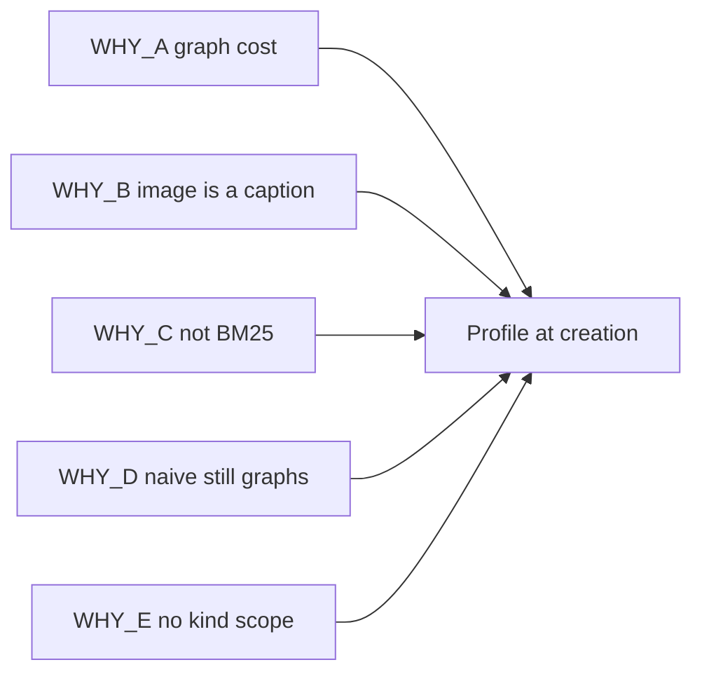

# 00 — Five WHYs

Parent: [README](README.md) · Next: [01-first-principles](01-first-principles.md)

Each chain stops at a cause the product can change. The laws in
[01-first-principles](01-first-principles.md) are those causes, written as rules.

## WHY-A — Every corpus pays for a graph

1. **Why does a small policy PDF cost as much to ingest as a research corpus?**
   Because every document runs entity extraction, relationship extraction, gleaning, merge, and community refresh.
2. **Why do those stages always run?**
   Because the pipeline is built as Hybrid GraphRAG, and the only skip switch is the fleet env `EDGEQUAKE_INGEST_PROFILE` ([F-180-01](04-code-findings.md)).
3. **Why is a fleet switch not enough?**
   Because two workspaces on one server often have different jobs. A support archive does not need a graph. A due-diligence room does.
4. **Why not turn the graph off after the fact?**
   Because the graph is already stored, and the query default is Mix, which expects it ([F-180-09](04-code-findings.md)). A setting that does not match the stored shape lies to the next query.
5. **Why is the cost structural?**
   Because the product treats "knowledge graph" as the only shape of a workspace. The shape is chosen too late, and it is chosen for the whole fleet.

**Cause:** the retrieval structure must be chosen per workspace, at creation, and the stored data must match that choice. → [LAW-180-1](01-first-principles.md), [LAW-180-3](01-first-principles.md), [LAW-180-12](01-first-principles.md).

Research: plain RAG beats GraphRAG on single-hop and page-level lookup, and GraphRAG costs more to build ([02-research](02-research.md) R-180-1, R-180-2).

## WHY-B — An image is searchable only as a caption

1. **Why can a user not search a photo with another photo?**
   Because image bytes are never embedded. A vision LLM writes a caption, and that caption is embedded as text ([F-180-21](04-code-findings.md)).
2. **Why is the embedding API text-only?**
   Because `EmbeddingProvider::embed` takes `&[String]`, and the Vertex path posts `:predict` with a text `content` string ([F-180-17](04-code-findings.md)).
3. **Why does the catalog not offer a multimodal embedder?**
   Because `embeddinggemma` is text-only (`supports_vision = false`) and `gemini-embedding-2` is not a card ([F-180-18](04-code-findings.md)). Gemma 2 is a chat model, not an embedding model.
4. **Why does a caption fail the job?**
   Because a caption drops layout, color, and the pixels the user is holding up. Cross-modal search needs one vector space for text and image (R-180-5).
5. **Why is the gap structural?**
   Because "multimodal" in this codebase means "describe, then embed the description." The embedding space itself is text.

**Cause:** when the workspace asks for images, the embedder must accept image parts and fail closed if it cannot. → [LAW-180-4](01-first-principles.md), [LAW-180-5](01-first-principles.md), [LAW-180-9](01-first-principles.md).

## WHY-C — The keyword leg is not BM25, and it can erase the vector leg

1. **Why do exact codes and rare terms miss, or why do synonyms miss?**
   Because one leg is cosine on chunks and the other is `ts_rank_cd` over an English `tsvector` ([F-180-13](04-code-findings.md)). `ts_rank_cd` has no corpus IDF. It is not BM25 (R-180-4).
2. **Why does turning fusion "on" sometimes make results worse?**
   Because the default fusion is `sparse_first`: if full-text search returns anything, the dense ranking is thrown away ([F-180-11](04-code-findings.md)). Measured hybrids that fuse `ts_rank` with vectors score below vectors alone (R-180-4).
3. **Why does the RRF path, when selected, return nothing under defaults?**
   Because fused scores are then filtered by `min_score` 0.1 ([F-180-12](04-code-findings.md)). The best RRF score with weights 1.0 and 1.25 and k = 60 is about 0.037 ([F-180-11](04-code-findings.md)).
4. **Why is the query language English-only?**
   Because `to_tsvector('english', …)` is generated in migration 136 and the query repeats `'english'` in SQL ([F-180-13](04-code-findings.md)).
5. **Why is the gap structural?**
   Because "BM25" in the engine names an in-process reranker over the dense candidates, not a corpus index. The product word and the implementation diverged.

**Cause:** normal retrieval fuses a real BM25 ranking with dense ranking by reciprocal rank, and it does not apply a cosine threshold to rank-fusion scores. → [LAW-180-6](01-first-principles.md), [LAW-180-7](01-first-principles.md), [LAW-180-16](01-first-principles.md).

## WHY-D — Naive mode still pays for the graph

1. **Why is a "chunks" query slow and graph-shaped?**
   Because `QueryMode::Naive` skips the graph *arms*, then the pipeline still extracts keywords with an LLM, validates them against the graph, admits graph seeds, and expands entities named in the query ([F-180-10](04-code-findings.md)).
2. **Why is Mix the mode the user gets?**
   Because Mix is the serde default, the API default, the UI default, and the MCP default ([F-180-09](04-code-findings.md)).
3. **Why does a chunk-only ingest still look failed?**
   Because `entity_count == 0` with `chunk_count > 0` is stored as `partial_failure` ([F-180-02](04-code-findings.md)).
4. **Why does delete and reprocess still touch the graph?**
   Because cascade and community refresh are unconditional once a document finishes with zero merge errors ([F-180-07](04-code-findings.md)).
5. **Why is the gap structural?**
   Because "no graph" was implemented as flags inside a graph pipeline, not as a workspace that has no graph.

**Cause:** a normal workspace runs a retriever that never calls graph storage, and a success rule that does not require entities. → [LAW-180-2](01-first-principles.md), [LAW-180-8](01-first-principles.md), [LAW-180-11](01-first-principles.md), [LAW-180-14](01-first-principles.md).

## WHY-E — Search cannot say "only images" or "only PDFs"

1. **Why can the user not restrict a question to images, or to PDFs?**
   Because `DocumentFilter` has dates, a title pattern, and document ids. It has no kind and no MIME type ([F-180-14](04-code-findings.md)).
2. **Why is "modality" not that filter?**
   Because chunk modality means chart, figure, table, or equation. Prose is NULL. It is not the file type ([F-180-15](04-code-findings.md)).
3. **Why does the picker not offer it?**
   Because the query composer scopes by document id only. The API cannot express the scope, so the UI cannot.
4. **Why must this not bypass security?**
   Because clearance (SPEC-174) already intersects document ids. A new predicate that skips that intersection would leak.
5. **Why is the gap structural?**
   Because retrieval filters were designed for "which files did I pick," not "which kind of evidence."

**Cause:** kind, MIME, and source modality are filters on the same candidate set, AND-ed with clearance. → [LAW-180-10](01-first-principles.md).

## How the five causes become one product

The profile is the product answer to all five: choose the structure once, store only that structure, retrieve with the legs that structure paid for, and let the user name the kind of document.
