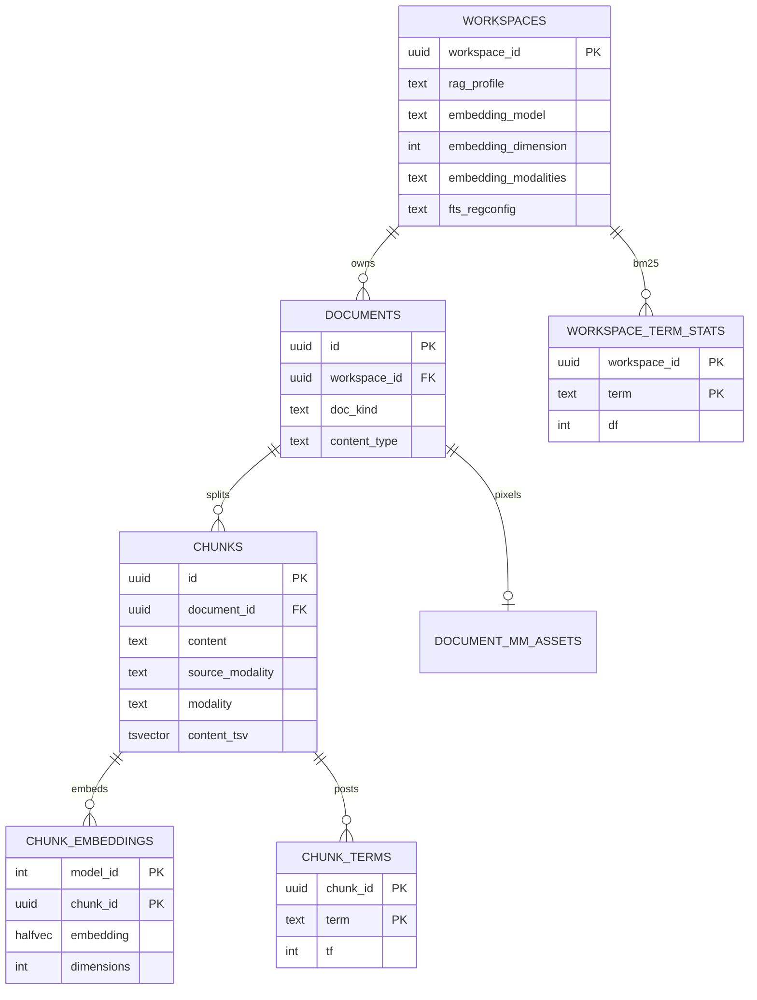

# 06 — Data and database contract

Parent: [README](README.md) · Prev: [05-profile-law](05-profile-law.md) · Next: [07-ingest-pipeline](07-ingest-pipeline.md)

Lens: [LENS-database](lenses/LENS-database.md).

Migration **225**. File `edgequake/migrations/225_spec180_normal_rag.sql`. Phase: **expand**. `lock_class`: `ddl_access_exclusive` for the `workspaces` alter (short), then indexes created with the same conventions as 132 (see that file for `CONCURRENTLY` policy; if 132 built indexes in-transaction, 225 follows 132, it does not invent a new lock style).

`compat_serve_max` becomes **225** in [manifest.toml](../../edgequake/migrations/manifest.toml). Checksums, schema-train docs, and `release_for_schema` move with the migration, same as SPEC-179. No contract-phase drop. Rollback is forward-only: a later migration would have to drop the trigger and column, and only if no `normal` row exists.

## Entity relationship



`modality` stays the chart/figure/table/equation label ([F-180-15](04-code-findings.md)). `source_modality` is new.

## `workspaces`

```sql
ALTER TABLE workspaces
  ADD COLUMN rag_profile text NOT NULL DEFAULT 'graph';

ALTER TABLE workspaces
  ADD CONSTRAINT workspaces_rag_profile_chk
  CHECK (rag_profile IN ('graph', 'normal'));

ALTER TABLE workspaces
  ADD COLUMN embedding_modalities text NOT NULL DEFAULT 'text';

ALTER TABLE workspaces
  ADD CONSTRAINT workspaces_embedding_modalities_chk
  CHECK (embedding_modalities IN ('text', 'text,image'));

ALTER TABLE workspaces
  ADD COLUMN fts_regconfig text NOT NULL DEFAULT 'english';

ALTER TABLE workspaces
  ADD CONSTRAINT workspaces_fts_regconfig_chk
  CHECK (fts_regconfig IN ('english', 'simple', 'french', 'german', 'spanish'));
```

`ADD COLUMN … DEFAULT` on PostgreSQL 11+ does not rewrite the table. Existing rows become `graph` / `text` / `english` without an update ([LAW-180-12](01-first-principles.md)).

Trigger `workspaces_rag_profile_immutable`: `BEFORE UPDATE`, if `NEW.rag_profile IS DISTINCT FROM OLD.rag_profile` then `RAISE EXCEPTION` with `ERRCODE = 'check_violation'` and a message containing `rag_profile_immutable`. Same trigger function rejects changes to `embedding_modalities` and `fts_regconfig`.

Embedding model and dimension stay in metadata as today. They are not copied into new columns in this migration. Rebuild remains the change path. The trigger does not freeze the model, because rebuild updates it on purpose.

`text,image` on a `graph` row is rejected by the API, not by a cross-column check, so a future pack can allow it without a new constraint migration. The API rule is the law for this pack.

## `documents.doc_kind`

Generated column, so writers cannot drift from `content_type`:

```sql
ALTER TABLE documents
  ADD COLUMN doc_kind text
  GENERATED ALWAYS AS (
    CASE
      WHEN content_type LIKE 'image/%' THEN 'image'
      WHEN content_type = 'application/pdf' THEN 'pdf'
      WHEN content_type IN ('text/markdown', 'text/x-markdown') THEN 'markdown'
      WHEN content_type LIKE 'text/%' THEN 'text'
      WHEN content_type IN (
        'application/vnd.openxmlformats-officedocument.wordprocessingml.document',
        'application/msword',
        'application/vnd.openxmlformats-officedocument.spreadsheetml.sheet',
        'application/vnd.ms-excel',
        'application/vnd.openxmlformats-officedocument.presentationml.presentation'
      ) THEN 'office'
      ELSE 'other'
    END
  ) STORED;
```

Index: `(workspace_id, doc_kind)`. `content_type` already exists from the init migration. Null `content_type` yields `other`.

## `chunks.source_modality`

```sql
ALTER TABLE chunks
  ADD COLUMN source_modality text NOT NULL DEFAULT 'text';

ALTER TABLE chunks
  ADD CONSTRAINT chunks_source_modality_chk
  CHECK (source_modality IN ('text', 'image'));
```

Index: `(workspace_id, source_modality)` if `workspace_id` is on `chunks` (it is, from the init schema). Existing rows are `text`.

Image chunks store caption text in `content` (may be empty) and the asset id in `metadata.asset_id`. BM25 uses `content`. An empty caption means the chunk is dense-only, which is legal. `content_tsv` stays the English generated column from migration 136 for graph workspaces. Normal BM25 does not read `ts_rank_cd`. It reads `chunk_terms`. Candidate generation for the built-in backend may still use `content_tsv` with OR, with the limitation that the generated column is English. For `fts_regconfig <> 'english'`, candidate generation uses `to_tsvector(regconfig, content)` in the query, not the generated column. That is a sequential expression on the workspace filter. W0 checks the plan. If it is too slow, a follow-up column `content_tsv_simple` is a new migration, not a silent change to 136 (136 is immutable).

## BM25 tables

```sql
CREATE TABLE chunk_terms (
  workspace_id uuid NOT NULL,
  chunk_id uuid NOT NULL REFERENCES chunks(id) ON DELETE CASCADE,
  term text NOT NULL,
  tf integer NOT NULL CHECK (tf > 0),
  PRIMARY KEY (chunk_id, term)
);

CREATE INDEX chunk_terms_ws_term ON chunk_terms (workspace_id, term);

CREATE TABLE workspace_term_stats (
  workspace_id uuid NOT NULL,
  term text NOT NULL,
  df integer NOT NULL CHECK (df >= 0),
  PRIMARY KEY (workspace_id, term)
);

ALTER TABLE workspaces
  ADD COLUMN bm25_doc_count integer NOT NULL DEFAULT 0,
  ADD COLUMN bm25_avgdl double precision NOT NULL DEFAULT 0;
```

`df` is the number of chunks in the workspace that contain the term. Updates happen in the same transaction as the chunk insert and delete. `bm25_doc_count` and `bm25_avgdl` are workspace aggregates, updated in that transaction. They are derived data. A repair function `rebuild_bm25(workspace_id)` recomputes them from `chunk_terms` if a crash is ever suspected. The transaction is the normal path, so repair is not on the ingest hot path.

Tokenizer for the default backend: Unicode lowercase, split on non-letters, drop tokens of length 1, no stemming in v1 of the table so `simple` and `english` stay explainable. English stemming is a W0 decision: if the SciFact check loses without stemming, the tokenizer uses the Postgres `english` snowball via `to_tsvector` and stores those lexemes. One tokenizer, stored in the table, documented in the migration comment. Do not stem in the application and also in SQL.

RLS: enable on `chunk_terms` and `workspace_term_stats` with the same tenant/workspace policy pattern as `chunks` (SPEC-091 / SPEC-174). A term row is visible only inside its workspace.

## HNSW for 3072

```sql
CREATE INDEX IF NOT EXISTS idx_chunk_embeddings_hnsw_d3072
  ON public.chunk_embeddings
  USING hnsw ((embedding::halfvec(3072)) halfvec_cosine_ops)
  WITH (m = 16, ef_construction = 128)
  WHERE dimensions = 3072;
```

768 and 1536 already exist ([F-180-19](04-code-findings.md)). 1408 is not added (`multimodalembedding@001` is out of scope).

## What is not stored

- No entity or relationship rows for normal ingests.
- No second vector table for images.
- No audio or video columns.
- No change to `content_tsv` generation (migration 136 stays).

## Read path for kind and modality filters

The typed ANN query already joins `chunks`. Extend the WHERE with:

- `d.doc_kind = ANY($kinds)` when the filter is set
- `c.source_modality = ANY($mods)` when set
- existing clearance document-id intersection AND-ed

Empty arrays mean the predicate is omitted, matching [query_types.rs](../../edgequake/crates/edgequake-api/src/handlers/query_types.rs) empty-list behavior.

## Failure and concurrency

- Two ingests in one workspace update `workspace_term_stats` with `INSERT … ON CONFLICT DO UPDATE` under the workspace row lock (`SELECT … FROM workspaces WHERE workspace_id = $1 FOR UPDATE`) so `df` does not lose increments. The lock is held only for the stats write, after embeddings return, so the vendor call is outside the lock.
- Delete decrements `df` and deletes `chunk_terms` via `ON DELETE CASCADE`, then fixes `df` in the same transaction before commit. Cascade alone would drop postings and leave `df` high. The delete worker updates stats first, then deletes chunks, in one transaction.
- A failed embed does not write terms. Terms are written only for chunks that have a stored embedding, except caption-empty image chunks which still have an embedding. A chunk with neither embedding nor terms is not inserted.
