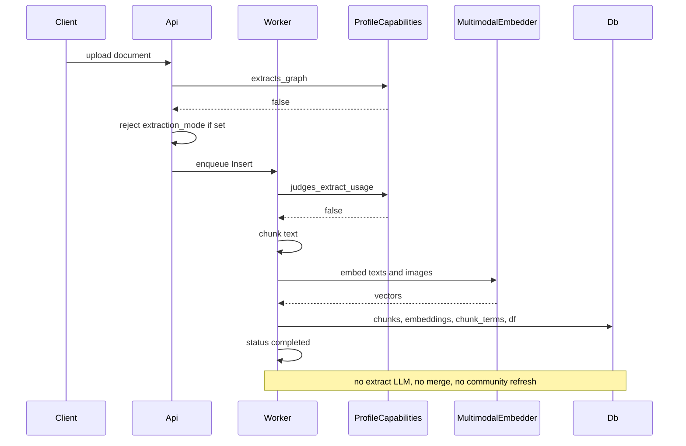
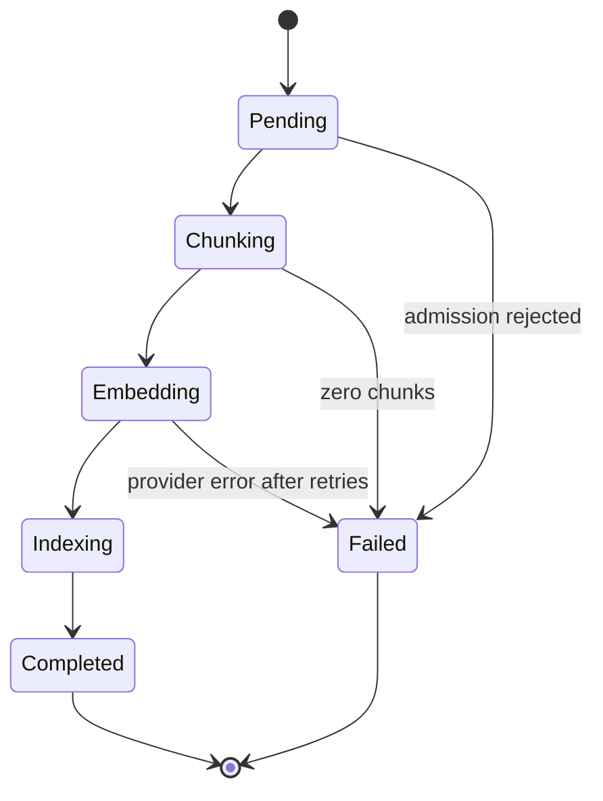

# 07 — Ingest pipeline

Parent: [README](README.md) · Prev: [06-data-and-db-contract](06-data-and-db-contract.md) · Next: [08-multimodal-embedding](08-multimodal-embedding.md)

Lens: [LENS-full-stack](lenses/LENS-full-stack.md), [LENS-ai-engineer](lenses/LENS-ai-engineer.md).

## Sequence (normal)

Graph sequence is unchanged. The branch is the capability check, not a copy of the worker.

## State of a normal document

There is no `Extracting`, `Gleaning`, `Merging`, or `Summarizing` state. Progress copy comes from a profile-aware formatter. The strings "Extracting entities and relationships" and "Storing in knowledge graph" are not used ([F-180-02](04-code-findings.md) sits next to those strings in the status mapper).

PDF conversion can still run before Insert: `PdfConversion` then the states above. Vision is a conversion stage, not an extraction stage.

## Gates in the worker

| Step today | File | When `extracts_graph` is false |
|------------|------|--------------------------------|
| `judge_ingest` | [workspace_resolver.rs](../../edgequake/crates/edgequake-api/src/processor/workspace_resolver.rs) 139, 178 | Skip extract judgement. Still judge embedding usage. |
| Build extract LLM | [workspace_pipeline_factory.rs](../../edgequake/crates/edgequake-api/src/workspace_pipeline_factory.rs) 147 | Do not build it. Build embedder only. |
| `enable_*extraction` | [processing.rs](../../edgequake/crates/edgequake-pipeline/src/pipeline/processing.rs) 283 | Flags false via capabilities. Extractor is `None`. |
| Zero-entity warning | processing.rs 368 | Do not set `error_details`. |
| Checkpoint / snapshot reuse | text_insert extraction path | Do not load. Do not merge a restored extraction. |
| `inject_modality_relations` | extraction path | Do not call. |
| Summary LLM | [persist.rs](../../edgequake/crates/edgequake-api/src/processor/text_insert/persist.rs) 196–217 | Do not resolve. Do not judge `Usage::Summary`. |
| Overwrite llm model in stats | persist.rs 456–470 | Leave embedding model fields. Do not write the extract role. |
| `partial_failure` | persist.rs 500–509 | Not applied. [LAW-180-14](01-first-principles.md). |
| Merge + community | [ingestion_persister.rs](../../edgequake/crates/edgequake-pipeline/src/persistence/ingestion_persister.rs) 792–856 | Do not call `build_merger`. Do not spawn refresh. |
| Graph phase progress | persist.rs PDF phase simulation | Do not emit Extraction or GraphStorage phases. |

Chunk embeddings and relational chunk insert stay. BM25 postings are written in the same persist transaction as the chunk rows ([06-data-and-db-contract](06-data-and-db-contract.md)).

## What still runs

- Dedup and admission.
- PDF to markdown when the file is a PDF (vision or EdgeParse, existing settings).
- Chunking (workspace chunking policy, SPEC-116).
- Optional image caption, only if the operator enabled captions. Default off. A caption is a vision call and is labeled as such in the cost stats.
- Embedding of text chunks.
- Embedding of image chunks when `embeds_images` ([08-multimodal-embedding](08-multimodal-embedding.md)).
- Typed `chunk_embeddings` insert.
- `chunk_terms` and `workspace_term_stats`.
- Status `completed`, counts: `chunk_count` set, `entity_count` 0, `relationship_count` 0. The UI hides the zeros ([LAW-180-11](01-first-principles.md)).

## Image and page chunks

| Input | Chunks |
|-------|--------|
| Markdown, text, office | Text chunks only. `source_modality = text`. |
| Standalone image | One chunk, `source_modality = image`, `content` = caption or empty, metadata points at the original bytes. |
| PDF | Text chunks from markdown. If page-image embedding is on (default on when `embeds_images`), one image chunk per page that has a rendered raster, aggregated with the page's markdown text as a second part only when both exist and the token budget allows. If the pair would exceed 8192 tokens, store two chunks: page text, and page image. Do not silently truncate ([LAW-180-4](01-first-principles.md)). |
| Figure crop | When figure analysis already produced a crop and a caption, one aggregated embedding (image part + caption part) if the workspace embeds images. The crop is not also embedded as a second vector. |

Graph workspaces do not write image chunks in this pack.

## Delete and reprocess

Delete: skip `cascade_remove_document_sources` when `skips_graph_on_delete`. Still delete vectors, chunks (terms cascade), KV, originals, and mm assets. The zero-match graph guard must not fail the delete when the profile has no graph.

Reprocess: retract chunk embeddings and terms, then the normal insert path. Do not read an extraction snapshot.

## Fingerprint and cost

Fingerprint includes `rp=normal` ([05-profile-law](05-profile-law.md)).

`cost_usd` on a normal document is the sum of embedding cost and optional vision cost. `llm_calls` for the extract role stays 0. The stats object must not copy the workspace extract model into `llm_model` ([F-180-06](04-code-findings.md)).

## Failure cases on this path

| Condition | Result |
|-----------|--------|
| Chunker returns zero chunks and there is no image chunk | `failed`, code `no_chunks` |
| Image-only file and modalities are `text` | `422` at admission `embedding_model_not_multimodal` (the file never enters the worker) |
| Embedder 429 | Retry with the existing provider backoff, then `failed` |
| Embedder 401 after one token refresh | `failed`, code `embedding_auth` |
| Stats transaction fails | Document `failed`, no partial terms (transaction rolls back) |
| Cancel | Existing cancellation token. No graph cleanup required. |
