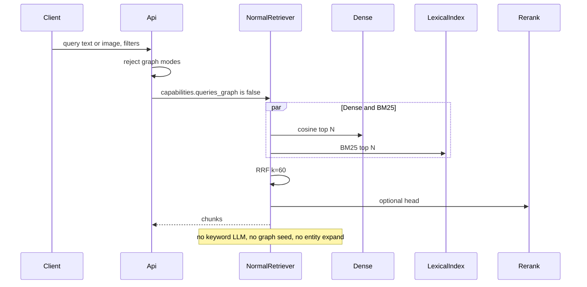

# 09 — Retrieval and fusion

Parent: [README](README.md) · Prev: [08-multimodal-embedding](08-multimodal-embedding.md) · Next: [10-api-contract](10-api-contract.md)

Lens: [LENS-rag-expert](lenses/LENS-rag-expert.md). Laws: [LAW-180-6](01-first-principles.md), [LAW-180-7](01-first-principles.md), [LAW-180-8](01-first-principles.md), [LAW-180-10](01-first-principles.md).

## Sequence



`NormalRetriever` lives in `edgequake-query`. It does not call `admit_into_context` or `expand_entities_named_in_query` ([F-180-10](04-code-findings.md)). The query pipeline checks `queries_graph` **before** keyword extraction and returns this retriever. Graph workspaces do not enter it.

`mode=naive` on a graph workspace stays the current naive path (including its FTS). This pack does not silently change graph naive to BM25. The alias "naive means NormalRetriever" applies only when the profile is normal ([LAW-180-8](01-first-principles.md)).

## Candidate widths

`N = max_chunks * bm25_candidate_multiplier` (existing clamp 2–20, default 5). Both legs request N. Fusion keeps `2 * max_chunks` before the reranker, then the reranker returns `rerank_top_k` (default 20).

## BM25

Score for chunk `d`, query terms `q`:

```text
Σ idf(t) * (tf * (k1 + 1)) / (tf + k1 * (1 - b + b * |d| / avgdl))
idf(t) = ln(1 + (doc_count - df + 0.5) / (df + 0.5))
k1 = 1.5
b = 0.75
```

`df`, `doc_count`, and `avgdl` come from [06-data-and-db-contract](06-data-and-db-contract.md). This is the Lucene-style IDF, computed in SQL or in Rust over a candidate set. It is not `ts_rank_cd`.

### Candidate generation (default backend)

1. Tokenize the query with the same tokenizer used at index time.
2. If every token is a stopword or the token list is empty, **skip the lexical leg** and return dense only. Do not return an empty fusion ([EC-180-33](14-edge-cases.md)).
3. Build an OR `tsquery` (`term1 | term2 | …`) with the workspace `fts_regconfig` when using Postgres lexemes, or an `IN` list on `chunk_terms.term`.
4. Take at most `N * 4` candidate chunk ids (cap 500) that match any term inside the workspace, the document filter, and clearance.
5. Score those ids with the BM25 formula. Return top N.

AND semantics are not used. A long natural-language question must not require every word ([F-180-13](04-code-findings.md), R-180-4).

### Optional `pg_search` backend

At boot, `SELECT 1 FROM pg_extension WHERE extname = 'pg_search'`. If present and `EDGEQUAKE_BM25_BACKEND=pg_search`, `LexicalIndex` uses that index. If the extension is missing, the setting is a **startup error**, not a silent fallback, because the operator asked for it. Unset means the built-in backend.

### Image chunks with empty captions

They have no terms. They are reachable only from the dense leg. Fusion still returns them when the dense rank is high. This is the text-to-image and image-to-image path.

## RRF

Call `fusion::reciprocal_rank_fusion` ([fusion.rs](../../edgequake/crates/edgequake-query/src/fusion.rs) lines 65–83).

- `k = 60` (`RRF_K`). Not configurable in this pack, so evals stay comparable (R-180-3).
- Weights from `EDGEQUAKE_NORMAL_DENSE_WEIGHT` (default 1.0) and `EDGEQUAKE_NORMAL_BM25_WEIGHT` (default 1.25). Values must be finite and `> 0`. A bad env fails startup.
- Do **not** apply `min_score` after fusion ([F-180-11](04-code-findings.md), [F-180-12](04-code-findings.md)).
- If one list is empty, the fused order is the other list. Scores are still RRF scores (one list).
- Tie break: higher dense rank, then chunk id ascending, so tests are stable.

Cross-modal cosine values are not compared across legs. Rank fusion is the mitigation for a modality gap. The reranker, if it is text-only BM25 or a text cross-encoder, reranks using chunk `content`. An image chunk with empty content keeps its RRF position (the reranker must not drop it for an empty string). A text cross-encoder that cannot score an image receives the caption, or is skipped for that row.

## Query image

`POST /query` and chat accept multipart field `query_image` (one file, png/jpeg/webp, same size limits as ingest).

- Modalities `text`: **422** `image_query_not_supported`.
- The query vector is the embedding of that image with no task prefix.
- Optional text query is a second vector, not concatenated into the image input (concatenation would be one aggregated vector and would change the meaning). The two query vectors are two dense searches whose ranks are fused with the BM25 leg of the text, weights equal on the two dense lists unless only one is present.
- The image is not stored as a document.

## Filters

Added to `DocumentFilter` and the chat request and MCP `eq_search`:

| Field | Effect |
|-------|--------|
| `doc_kinds` | `documents.doc_kind = ANY` |
| `mime_types` | `documents.content_type = ANY` (exact, lowercased) |
| `source_modalities` | `chunks.source_modality = ANY` |

AND across these, AND clearance, AND the existing date filter. `document_ids` and `document_pattern` stay OR with each other, then AND with the kind filters. Implementation extends the resolver that already turns a filter into allowed ids **or** pushes the predicate into SQL. **SQL pushdown is required** for kind and modality so a workspace with many documents does not materialize every id. Clearance ids stay an intersection: if clearance is "all," the SQL predicate is the kind filter alone; if clearance is a set, `document_id = ANY(clearance)` AND kind.

Unknown kind strings: **400** `invalid_doc_kind`. Allowed: `pdf`, `image`, `markdown`, `text`, `office`, `other`.

## Answer generation

The answer LLM is unchanged. Context is chunks (text, or caption plus an image citation). The prompt gains a line when a chunk is `source_modality = image`: the model is told the hit is an image and is given the caption and the document title. The raw pixels are not sent to the answer model in this pack (that would be a vision chat call). The UI shows the image from the asset URL. This keeps answer cost predictable. A follow-up can attach pixels when the answer model has vision.

## Telemetry

Retrieval trace records `profile=normal`, `dense_hits`, `bm25_hits`, `fused_hits`, `bm25_backend`, `query_modality` (`text` or `image` or `both`). It does not record chunk text.
