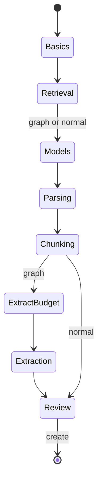

# 12 — Screens

Parent: [README](README.md) · Prev: [11-ux-ui-spec](11-ux-ui-spec.md) · Next: [13-frontend-architecture](13-frontend-architecture.md)

ASCII wireframes. Boxes are 70 characters wide, including corners. Navigation map is at the bottom.

## Create wizard — retrieval step

```text
+--------------------------------------------------------------------+
| Create workspace                                            2 of 6 |
+--------------------------------------------------------------------+
| Retrieval type                                                     |
|                                                                    |
| ( ) Graph                                                          |
|     Entities, relationships, and communities.                      |
|     Higher ingest cost. Better for multi-hop questions.            |
|                                                                    |
| (x) Normal                                                         |
|     Embeddings and keyword match. No knowledge graph.              |
|     Lower ingest cost. Enough for lookup.                          |
|                                                                    |
| Evidence                                                           |
| (x) Text                                                           |
| ( ) Text and images                                                |
|     Needs an embedding model that accepts images.                  |
|                                                                    |
| Keyword language   [ English v ]                                   |
|                                                                    |
|                                        [ Back ]  [ Next ]          |
+--------------------------------------------------------------------+
```

Graph selected is the default. "Text and images" is disabled with the hint until the user selects Normal. The control is a radio, not a checkbox, so the two evidence choices stay mutually exclusive.

## Create wizard — review (normal, images on)

```text
+--------------------------------------------------------------------+
| Create workspace                                            6 of 6 |
+--------------------------------------------------------------------+
| Review                                                             |
|                                                                    |
| Name              Policy desk                                      |
| Retrieval         Normal                                           |
| Evidence          Text and images                                  |
| Embedding model   gemini-embedding-2 (1536)                        |
| Extraction model  Off                                              |
| Keyword index     On, English                                      |
| PDF vision        On, for scanned pages                            |
|                                                                    |
| This choice is permanent. To use a graph later, create another     |
| workspace and upload again.                                        |
|                                                                    |
|                                    [ Back ]  [ Create workspace ]  |
+--------------------------------------------------------------------+
```

If evidence is text only, the embedding line can name EmbeddingGemma, and "PDF vision" remains an independent line.

## Settings card

```text
+--------------------------------------------------------------------+
| Retrieval                                                          |
+--------------------------------------------------------------------+
| Type              Normal                                           |
| Evidence          Text and images                                  |
| Keyword language  English                                          |
|                                                                    |
| Permanent. Create a new workspace to use Graph retrieval.          |
+--------------------------------------------------------------------+
```

No button on the card. Rebuild embeddings stays on the existing actions card.

## Documents (normal)

```text
+--------------------------------------------------------------------+
| Documents                                          [ Upload ]      |
+--------------------------------------------------------------------+
| Name              Status       Chunks                              |
| policy.md         Completed    12                                  |
| scan.pdf          Completed    40                                  |
| photo.png         Completed    1                                   |
+--------------------------------------------------------------------+
```

Entity and relationship columns are absent. A graph workspace keeps those columns. Same component, columns from `shows_graph_ui`.

## Query composer (normal)

```text
+--------------------------------------------------------------------+
| Ask                                                                |
+--------------------------------------------------------------------+
| Scope   [ PDFs x ] [ Images x ]              Mode [ Chunks v ]     |
|                                                                    |
| +----------------------------------------------------------------+ |
| | Where is the refund clause?                                    | |
| +----------------------------------------------------------------+ |
| [ Search by image ]                              [ Ask ]           |
+--------------------------------------------------------------------+
| Answer                                                             |
| The refund clause is on page 4.                                    |
| [1] scan.pdf p.4                                         [thumb]   |
+--------------------------------------------------------------------+
```

"Search by image" is omitted when the workspace does not embed images. Mode menu items other than Chunks and Chat are not in the list.

## Knowledge route on a normal workspace

```text
+--------------------------------------------------------------------+
| Knowledge graph                                                    |
+--------------------------------------------------------------------+
|                                                                    |
| This workspace has no knowledge graph.                             |
| It retrieves by embeddings and keywords.                           |
|                                                                    |
| [ Go to documents ]              [ New graph workspace ]           |
|                                                                    |
+--------------------------------------------------------------------+
```

## Navigation

```text
Graph workspace                         Normal workspace
+---------------------------+           +---------------------------+
| Documents                 |           | Documents                 |
| Query                     |           | Query                     |
| Knowledge graph           |           |                           |
| Workspace settings        |           | Workspace settings        |
+---------------------------+           +---------------------------+
```

The knowledge item is not rendered. It is not a disabled row.

## Wizard state



A normal draft never enters ExtractBudget or Extraction. Back from Review returns to Chunking.
