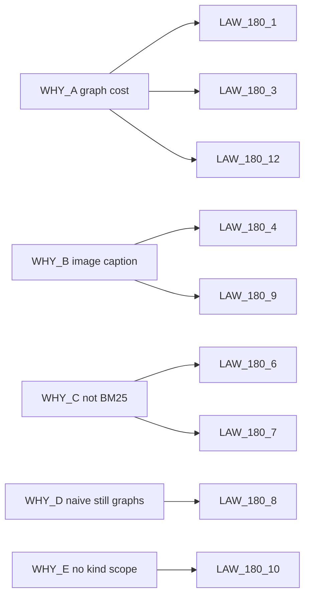

# 17 — Cross-reference

Parent: [README](README.md) · Prev: [16-e2e-test-matrix](16-e2e-test-matrix.md)

## WHY to law

| WHY | Laws |
|-----|------|
| [WHY-A](00-why.md) Every corpus pays for a graph | LAW-180-1, LAW-180-2, LAW-180-3, LAW-180-12, LAW-180-13, LAW-180-14 |
| [WHY-B](00-why.md) Image is only a caption | LAW-180-4, LAW-180-5, LAW-180-9 |
| [WHY-C](00-why.md) Lexical leg is not BM25 | LAW-180-6, LAW-180-7, LAW-180-16 |
| [WHY-D](00-why.md) Naive still runs the graph | LAW-180-2, LAW-180-8, LAW-180-11, LAW-180-14 |
| [WHY-E](00-why.md) No document-kind scope | LAW-180-10 |

LAW-180-15 binds the matrix. LAW-180-16 is the product word "keywords."

## Law to finding, wave, lens

| Law | Findings | Wave | Lens |
|-----|----------|------|------|
| LAW-180-1 | F-180-01, F-180-20 | W1 | Product, database |
| LAW-180-2 | F-180-01, F-180-04 | W1, W2 | Full stack |
| LAW-180-3 | F-180-04, F-180-05, F-180-06, F-180-07 | W2 | AI engineer |
| LAW-180-4 | F-180-17 | W0, W4 | AI engineer |
| LAW-180-5 | F-180-18, F-180-19 | W1, W4 | Database, AI engineer |
| LAW-180-6 | F-180-11, F-180-12 | W3 | RAG expert |
| LAW-180-7 | F-180-13 | W0, W3 | RAG expert, database |
| LAW-180-8 | F-180-09, F-180-10 | W3 | RAG expert |
| LAW-180-9 | F-180-15, F-180-21 | W4 | AI engineer, RAG expert |
| LAW-180-10 | F-180-14, F-180-15 | W3 | Database, UX |
| LAW-180-11 | F-180-16, F-180-22 | W5 | UX, front |
| LAW-180-12 | F-180-01, F-180-09 | W1 | Product, database |
| LAW-180-13 | F-180-08 | W2 | Full stack |
| LAW-180-14 | F-180-02, F-180-03 | W2 | Full stack |
| LAW-180-15 | — | W6 | Full stack |
| LAW-180-16 | F-180-10 | W3 | RAG expert |

## Finding to edge case

| Finding | Edge cases |
|---------|------------|
| F-180-01 | EC-180-02, EC-180-08 |
| F-180-02 | EC-180-13 |
| F-180-03 | EC-180-13 |
| F-180-04 | EC-180-02, EC-180-49 |
| F-180-05 | EC-180-49 |
| F-180-06 | EC-180-49, EC-180-50 |
| F-180-07 | EC-180-48, EC-180-11 |
| F-180-08 | EC-180-03, EC-180-09 |
| F-180-09 | EC-180-38, EC-180-39 |
| F-180-10 | EC-180-39, EC-180-44 |
| F-180-11 | EC-180-33, EC-180-36, EC-180-37 |
| F-180-12 | EC-180-36 |
| F-180-13 | EC-180-34, EC-180-35 |
| F-180-14 | EC-180-40, EC-180-41 |
| F-180-15 | EC-180-40 |
| F-180-16 | EC-180-43, EC-180-44 |
| F-180-17 | EC-180-28, EC-180-29, EC-180-31 |
| F-180-18 | EC-180-18, EC-180-56 |
| F-180-19 | EC-180-32 |
| F-180-20 | EC-180-01, EC-180-04, EC-180-58 |
| F-180-21 | EC-180-19, EC-180-20, EC-180-21 |
| F-180-22 | EC-180-45, EC-180-46 |

EC-180-05, EC-180-06, EC-180-07, EC-180-10, EC-180-12, EC-180-14 through EC-180-17, EC-180-22 through EC-180-27, EC-180-30, EC-180-42, EC-180-47, EC-180-51 through EC-180-55, EC-180-57, EC-180-59, and EC-180-60 are operational cases. They map to laws as follows.

| Law | Additional ECs |
|-----|----------------|
| LAW-180-1 | EC-180-04, EC-180-05, EC-180-06, EC-180-07, EC-180-58, EC-180-59 |
| LAW-180-3 | EC-180-10, EC-180-12, EC-180-47, EC-180-51, EC-180-52 |
| LAW-180-4 | EC-180-23, EC-180-24, EC-180-25, EC-180-26, EC-180-27, EC-180-30 |
| LAW-180-5 | EC-180-53 |
| LAW-180-7 | EC-180-42 |
| LAW-180-8 | EC-180-54 |
| LAW-180-9 | EC-180-22, EC-180-55, EC-180-60 |
| LAW-180-10 | EC-180-57 |
| LAW-180-11 | EC-180-14, EC-180-45 |
| LAW-180-14 | EC-180-15, EC-180-16, EC-180-17 |

## EC to test

The test name is on each row of [14-edge-cases](14-edge-cases.md). The layer and wave are in [16-e2e-test-matrix](16-e2e-test-matrix.md). An EC missing from that matrix breaks LAW-180-15.

## Reading by role

| Role | Read first |
|------|------------|
| Product | [00-why](00-why.md), [03-product-spec](03-product-spec.md), [LENS-product-owner](lenses/LENS-product-owner.md) |
| Full stack | [05-profile-law](05-profile-law.md), [07-ingest-pipeline](07-ingest-pipeline.md), [10-api-contract](10-api-contract.md), [LENS-full-stack](lenses/LENS-full-stack.md) |
| Database | [06-data-and-db-contract](06-data-and-db-contract.md), [LENS-database](lenses/LENS-database.md) |
| UX | [11-ux-ui-spec](11-ux-ui-spec.md), [12-screens](12-screens.md), [LENS-ux-ui](lenses/LENS-ux-ui.md) |
| Front | [13-frontend-architecture](13-frontend-architecture.md), [LENS-front](lenses/LENS-front.md) |
| AI engineer | [08-multimodal-embedding](08-multimodal-embedding.md), [LENS-ai-engineer](lenses/LENS-ai-engineer.md) |
| RAG | [02-research](02-research.md), [09-retrieval-and-fusion](09-retrieval-and-fusion.md), [LENS-rag-expert](lenses/LENS-rag-expert.md) |
