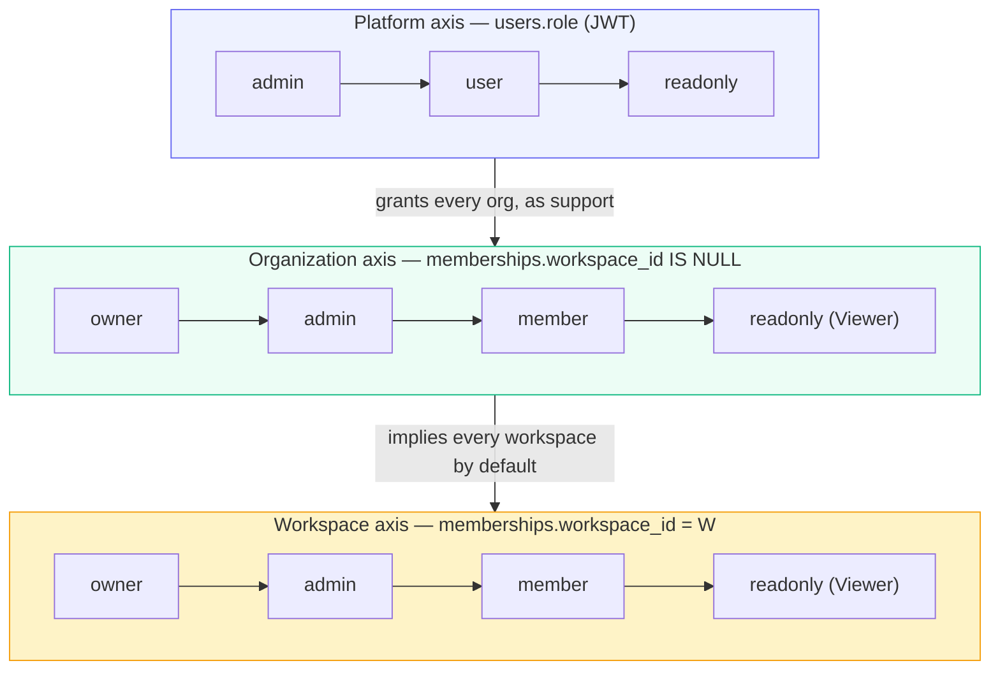
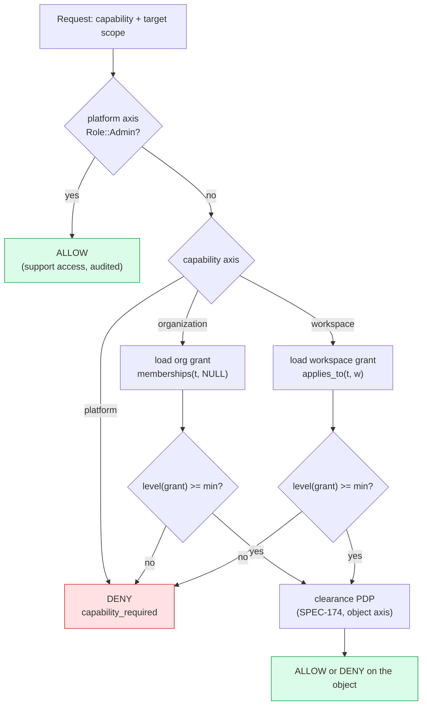
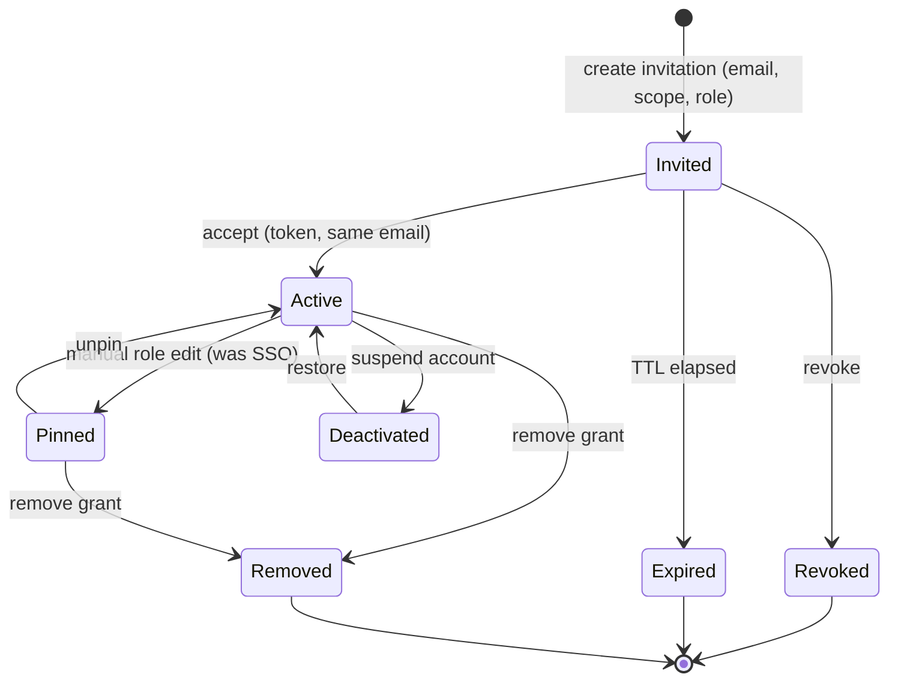

# 05 — Authorization model (RBAC × ABAC)

Parent: [README](README.md) · Prev: [04-findings](04-findings.md) ·
Next: [06-user-journeys](06-user-journeys.md)

This file is the whole rights story: three axes, one capability catalog, the algebra that
combines them, the two-person rules, and how the UI derives every affordance from one
`GET /me/access` answer. It is deliberately independent of [SPEC-174](../174-document-security/),
which owns the *object* axis (which document a reader may see). Here we decide *who may act on
a scope*; there we decide *what a reader may see inside it*.

---

## 1 — Three axes



| Axis | Row | Question it answers | Never answers |
|------|-----|---------------------|---------------|
| **Platform** | `users.role` | May this person operate the deployment? | May they see Legal's documents? |
| **Organization** | `memberships(tenant, NULL, role)` | May they run this company's account? | Which documents exist here? |
| **Workspace** | `memberships(tenant, W, role)` | May they run this workspace? | May they read a `restricted` document? |

A fourth axis exists in the product and is **not** part of this file: **clearance**
(`security_roles` + document `classification` + compartments, SPEC-174). It is evaluated
*after* all three above allow the action, and it can only narrow. See
[§7](#7-where-clearance-fits).

---

## 2 — Role definitions (what each role actually means)

Organization and workspace share the same four role ids. Their meanings differ by axis.

### Organization roles

| Role | Wire id | Level | May | May not |
|------|---------|-------|-----|---------|
| Owner | `owner` | 4 | Everything Admin may, plus: delete the organization, transfer ownership, grant/revoke Owner, change the plan, archive | — |
| Admin | `admin` | 3 | Invite and manage organization members, grant any role ≤ admin **in any workspace of this org**, create/rename/delete workspaces, edit brand, set the model ceiling and org defaults | Grant Owner, delete the organization, change the plan |
| Member | `member` | 2 | Work with knowledge in workspaces they can reach: upload, edit, delete documents, query | Manage members, create workspaces, edit org settings |
| Viewer | `readonly` | 1 | Read documents, graph, answers | Any write, any management |

### Workspace roles

| Role | Wire id | Level | May | May not |
|------|---------|-------|-----|---------|
| Owner | `owner` | 4 | Everything Admin may, plus delete this workspace | Delete the organization, touch a sibling workspace |
| Admin | `admin` | 3 | Invite and manage members **of this workspace**, edit its models and ingestion, manage document labels (SPEC-174 tag writes), rebuild embeddings | Create or delete a workspace, edit org settings |
| Member | `member` | 2 | Upload, edit, delete documents in this workspace, run queries | Manage members, change models |
| Viewer | `readonly` | 1 | Read documents, graph, answers | Any write |

### Platform roles

| Role | Wire id | May | Notes |
|------|---------|-----|-------|
| Platform Admin | `admin` | Everything, in every organization, as support | Label **never** reads "Super Admin" ([LAW-175-17](../175-perfect-settings/15-roles.md)) |
| Standard | `user` | Whatever the org/workspace axes grant; may create an organization if `allow_self_serve_org` | Default for humans |
| Read-only | `readonly` | Account-wide read guard, applied after every other grant | Offboarding |

---

## 3 — The capability catalog

Fourteen capabilities. Each names **one axis**, a **minimum role**, and the **predicate** that
decides it. The predicate is the function the handler already calls — the catalog cannot drift
because it does not restate the rule.

| # | Capability id | Axis | Min | Predicate | Group |
|---|---------------|------|-----|-----------|-------|
| 1 | `platform.deployment.manage` | platform | admin | `Role::Admin` | Deployment |
| 2 | `platform.organizations.list` | platform | admin | `Role::Admin` | Deployment |
| 3 | `platform.organizations.create` | platform | admin | `require_platform_admin` | Deployment |
| 4 | `platform.organizations.delete` | platform | admin | `require_platform_admin` | Deployment |
| 5 | `organization.read` | organization | readonly | `Membership::applies_to(t, None)` | Organization |
| 6 | `organization.settings.manage` | organization | admin | `can_manage_users()` | Organization |
| 7 | `organization.members.manage` | organization | admin | `can_manage_users()` | Organization |
| 8 | `organization.grant_owner` | organization | owner | `r == Owner` | Organization |
| 9 | `organization.delete` | organization | owner | `can_delete_tenant()` | Organization |
| 10 | `organization.workspaces.create` | organization | admin | `can_manage_workspaces()` | Organization |
| 11 | `workspace.read` | workspace | readonly | `applies_to(t, Some(w))` | Workspace |
| 12 | `workspace.content.write` | workspace | member | `can_write()` | Workspace |
| 13 | `workspace.settings.manage` | workspace | admin | `can_manage_workspaces()` | Workspace |
| 14 | `workspace.members.manage` | workspace | admin | `can_manage_users()` | Workspace |
| 15 | `workspace.delete` | workspace | owner | `r == Owner` on the workspace row | Workspace |

Capability 15 is **new** and narrows today's behaviour: `delete_workspace` currently accepts
any `can_manage_workspaces()` on the selected workspace, which includes workspace Admin. The
plan promotes it to workspace Owner only, matching the org rule where only Owner deletes the
scope. This is a behaviour change and is called out in [EC-181-21](12-edge-cases.md).

### The matrix, as the UI renders it

```
 CAPABILITY                        ORG: Owner  Admin  Member  Viewer | WS: Owner  Admin  Member  Viewer
 --------------------------------- ------- ------ ------- ------- | ------- ------ ------- -------
 organization.read                      Y      Y       Y       Y   |    -      -       -       -
 organization.settings.manage           Y      Y       .       .   |    -      -       -       -
 organization.members.manage            Y      Y       .       .   |    -      -       -       -
 organization.workspaces.create         Y      Y       .       .   |    -      -       -       -
 organization.grant_owner               Y      .       .       .   |    -      -       -       -
 organization.delete                    Y      .       .       .   |    -      -       -       -
 workspace.read                         Y      Y       Y       Y   |    Y      Y       Y       Y
 workspace.content.write                Y      Y       Y       .   |    Y      Y       Y       .
 workspace.settings.manage              Y      Y       .       .   |    Y      Y       .       .
 workspace.members.manage               Y      Y       .       .   |    Y      Y       .       .
 workspace.delete                       Y      Y       .       .   |    Y      .       .       .
```

Read the last row carefully: an **organization Admin** may delete any workspace of the
organization (they inherited every workspace grant); a **workspace Admin** may not delete
their own workspace. That asymmetry is intentional and matches Vercel (team admin deletes a
project; project admin does not).

An organization Owner/Admin is an *implicit* member of every workspace in the organization —
`applies_to` returns true when `workspace_id IS NULL`. The matrix shows that inheritance in
the left block.

---

## 4 — The algebra (how a decision is made)



Three properties make this safe:

1. **Platform short-circuits but is recorded.** A platform admin acting inside a customer
   organization is audited as `actor_kind=platform_admin`
   ([LAW-181-9](01-first-principles.md)), because support access is the highest-risk grant in
   the product.
2. **The axis decides which rows are read.** An organization capability never consults a
   workspace grant, and vice versa. This is why
   `get_user_role` filters `workspace_id IS NULL` — it is the feature, not a bug
   ([F-175-25](../175-perfect-settings/04-findings.md)).
3. **Clearance can only subtract.** After every axis allows, the SPEC-174 PDP runs. It cannot
   grant what the axes denied.

### The resolution function (one implementation)

```text
  effective(principal, scope) -> Grants

  platform   = jwt.role == admin
  org_grant  = max(level) over memberships where tenant=t and workspace IS NULL and active
  ws_grants  = { workspace -> max(level) } over memberships where tenant=t and workspace=W
  implicit   = (org_grant >= admin) ? all workspaces : {}

  may(capability, target):
     if platform and capability.axis != organization.owner_only : yes
     if capability.axis == organization : org_grant >= min
     if capability.axis == workspace    :
        level(target.workspace) >= min
        where level(w) = max(ws_grants[w], org_grant if org manages else 0)
```

`GET /me/access` returns exactly the inputs and outputs of that function, so the UI never
needs the algebra:

```json
{
  "user_id": "…",
  "platform": { "role": "user", "admin": false },
  "organization": {
    "id": "…", "name": "Acme", "role": "member", "level": 2,
    "capabilities": ["organization.read"]
  },
  "workspaces": [
    { "id": "…", "name": "Legal",   "slug": "legal",   "role": "admin", "level": 3,
      "capabilities": ["workspace.read","workspace.content.write",
                       "workspace.settings.manage","workspace.members.manage"] },
    { "id": "…", "name": "Finance", "slug": "finance", "role": "readonly", "level": 1,
      "capabilities": ["workspace.read"] }
  ],
  "quota": { "workspaces": { "used": 3, "limit": 10 }, "seats": { "used": 9, "limit": 25 } },
  "can_create": { "organization": false, "workspace": false }
}
```

The UI computes nothing about roles; it reads `capabilities` as a set. `can_create` is the
server's own answer to the two questions the buttons ask, so [LAW-181-3](01-first-principles.md)
is satisfied by construction.

---

## 5 — Two-person rules and invariants

These are enforced server-side in pure functions (`members/guards.rs`) and mirrored in the UI
only to hide impossible options.

| Invariant | Rule | Denial |
|-----------|------|--------|
| **I-1 Last owner** | The only active organization `owner` cannot be demoted, removed or suspended | 409 `last_owner` |
| **I-2 Rank ceiling** | A manager may assign at most their own level, in the scope they manage | 403 `capability_required:…` |
| **I-3 Axis ceiling** | An organization Admin may grant workspace roles ≤ admin, never organization Owner | 403 `capability_required:organization.grant_owner` |
| **I-4 No self-suspend** | A person cannot suspend their own account | 409 `self_suspend` |
| **I-5 Last platform admin** | The only active platform admin cannot be suspended or demoted | 409 `last_platform_admin` |
| **I-6 Grant scope** | A grant's `workspace_id`, when present, must belong to the same tenant | 400 `grant_scope_mismatch` |
| **I-7 Workspace admin cannot escalate** | A workspace Admin cannot grant workspace Owner or any organization grant | 403 |
| **I-8 Owner transfer is atomic** | Promoting B to Owner and demoting A runs in one transaction | — |
| **I-9 SSO pinning** | A manual edit pins the role; the next IdP sign-in does not overwrite it | — |
| **I-10 Deleting a scope needs no other owner** | A workspace with no members may be deleted by an org Admin | — |

### State machine — a grant's life



`Deactivated` is account-level (platform axis) and affects **all** grants at once; `Removed`
is per-grant. That distinction is why the members table shows account status and grant rows
separately.

---

## 6 — Right attribution in the UI

Every affordance maps to exactly one capability. This table is the contract between
[09-ux-ui-spec](09-ux-ui-spec.md) and the API.

| Affordance | Capability | Absent when | Disabled when |
|-----------|-----------|-------------|----------------|
| Header: **New organization** | `platform.organizations.create` | no platform admin | org quota N/A |
| Header: **New workspace** | `organization.workspaces.create` | not org manager | `quota.workspaces.used >= limit` |
| Switcher: switch to org X | `organization.read` on X | not a member | X inactive |
| Switcher: switch to workspace W | `workspace.read` on W | not granted | W inactive |
| Palette: `/members` | `organization.members.manage` **or** any `workspace.members.manage` | neither | — |
| Palette: `Settings → Organization` | `organization.settings.manage` | no | — |
| Palette: `Settings → Deployment` | `platform.deployment.manage` | no | — |
| Org page: **Invite people** | `organization.members.manage` | no | seats full |
| Org page: **Delete organization** | `organization.delete` | no | not last owner |
| Grant editor: role select | per-axis rank ceiling | no | target outranks you |
| WS page: **Invite to this workspace** | `workspace.members.manage` | no | seats full |
| WS page: **Delete workspace** | `workspace.delete` | no | — |
| WS page: model / ingestion editors | `workspace.settings.manage` | no | — |
| WS page: **Access** (labels) | `workspace.settings.manage` | no | enforcement off |
| Upload button | `workspace.content.write` | no | — |

"Absent when" is [LAW-181-3](01-first-principles.md): the element does not exist in the DOM, so
it cannot be reached by keyboard, screen reader or a stale tab. "Disabled when" means the
caller can fix it (quota) and the reason is printed inline.

---

## 7 — Where clearance fits

```text
  Axis 1  Platform       may this person touch the deployment?
  Axis 2  Organization   may they operate this company's account?
  Axis 3  Workspace      may they operate this workspace?
  -------------------------------------------------------------
  Axis 4  Clearance      may they see THIS document?            (SPEC-174)
```

The first three are **capability** checks on a scope. The fourth is an **object** check with an
ordered rank and a compartment set. They compose as `AND`, with clearance last, and clearance
can never widen.

The grant editor therefore links to Access rather than embedding it:

```text
+------------------------------------------------------------------------+
| Aïcha Benali                                          Organization     |
| Organization  Member                                                    |
| Legal         Admin          [ Change v ]  [ Remove ]                   |
| Finance       Viewer         [ Change v ]  [ Remove ]                   |
+------------------------------------------------------------------------+
| + Add a workspace grant                                                |
+------------------------------------------------------------------------+
| What she can see inside a workspace is set by document labels.          |
| [ Open Legal → Access ]                                                 |
+------------------------------------------------------------------------+
```

Two managers with identical grants can see different documents. That is correct, and the copy
says so once instead of pretending otherwise.

---

## 8 — Why this matches the best SaaS

| Product | Organization role | Resource role | Separately grantable | Last-owner guard | Our equivalent |
|---------|-------------------|---------------|----------------------|------------------|----------------|
| **GitHub** | org `owner` / `member` | repo `admin` / `maintain` / `write` / `read` | yes, per team and per repo | yes | axes 2 and 3 |
| **Vercel** | team `owner` / `member` | project access per member | yes | yes | axes 2 and 3 |
| **Slack Enterprise Grid** | org owner / admin | workspace owner / admin / member | yes | yes | axes 2 and 3 |
| **Linear** | workspace admin / member | team membership | yes | n/a | axes 2 and 3 |
| **Stripe** | account `owner` / `admin` / `analyst` / `support` | — | roles only | yes (top role) | axes 1 and 2 |
| **EdgeQuake today** | org owner/admin/member/readonly | *(storage only)* | **no** | yes | — |
| **EdgeQuake SPEC-181** | same four | same four, per workspace | **yes** | yes | all three |

What we copy: the *two-level* grant with an explicit per-resource row, the last-owner guard,
and the rule that the top role cannot orphan the account.
What we do not copy: Vercel's and GitHub's separate "team" object. EdgeQuake's grouping
primitive is the workspace, and adding a team layer would be a third axis with no enforcement
behind it.

Sources: [GitHub organization roles](https://docs.github.com/en/organizations/managing-peoples-access-to-your-organization-with-roles/roles-in-an-organization) ·
[Vercel team roles](https://vercel.com/docs/accounts/team-members-and-roles) ·
[Slack Grid roles](https://slack.com/help/articles/360000120963-Roles-and-permissions-in-the-org-dashboard) ·
[Stripe team roles](https://docs.stripe.com/get-started/account/teams/roles).
