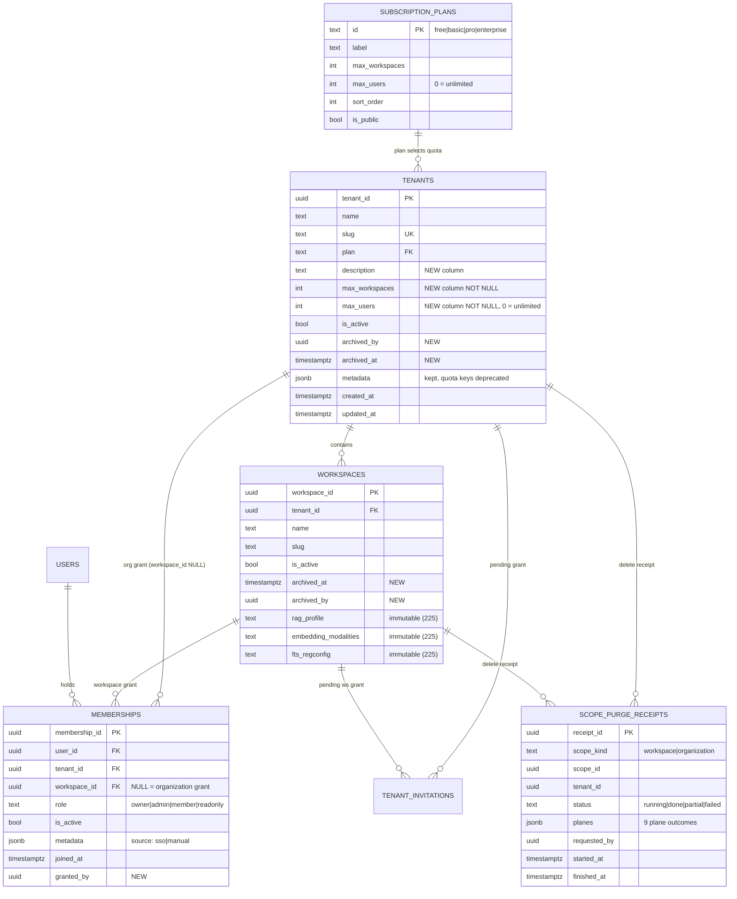

# 07 — Data and database contract (migration 226)

Parent: [README](README.md) · Prev: [06-user-journeys](06-user-journeys.md) ·
Next: [08-api-contract](08-api-contract.md)

Reserved file: `edgequake/migrations/226_spec181_admin.sql`. Manifest entry appended after
`version = 225`, `phase = "expand"`, `lock_class = "ddl_access_exclusive"`,
`compat_serve_max` bumped to `226`.

Every statement is additive and idempotent. No column is dropped, no type is narrowed, no row
is rewritten. The pack ships before any UI reads the new columns, so a rolling deploy is safe.

---

## 1 — Current shape (what we are correcting)

```text
  tenants                              workspaces
  -------------------------------      --------------------------------
  tenant_id     uuid pk                workspace_id  uuid pk
  name          varchar(255)           tenant_id     uuid fk -> tenants
  slug          varchar(100) unique    name          varchar(255)
  settings      jsonb                  slug          varchar(100)
  metadata      jsonb   <-- plan,     description   text
                           max_workspaces,           settings  jsonb
                           max_users,      <--      metadata  jsonb
                           description,             is_active boolean
                           default_llm_*,           rag_profile text
                           pdf_parser_backend,      embedding_modalities text
                           primary_color            fts_regconfig text
  is_active     boolean                                     (225)
  created_at / updated_at
```

Two structural problems:

1. **`tenants.plan`, `max_workspaces`, `max_users`, `description` live in `metadata` (or in a
   dead column from migration 008).** `TenantRow::into_tenant` reads them from jsonb with
   fallbacks `unwrap_or("free")`, `unwrap_or(5)`, `unwrap_or(10)`. The type cannot be enforced
   and the default is wrong ([F-181-06](04-findings.md)).
2. **`memberships` can hold a workspace grant but nothing writes one, and nothing projects
   more than one row per person** ([F-181-05](04-findings.md)).

There is also no plan catalog, no archive timestamp, and no purge receipt.

---

## 2 — Target ER diagram



---

## 3 — Migration 226, statement by statement

### 3.1 Plan catalog

```sql
CREATE TABLE IF NOT EXISTS subscription_plans (
    id              text PRIMARY KEY,          -- 'free' | 'basic' | 'pro' | 'enterprise'
    label           text NOT NULL,
    max_workspaces  integer NOT NULL CHECK (max_workspaces > 0),
    max_users       integer NOT NULL CHECK (max_users >= 0),   -- 0 = unlimited
    sort_order      integer NOT NULL DEFAULT 0,
    is_public       boolean NOT NULL DEFAULT true,
    created_at      timestamptz NOT NULL DEFAULT now()
);

INSERT INTO subscription_plans (id, label, max_workspaces, max_users, sort_order)
VALUES ('free',       'Free',       10,  3,  1),
       ('basic',      'Basic',     100, 10,  2),
       ('pro',        'Pro',       500, 50,  3),
       ('enterprise', 'Enterprise',500,  0,  4)
ON CONFLICT (id) DO NOTHING;
```

`max_users = 0` means unlimited. That replaces `u32::MAX`, which cannot round-trip through a
`CHECK` and does not survive JSON.

### 3.2 Real columns on `tenants`

```sql
ALTER TABLE public.tenants
    ADD COLUMN IF NOT EXISTS plan            text,
    ADD COLUMN IF NOT EXISTS description     text,
    ADD COLUMN IF NOT EXISTS max_workspaces  integer,
    ADD COLUMN IF NOT EXISTS max_users       integer,
    ADD COLUMN IF NOT EXISTS archived_at     timestamptz,
    ADD COLUMN IF NOT EXISTS archived_by     uuid;

-- Backfill from metadata, then from the plan catalog, then a safe floor.
UPDATE public.tenants t
   SET plan = COALESCE(t.plan, NULLIF(t.metadata->>'plan', ''), 'free')
 WHERE t.plan IS NULL;

UPDATE public.tenants t
   SET description = t.metadata->>'description'
 WHERE t.description IS NULL AND t.metadata ? 'description';

UPDATE public.tenants t
   SET max_workspaces = COALESCE(
         NULLIF((t.metadata->>'max_workspaces')::integer, NULL),
         (SELECT p.max_workspaces FROM subscription_plans p WHERE p.id = t.plan),
         5)
 WHERE t.max_workspaces IS NULL;

UPDATE public.tenants t
   SET max_users = COALESCE(
         NULLIF((t.metadata->>'max_users')::integer, NULL),
         (SELECT p.max_users FROM subscription_plans p WHERE p.id = t.plan),
         3)
 WHERE t.max_users IS NULL;

ALTER TABLE public.tenants
    ALTER COLUMN plan           SET NOT NULL,
    ALTER COLUMN plan           SET DEFAULT 'free',
    ALTER COLUMN max_workspaces SET NOT NULL,
    ALTER COLUMN max_workspaces SET DEFAULT 10,
    ALTER COLUMN max_users      SET NOT NULL,
    ALTER COLUMN max_users      SET DEFAULT 3;

ALTER TABLE public.tenants
    DROP CONSTRAINT IF EXISTS tenants_plan_fk;
ALTER TABLE public.tenants
    ADD CONSTRAINT tenants_plan_fk
        FOREIGN KEY (plan) REFERENCES public.subscription_plans(id)
        ON UPDATE CASCADE ON DELETE RESTRICT;

ALTER TABLE public.tenants
    DROP CONSTRAINT IF EXISTS tenants_quota_positive;
ALTER TABLE public.tenants
    ADD CONSTRAINT tenants_quota_positive
        CHECK (max_workspaces > 0 AND max_users >= 0);
```

**Not null, not "safe floor".** A tenant created before 226 with `metadata.max_workspaces`
absent keeps its *old effective* value first (jsonb), then its plan's value. It never gets a
number it did not already behave like.

### 3.3 Archive on workspaces

```sql
ALTER TABLE public.workspaces
    ADD COLUMN IF NOT EXISTS archived_at timestamptz,
    ADD COLUMN IF NOT EXISTS archived_by uuid;

CREATE INDEX IF NOT EXISTS workspaces_live_tenant_idx
    ON public.workspaces (tenant_id, created_at DESC)
    WHERE archived_at IS NULL;
```

`is_active` keeps its current meaning ("usable"); `archived_at` records *why* it is not. A
workspace archived by the quota flow is restorable for 30 days; a soft-inactive row from
before 226 has `archived_at IS NULL` and is treated as a system-disable.

### 3.4 Grant provenance

```sql
ALTER TABLE public.memberships
    ADD COLUMN IF NOT EXISTS granted_by uuid;

CREATE INDEX IF NOT EXISTS memberships_tenant_workspace_role_idx
    ON public.memberships (tenant_id, workspace_id, role)
    WHERE is_active;
```

`granted_by` feeds the audit dialog ("granted by Marc, 3 Feb"). Nullable: pre-226 rows have no
author, and SSO-provisioned rows have the IdP.

### 3.5 Purge receipts

```sql
CREATE TABLE IF NOT EXISTS scope_purge_receipts (
    receipt_id   uuid PRIMARY KEY DEFAULT gen_random_uuid(),
    scope_kind   text NOT NULL CHECK (scope_kind IN ('workspace', 'organization')),
    scope_id     uuid NOT NULL,
    tenant_id    uuid NOT NULL,
    status       text NOT NULL DEFAULT 'running'
                 CHECK (status IN ('running', 'done', 'partial', 'failed')),
    planes       jsonb NOT NULL DEFAULT '{}'::jsonb,
    requested_by uuid,
    started_at   timestamptz NOT NULL DEFAULT now(),
    finished_at  timestamptz
);

CREATE INDEX IF NOT EXISTS scope_purge_receipts_scope_idx
    ON scope_purge_receipts (scope_kind, scope_id, started_at DESC);
```

`planes` is the idempotency ledger:

```json
{ "tasks":        "done",
  "vectors":      {"status":"done","count":18},
  "graph":        {"status":"done","nodes":412,"edges":1903},
  "kv":           {"status":"done","keys":10422},
  "pdf_rows":     {"status":"done","count":37},
  "originals":    {"status":"done","objects":37},
  "decision":     "done",
  "vector_table": "done",
  "row":          "done" }
```

A retry re-runs only planes whose status is not `done`. That is [LAW-181-7](01-first-principles.md)
made idempotent.

**No RLS on this table.** It is written by the purge path, which runs with the operator
role and before/after the scope exists. It holds no document content — only counts and ids —
and it is readable only by a platform admin. A permissive policy would leak the existence of a
tenant id to a member of another tenant, so access is by role, not by row.

### 3.6 Guard: no orphan ownerless organization

```sql
CREATE OR REPLACE FUNCTION public.eq_tenant_requires_owner() RETURNS trigger
LANGUAGE plpgsql AS $$
BEGIN
    -- Only meaningful for live tenants.
    IF NEW.is_active AND NEW.archived_at IS NULL THEN
        IF NOT EXISTS (
            SELECT 1 FROM public.memberships m
             WHERE m.tenant_id = NEW.tenant_id
               AND m.workspace_id IS NULL
               AND m.role = 'owner'
               AND m.is_active
        ) THEN
            RAISE EXCEPTION 'tenant_requires_owner: % has no active owner', NEW.tenant_id
                USING ERRCODE = 'check_violation';
        END IF;
    END IF;
    RETURN NEW;
END $$;
```

Applied **not** on `tenants` (which cannot see the membership inserted later in the same
transaction with a deferred constraint, and would reject the transient state during creation)
but as a `CONSTRAINT TRIGGER ... DEFERRABLE INITIALLY DEFERRED` on `memberships`:

```sql
CREATE OR REPLACE FUNCTION public.eq_org_keeps_an_owner() RETURNS trigger
LANGUAGE plpgsql AS $$
DECLARE t public.tenants;
BEGIN
    SELECT * INTO t FROM public.tenants WHERE tenant_id = COALESCE(OLD.tenant_id, NEW.tenant_id);
    IF NOT FOUND OR NOT t.is_active OR t.archived_at IS NOT NULL THEN
        RETURN COALESCE(NEW, OLD);   -- archive/delete in progress
    END IF;
    IF NOT EXISTS (
        SELECT 1 FROM public.memberships m
         WHERE m.tenant_id = t.tenant_id AND m.workspace_id IS NULL
           AND m.role = 'owner' AND m.is_active
    ) THEN
        RAISE EXCEPTION 'organization_requires_owner: % would have no owner', t.tenant_id
            USING ERRCODE = 'check_violation';
    END IF;
    RETURN COALESCE(NEW, OLD);
END $$;

DROP TRIGGER IF EXISTS trg_org_keeps_an_owner ON public.memberships;
CREATE CONSTRAINT TRIGGER trg_org_keeps_an_owner
    AFTER UPDATE OR DELETE ON public.memberships
    DEFERRABLE INITIALLY DEFERRED
    FOR EACH ROW EXECUTE FUNCTION public.eq_org_keeps_an_owner();
```

This is the database-level twin of `guards.rs::check_remove`. The application guard gives the
good error; the trigger makes it impossible to bypass with a script. It fires **deferred**, so
the create transaction (tenant → workspace → membership) never sees the intermediate state.

### 3.7 Quota guard for workspace inserts

```sql
CREATE OR REPLACE FUNCTION public.eq_workspace_quota_guard() RETURNS trigger
LANGUAGE plpgsql AS $$
DECLARE t public.tenants; used integer;
BEGIN
    SELECT * INTO t FROM public.tenants WHERE tenant_id = NEW.tenant_id FOR UPDATE;
    IF NOT FOUND THEN
        RAISE EXCEPTION 'tenant_missing: %', NEW.tenant_id USING ERRCODE = 'foreign_key_violation';
    END IF;
    SELECT count(*) INTO used
      FROM public.workspaces
     WHERE tenant_id = NEW.tenant_id AND archived_at IS NULL;
    IF used >= t.max_workspaces THEN
        RAISE EXCEPTION 'workspace_quota_reached: % of %', used, t.max_workspaces
            USING ERRCODE = 'check_violation';
    END IF;
    RETURN NEW;
END $$;

DROP TRIGGER IF EXISTS trg_workspace_quota_guard ON public.workspaces;
CREATE TRIGGER trg_workspace_quota_guard
    BEFORE INSERT ON public.workspaces
    FOR EACH ROW EXECUTE FUNCTION public.eq_workspace_quota_guard();
```

`FOR UPDATE` on the tenant row serializes concurrent inserts for the same organization, which
is exactly what [F-181-06](04-findings.md) lacks. Two concurrent creates now produce one
`workspace_quota_reached`, deterministically.

**Cost:** one extra row lock per workspace insert. Workspace creation is a rare, human-paced
operation; the lock is held for microseconds and never on a hot path.

**Compatibility:** the trigger applies to every insert, including the bootstrap default
workspace. The default tenant is seeded with `max_workspaces = 10`, so the first insert
succeeds.

### 3.8 Backfill correctness for existing grants

No change. `memberships` already holds what it holds; 226 only adds `granted_by`.

---

## 4 — Query patterns the new surfaces use

### Organization list for a platform admin (with usage)

```sql
SELECT t.tenant_id, t.name, t.slug, t.plan, t.max_workspaces, t.max_users,
       t.is_active, t.archived_at,
       (SELECT count(*) FROM workspaces w
         WHERE w.tenant_id = t.tenant_id AND w.archived_at IS NULL) AS workspaces_used,
       (SELECT count(DISTINCT user_id) FROM memberships m
         WHERE m.tenant_id = t.tenant_id AND m.is_active) AS members_used
  FROM tenants t
 ORDER BY t.created_at DESC
 LIMIT $1 OFFSET $2;
```

Two correlated subqueries over indexed columns. At 1000 tenants × 50 workspaces × 200
memberships the cost is sub-10 ms. If it ever matters, both become materialized counters with
triggers; the wire shape does not change.

### Grants for one person

```sql
SELECT membership_id, workspace_id, role, is_active, granted_by, joined_at
  FROM memberships
 WHERE tenant_id = $1 AND user_id = $2
 ORDER BY workspace_id NULLS FIRST;
```

`NULLS FIRST` puts the organization grant at the top, which is the order the editor renders.

### Effective level for a workspace

```sql
SELECT max(CASE role WHEN 'owner' THEN 4 WHEN 'admin' THEN 3
                     WHEN 'member' THEN 2 ELSE 1 END) AS level
  FROM memberships
 WHERE tenant_id = $1 AND user_id = $2 AND is_active
   AND (workspace_id IS NULL OR workspace_id = $3);
```

One statement, both axes, which is what `me/access` needs per workspace.

---

## 5 — Indexes added, and why

| Index | Serves |
|-------|--------|
| `workspaces_live_tenant_idx (tenant_id, created_at DESC) WHERE archived_at IS NULL` | switcher list, quota count, tenant delete enumeration |
| `memberships_tenant_workspace_role_idx (tenant_id, workspace_id, role) WHERE is_active` | members directory filter by workspace, effective-level query |
| `scope_purge_receipts_scope_idx` | receipt polling |

Existing and sufficient: `idx_tenants_slug`, `memberships_user_tenant_workspace_uidx`,
`idx_workspaces_tenant`.

---

## 6 — Rollback

226 is expand-only, so the previous binary runs on the new schema:

| Change | Old binary behaviour |
|--------|---------------------|
| New nullable columns | ignored |
| `metadata` retained | still read (and still written by `build_tenant_metadata`) → dual write is safe |
| `plan` FK | old writes always send a valid enum value |
| `archived_at` trigger on quota | old inserts count against the limit exactly as before |
| Owner trigger (deferred) | old create path inserts no owner → **the first org it creates fails** |

The last row is the one incompatibility, and it is the bug this pack exists to fix. The wave
order handles it: **W1** ships the `create_tenant` ownership fix **before** migration 226 is
applied. [13-implementation-plan](13-implementation-plan.md#ordering) states the ordering as a
gate, and `spec181_owner_trigger_preconditions` asserts that every existing tenant has an owner
before the trigger is created — if one does not, the migration backfills a platform-admin owner
row rather than failing.

```sql
-- Precondition inside 226, before the trigger is created.
INSERT INTO public.memberships (user_id, tenant_id, workspace_id, role, is_active, granted_by)
SELECT u.user_id, t.tenant_id, NULL, 'owner', true, NULL
  FROM public.tenants t
  JOIN LATERAL (
        SELECT user_id FROM public.users
         WHERE role = 'admin' AND is_active ORDER BY created_at LIMIT 1
       ) u ON true
 WHERE t.is_active AND t.archived_at IS NULL
   AND NOT EXISTS (
        SELECT 1 FROM public.memberships m
         WHERE m.tenant_id = t.tenant_id AND m.workspace_id IS NULL
           AND m.role = 'owner' AND m.is_active)
ON CONFLICT DO NOTHING;
```

An ownerless live organization predates the fix; giving it the bootstrap admin as Owner is the
only non-destructive repair, and it is logged.
