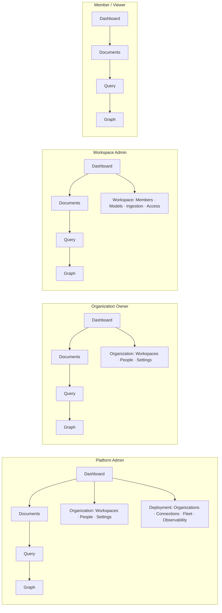

# 09 — UX / UI specification (wireframes W-01 … W-16)

Parent: [README](README.md) · Prev: [08-api-contract](08-api-contract.md) ·
Next: [10-frontend-architecture](10-frontend-architecture.md)

The words in these wireframes are the copy that ships. A designer may change spacing, weight
and icon. They may not add a second place that creates a scope
([LAW-181-15](01-first-principles.md)), and they may not remove an inherited-value row
([LAW-181-13](01-first-principles.md)).

Visual language: [11-design-system](11-design-system.md). Access rules for every control:
[05-authorization-model §6](05-authorization-model.md#6--right-attribution-in-the-ui).

---

## Information architecture

```text
  ┌─ Header ────────────────────────────────────────────────────────────────────┐
  │  [Organization ▾] [Workspace ▾]        ⌘K        status   theme   avatar     │
  └─────────────────────────────────────────────────────────────────────────────┘
  ┌─ Sidebar ───────────┐ ┌─ Content ────────────────────────────────────────────┐
  │  Acme  ▾            │ │                                                      │
  │                     │ │                                                      │
  │  WORKSPACE          │ │   scoped by the SELECTED WORKSPACE                   │
  │    Dashboard        │ │                                                      │
  │    Documents        │ │                                                      │
  │    Query            │ │                                                      │
  │    Knowledge Graph  │ │                                                      │
  │    Knowledge        │ │                                                      │
  │                     │ │                                                      │
  │  ORGANIZATION       │ │   scoped by the SELECTED ORGANIZATION                │
  │    Workspaces       │ │                                                      │
  │    People           │ │                                                      │
  │    Settings         │ │                                                      │
  │                     │ │                                                      │
  │  DEPLOYMENT         │ │   platform only                                     │
  │    Organizations    │ │                                                      │
  │    Connections      │ │                                                      │
  │    Fleet            │ │                                                      │
  │    Observability    │ │                                                      │
  │                     │ │                                                      │
  │  ── v0.38.3         │ │                                                      │
  └─────────────────────┘ └──────────────────────────────────────────────────────┘
```

Three group headings, one per axis. The heading of a group *is* its scope: a workspace section
writes the selected workspace, an organization section writes the selected organization, a
deployment section writes the installation. Today the sidebar has `Primary / Knowledge /
System`, which mixes all three ([F-181-09](04-findings.md)).

### Navigation tree by persona



```text
  PERSONA          SEES GROUP HEADINGS
  ---------------  ---------------------------------------------------------------
  Platform Admin   WORKSPACE + ORGANIZATION + DEPLOYMENT
  Org Owner/Admin  WORKSPACE + ORGANIZATION
  Workspace Admin  WORKSPACE (+ a workspace-scoped Members entry for that workspace)
  Member / Viewer  WORKSPACE only
```

A group heading with no reachable item is not rendered. That is
`visibleScopes(access)` from [SPEC-175](../../edgequake_webui/src/lib/settings/registry.ts),
promoted from settings to the whole app.

---

## W-01 Header switcher

Two popovers, one chip. The chip names both scopes, because "which organization am I in" is
the most common orientation failure in a multi-tenant product.

```text
+------------------------------------------------------------------------------+
|  [■ Acme / Legal ▾]                                        ⌘K   ●   ☾   (AL)  |
+------------------------------------------------------------------------------+
          |
          +-- click ---------------------------------------------------------+
                                                                             |
+---------------------------------------------------------------------------+
| Search organizations and workspaces…                                       |
+---------------------------------------------------------------------------+
| ORGANIZATION                                                               |
|  ✓ Acme                                              3 workspaces          |
|    Globex Holdings                                                         |
|  + New organization                          (platform admin only)         |
+---------------------------------------------------------------------------+
| WORKSPACE  ·  Acme                                            3 of 10 used |
|  ✓ Legal                              Admin                                |
|    Finance                            Viewer                               |
|    Research                           Admin                                |
|    Archived (1)                       ›                                    |
|  + New workspace                          (org admin, quota remaining)     |
+---------------------------------------------------------------------------+
|  Ask an admin to create a workspace                     (member only)      |
+---------------------------------------------------------------------------+
```

Rules:

| Caller | Row `+ New organization` | Row `+ New workspace` |
|--------|--------------------------|----------------------|
| Platform admin | present | present |
| Org Owner / Admin | **absent** | present, or **disabled** with the quota line when full |
| Member / Viewer | absent | absent; the hint line replaces it |

The per-workspace role chip on the right is new: it answers "what am I here?" without opening
Settings. Sourced from `me/access.workspaces[].role`.

Keyboard: `↓/↑` move, `Enter` selects, `⌘.` opens the switcher, `⌘⇧O` = new organization,
`⌘⇧W` = new workspace (both capability-gated).

---

## W-02 Empty state — no organization

```text
+-------------------------------------------------------------------------+
|                                                                         |
|                          ┌───────────────┐                              |
|                          │   ◇  ◇   ◇    │                              |
|                          │     ◇         │                              |
|                          └───────────────┘                              |
|                                                                         |
|                        Create your organization                         |
|                                                                         |
|           An organization holds your workspaces, your people             |
|           and your billing plan. You will be its owner.                  |
|                                                                         |
|                    [ Create organization ]                              |
|                                                                         |
|           Joining a team? Ask an owner for an invitation link.           |
|                                                                         |
+-------------------------------------------------------------------------+
```

Variant for a caller who cannot create ([F-181-10](04-findings.md)):

```text
|                        You're not in an organization yet                 |
|                                                                         |
|           Ask an owner of the organization you work with to add          |
|           you, or to send you an invitation link.                       |
|                                                                         |
|                       [ Copy request message ]                          |
|                                                                         |
|           Signed in as tom@acme.test                                     |
```

The "Copy request message" copies:

```text
Hi — please add tom@acme.test to our EdgeQuake organization.
I need access to (workspace name). Thanks.
```

No create button, no spinner, no "welcome, create your first tenant" when the product is not
empty for someone else.

---

## W-03 Create workspace — the three-decision dialog

```text
+---------------------------------------------------------------------------+
|  Create a workspace                                                   ✕   |
|  Workspaces keep documents and knowledge apart.                           |
+---------------------------------------------------------------------------+
|  3 of 10 workspaces used           ■■■□□□□□□□                             |
+---------------------------------------------------------------------------+
|                                                                           |
|  Name                                                                     |
|  [ Legal                                                              ]    |
|  /w/legal                                                                 |
|                                                                           |
|  Retrieval type                                    ⓘ this is permanent    |
|  ( • )  Graph          Entities and relations. Slower ingest.              |
|                        Better for questions that connect facts.            |
|  (   )  Normal         Text and keywords only. No graph. Faster ingest.    |
|                        Enough for lookup.                                  |
|                                                                           |
|  Models                                                                    |
|  ● Inherit from Acme                                                       |
|      Extract  gpt-5-nano · openai                                          |
|      Embed    text-embedding-3-small · openai · 1536                       |
|      Vision   not set                                                      |
|  ( )  Choose models for this workspace                                     |
|                                                                           |
|  ┌─────────────────────────────────────────────────────────────────────┐  |
|  │ ▸ Tune later    Parsing · Chunking · Extract budget · Entity types    │  |
|  │                 Language · Decision engine       4 inherited          │  |
|  └─────────────────────────────────────────────────────────────────────┘  |
|                                                                           |
+---------------------------------------------------------------------------+
|                                                    [ Cancel ]  [ Create ] |
+---------------------------------------------------------------------------+
```

Counts: **3 decisions** (name, retrieval, models). Today: 8 steps, 3 of which are repeated
`Next` clicks with no decision at all ([F-181-03](04-findings.md)).

### Quota-blocked variant

```text
+---------------------------------------------------------------------------+
|  10 of 10 workspaces used          ■■■■■■■■■■                             |
|                                                                           |
|  Your plan allows 10 workspaces. Archive one you no longer need, or ask    |
|  your platform admin to raise the limit.                                   |
|  [ Archive a workspace → ]                                                 |
+---------------------------------------------------------------------------+
|  Name        [ Legal                                      ]  (kept)       |
|  …                                                                        |
+---------------------------------------------------------------------------+
|                                                  [ Cancel ]  [ Create ]⊘  |
+---------------------------------------------------------------------------+
```

The form stays editable; only the final button is inert, with the reason above it. Nothing the
operator typed is discarded ([LAW-181-14](01-first-principles.md)).

### The Advanced drawer

```text
  Tune later                                                        4 set · 5 inherited
  ┌───────────────────────────────────────────────────────────────────────────────┐
  │ Parsing          PDF parser        Inherited from Acme · vision       [ Edit ] │
  │ Chunking         mode, size        Inherited · adaptive 1200/100      [ Edit ] │
  │ Extract budget   entities, records Inherited · 40 / 100               [ Edit ] │
  │ Entity types     PERSON, ORG, …    Inherited from Acme               [ Edit ] │
  │ Language         extraction        Inherited · English                [ Edit ] │
  │ Decision         mode, model       Inherited · enabled, tev1:0.8b     [ Edit ] │
  └───────────────────────────────────────────────────────────────────────────────┘
```

Each row is one line. Editing opens the same field components the 8-step wizard already owns
(`components/onboarding/steps/*`), so nothing is re-implemented — the wizard's *order* goes
away, its *fields* stay.

---

## W-04 Create organization

```text
+---------------------------------------------------------------------------+
|  Create an organization                                               ✕   |
|  An organization holds workspaces, people and one plan.                    |
+---------------------------------------------------------------------------+
|  Name                                                                     |
|  [ Globex Holdings                                                    ]    |
|  /globex                                                                   |
|                                                                           |
|  Owner                                                                    |
|  ( • )  Me — Dana Reyes                                                    |
|  (   )  Someone else    [ ines@globex.test                          ]      |
|         They receive an invitation. You stay owner until they accept.      |
|                                                                           |
|  Default models for new workspaces                                         |
|  ( • )  Server defaults      gpt-5-nano · text-embedding-3-small          |
|  (   )  Choose now                                                         |
|                                                                           |
|  ┌─────────────────────────────────────────────────────────────────────┐  |
|  │ ▸ Advanced    Plan · Brand color · PDF parser                        │  |
|  └─────────────────────────────────────────────────────────────────────┘  |
+---------------------------------------------------------------------------+
|                        [ Cancel ]   [ Create organization ]               |
+---------------------------------------------------------------------------+
```

**Why the owner field exists in the platform-admin flow and not the self-serve flow:** a
platform admin creates organizations *for someone else*, and the most common failure is
"created for me, now I own the customer's data". Naming the owner at creation removes a
second transaction (transfer ownership) and an audit ambiguity.

### Self-serve variant (platform role `user`, `allow_self_serve_org` on)

```text
|  Create an organization                                                   |
|                                                                           |
|  Name  [ Globex Holdings                                            ]      |
|                                                                           |
|  You will be its owner. You can invite people after.                      |
|                                                                           |
|                              [ Cancel ]   [ Create organization ]         |
```

One field. The owner and the models are implied.

---

## W-05 Confirmation after create

A dialog that closes into a toast is a dead end. This card replaces it and names the *next*
action.

```text
+---------------------------------------------------------------------------+
|                            ✓                                              |
|                                                                           |
|                    Globex Holdings is ready                              |
|                                                                           |
|  Owner              Dana Reyes (you)                                      |
|  Default workspace  Default Workspace · /w/default                        |
|  Plan               Free · 10 workspaces, 3 people                        |
|                                                                           |
|            [ Invite people ]        [ Upload documents ]                  |
|                                                                           |
|  Or switch to it later from the organization menu in the header.          |
+---------------------------------------------------------------------------+
```

For a workspace:

```text
+---------------------------------------------------------------------------+
|                            ✓                                              |
|                                                                           |
|                       Legal is ready                                     |
|                                                                           |
|  Retrieval   Graph                                                        |
|  Models      Inherited from Acme (gpt-5-nano, text-embedding-3-small)     |
|  Plan        4 of 10 workspaces used                                      |
|                                                                           |
|         [ Upload documents ]      [ Invite people ]      [ Tune settings ] |
+---------------------------------------------------------------------------+
```

---

## W-06 Organization page (Organization Owner)

```text
+---------------------------------------------------------------------------+
|  Acme Research                                       Owner                 |
|  acme · Free plan · 3 of 10 workspaces · 9 of 25 people                   |
|                                     [ Invite people ]  [ New workspace ]  |
+---------------------------------------------------------------------------+
|  Workspaces  |  People  |  Settings                                       |
+---------------------------------------------------------------------------+
|                                                                           |
|  Legal                                        Graph · 412 documents       |
|  Admin: Marc, Aïcha          Members: 14            [ Open ]  [ ⋯ ]       |
|                                                                           |
|  Finance                                      Normal · 88 documents       |
|  Admin: Marc                 Members: 6             [ Open ]  [ ⋯ ]       |
|                                                                           |
|  Research                                     Graph · 1,204 documents     |
|  Admin: Marc                 Members: 3             [ Open ]  [ ⋯ ]       |
|                                                                           |
|  Archived (1)  ›                                                          |
+---------------------------------------------------------------------------+
```

Row menu `⋯`: Rename · Members · Models · Archive · Delete (Delete absent unless Owner).
This is the page that does not exist today: there is no organization home.

---

## W-07 Platform admin — Deployment > Organizations

```text
+---------------------------------------------------------------------------+
|  Organizations                                       Platform admin        |
|  Every organization on this deployment.                                   |
|                                          [ Search ]        [ New ]        |
+---------------------------------------------------------------------------+
|  ORGANIZATION        PLAN        WORKSPACES   PEOPLE    STATUS    CREATED   |
|  Acme Research       Free        3 / 10       9 / 25    Active    12 Feb    |
|  Globex Holdings     Pro         41 / 500     180/ 50   Active    3 Mar     |
|  Initech             Basic       12 / 100     4 / 10    Active    8 Jan     |
|  Old Trial           Free        2 / 10       1 / 25    Archiving 2 Feb ⏳   |
+---------------------------------------------------------------------------+
|  4 organizations · 58 workspaces · 194 people                             |
+---------------------------------------------------------------------------+
```

The `WORKSPACES` and `PEOPLE` cells are the `used / limit` meter. A tenant over its people
limit (Globex: 180 of 50) is drawn in amber — the limit was lowered after the fact, which the
admin can see and act on. Today this data exists only in a small card inside
Observability ([`AdminQuotaSection`](../../edgequake_webui/src/components/settings/admin-quota-section.tsx)),
with no tenant list, no create, no delete.

---

## W-08 Delete organization — typed confirmation

```text
+---------------------------------------------------------------------------+
|  Delete Globex Holdings?                                              ✕   |
+---------------------------------------------------------------------------+
|  This cannot be undone. Everything below is destroyed:                    |
|                                                                           |
|    3 workspaces          ·  412 documents                                |
|    1,903 graph edges     ·  18 vector tables                             |
|    37 original PDFs      ·  340 MB in object storage                     |
|                                                                           |
|  Type the slug to confirm:                                                |
|  [ globex                                                     ]           |
|                                                                           |
|  ┌─────────────────────────────────────────────────────────────────────┐  |
|  │ A purge receipt is kept for 30 days so support can prove what was    │  |
|  │ removed. Your platform admin is notified.                            │  |
|  └─────────────────────────────────────────────────────────────────────┘  |
+---------------------------------------------------------------------------+
|                                    [ Cancel ]  [ Delete organization ]⊘   |
+---------------------------------------------------------------------------+
```

Then progress, per plane, in place of the dialog:

```text
|  Deleting Globex Holdings…                                    4 of 9      |
|  ✓ Tasks    ✓ Vectors (18)   ✓ Graph (1,903)   ✓ Knowledge index          |
|  ✓ PDF records   ⟳ Originals (37)   · Decision cache   · Vector table      |
|  · Organization record                                                    |
|                                                          [ Run in background ]|
```

---

## W-09 Grant editor

```text
+---------------------------------------------------------------------------+
|  Aïcha Benali                                                ✕            |
|  aicha@acme.test · Active · Signed in 2 hours ago                          |
+---------------------------------------------------------------------------+
|  GRANTS                                                        [+ Add]     |
|                                                                           |
|  ORGANIZATION                                                             |
|  [ Owner ▾ ]   Acme Research                    granted by Marc · 3 Feb    |
|                                                 [ Remove ]                |
|                                                                           |
|  WORKSPACES                                                               |
|  [ Admin ▾ ]   Legal                            granted by Marc · 3 Feb    |
|                                                 [ Remove ]                |
|  [ Viewer ▾ ]  Finance                          granted by Marc · 3 Feb    |
|                                                 [ Remove ]                |
|                                                                           |
|  + Add a workspace grant                                                  |
+---------------------------------------------------------------------------+
|  What she can see inside a workspace is set by document labels.            |
|  [ Open Legal → Access ]                                  (SPEC-174)      |
+---------------------------------------------------------------------------+
|                                        [ Suspend account ]   [ Done ]     |
+---------------------------------------------------------------------------+
```

`Suspend account` is platform-only. The role selects are filtered by the actor's rank in that
scope ([I-2](05-authorization-model.md#5--two-person-rules-and-invariants)), so an Admin never
sees `Owner` in the organization select, and a workspace Admin never sees more than `Admin`.

Disabled-with-reason state on the last owner:

```text
|  [ Owner ▾ ]⊘  Acme Research                     ⓘ Acme needs a second    |
|                                                   owner before this one   |
|                                                   can change.             |
|                                                   [ Promote someone ]     |
```

---

## W-10 Invite — scope first

```text
+---------------------------------------------------------------------------+
|  Invite someone                                                       ✕   |
+---------------------------------------------------------------------------+
|  Email                                                                    |
|  [ tom@acme.test                                                      ]    |
|                                                                           |
|  Add to                                                                   |
|  ( • )  The whole organization        Acme Research                       |
|  (   )  One workspace                 [ Legal ▾ ]                         |
|                                                                           |
|  Role                                                                     |
|  ( • )  Member    Uploads, edits and asks questions                       |
|  (   )  Admin     Also manages people, models and settings                |
|  (   )  Viewer    Reads and asks questions only                           |
|         Owner is not offered: only an owner may create another owner.     |
|                                                                           |
|  9 of 25 seats used                                                       |
+---------------------------------------------------------------------------+
|                                  [ Cancel ]   [ Create invite link ]      |
+---------------------------------------------------------------------------+
```

Then the one-time link panel, unchanged from [SPEC-169](../../edgequake_webui/src/components/members/share-link-panel.tsx).

---

## W-11 Members — one person, many grants

```text
+---------------------------------------------------------------------------+
|  People                                             9 active · 2 pending  |
|  9 of 25 seats                                            [ Invite ]      |
+---------------------------------------------------------------------------+
|  [ Search…              ]  Scope [ Any ▾ ]  Role [ Any ▾ ]  Status [ Any ]|
+---------------------------------------------------------------------------+
|  PERSON                 SCOPE                                 ROLE    ⋯   |
|  Ada Lovelace (you)     Organization                          Owner       |
|  Marc Weber             Organization                          Owner       |
|                         Legal                                 Admin       |
|                         Finance                               Admin       |
|  Aïcha Benali           Organization                          Member      |
|                         Legal                                 Admin       |
|                         +1 more                                           |
|  Tom Okafor             Legal                                 Member      |
|  Ruth Ibarra            —                                     —           |
|  grace@acme.test        Organization                          Admin   Pending|
+---------------------------------------------------------------------------+
```

Today this table has a single `Role` column fed by `primary_membership`, so the middle three
rows above collapse to `Member`, `Member`, `Member` ([F-181-05](04-findings.md)).

The `SCOPE` filter is what makes the workspace axis usable: "show me everyone who can touch
Finance" is one click.

---

## W-12 Workspace-scoped members (Workspace Admin)

```text
+---------------------------------------------------------------------------+
|  Legal / Members                                     Workspace admin       |
+---------------------------------------------------------------------------+
|  ┌─────────────────────────────────────────────────────────────────────┐  |
|  │ You administer Legal. Organization membership is managed by Acme's   │  |
|  │ owners. You can add people to Legal.                    [ Ask Marc ] │  |
|  └─────────────────────────────────────────────────────────────────────┘  |
+---------------------------------------------------------------------------+
|  14 people can open Legal                          [ Invite to Legal ]    |
+---------------------------------------------------------------------------+
|  PERSON                 ROLE                                   ⋯         |
|  Marc Weber             Organization Admin (inherited)                   |
|  Aïcha Benali (you)     Admin                                            |
|  Tom Okafor             Member                                           |
|  Ruth Ibarra            Viewer                                           |
+---------------------------------------------------------------------------+
|  No delete, no create, no organization people.                           |
+---------------------------------------------------------------------------+
```

The `(inherited)` marker is the visible form of `applies_to(tenant, NULL)`. An inherited row
cannot be edited here — removing it would remove organization membership, which this person
does not administer.

---

## W-13 Refusal states

| Situation | Drawing |
|-----------|---------|
| Caller opens `/settings/deployment/*` without platform admin | redirect to the caller's landing page (no flash: the gate resolves before render) |
| Caller opens `/organization` without org manager | redirect to `/` |
| Workspace Admin opens Finance `/members` | [W-12](#w-12-workspace-scoped-members-workspace-admin) with `Finance` and the banner reading *"You do not administer Finance."*, invite absent |
| `?create=organization` forced for a non-admin | full-page state: title *"Only a platform administrator can create an organization."* + `[ Back to dashboard ]` |
| Quota full | [W-03](#quota-blocked-variant) |
| Slug taken | inline under the field: *"Globex Holdings already exists in this organization. [Open it]"* |
| Server 500 | dialog stays open, fields kept, banner *"Could not create the workspace. The server said: …"* + `[ Retry ]` |

Every row is a designed state, not an error boundary.

---

## W-14 Narrow screens (< 768px)

```text
+---------------------------------+
|  ☰   Acme / Legal ▾        (AL) |
+---------------------------------+
|  Create a workspace             |
|  3 of 10 used  ■■■□□□□□□□       |
|                                 |
|  Name                           |
|  [ Legal                    ]   |
|  /w/legal                       |
|                                 |
|  Retrieval type        permanent|
|  ( • ) Graph                    |
|        Entities and relations…  |
|  (   ) Normal                   |
|        Text and keywords only…  |
|                                 |
|  Models                         |
|  ● Inherit from Acme            |
|  ( ) Choose                     |
|                                 |
|  ▸ Tune later           4/9     |
+---------------------------------+
|  [ Cancel ]      [ Create ]     |
+---------------------------------+
```

The drawer becomes a full-screen sheet. Everything else stays in the same order, so the
thumb reaches `Create` at the bottom edge.

---

## Copy deck (the words that ship)

| Key | Copy |
|-----|------|
| `admin.create.org.title` | Create an organization |
| `admin.create.org.lead` | An organization holds workspaces, people and one plan. |
| `admin.create.ws.title` | Create a workspace |
| `admin.create.ws.lead` | Workspaces keep documents and knowledge apart. |
| `admin.create.owner.self` | Me — {{name}} |
| `admin.create.owner.other` | Someone else |
| `admin.create.owner.inviteHint` | They receive an invitation. You stay owner until they accept. |
| `admin.create.retrieval.graph` | Graph — entities and relations. Better for questions that connect facts. |
| `admin.create.retrieval.normal` | Normal — text and keywords only. Enough for lookup. |
| `admin.create.retrieval.permanent` | This is permanent |
| `admin.create.models.inherit` | Inherit from {{organization}} |
| `admin.create.tuneLater` | Tune later |
| `admin.quota.workspaces` | {{used}} of {{limit}} workspaces used |
| `admin.quota.seats` | {{used}} of {{limit}} seats used |
| `admin.quota.full` | Your plan allows {{limit}} workspaces. Archive one you no longer need, or ask your platform admin to raise the limit. |
| `admin.created.org.title` | {{name}} is ready |
| `admin.created.ws.title` | {{name}} is ready |
| `admin.delete.title` | Delete {{name}}? |
| `admin.delete.cannotUndo` | This cannot be undone. Everything below is destroyed: |
| `admin.delete.typeSlug` | Type the slug to confirm |
| `admin.delete.receipt` | A purge receipt is kept for 30 days so support can prove what was removed. |
| `admin.grant.add` | Add a workspace grant |
| `admin.grant.clearanceHint` | What she can see inside a workspace is set by document labels. |
| `admin.invite.scope` | Add to |
| `admin.invite.scope.org` | The whole organization |
| `admin.invite.scope.ws` | One workspace |
| `admin.invite.ownerHidden` | Owner is not offered: only an owner may create another owner. |
| `admin.empty.noOrg.title` | You're not in an organization yet |
| `admin.empty.noOrg.body` | Ask an owner of the organization you work with to add you, or to send you an invitation link. |
| `admin.empty.copyRequest` | Copy request message |
| `admin.empty.noWorkspace.title` | You don't have access to a workspace in {{organization}} yet |
| `admin.wsAdmin.banner` | You administer {{workspace}}. Organization membership is managed by {{organization}}'s owners. You can add people to {{workspace}}. |
| `admin.refused.org` | Only a platform administrator can create an organization. |
| `admin.refused.ws` | Only an organization owner or admin can create workspaces. |

Ship `en`, `fr`, `zh` in the same commit as the UI strings, matching
[SPEC-158](../158-entreprise-grade-authentication/lenses/LENS-ux-ui.md) practice. The
repository already carries `src/locales/{en,fr,zh}.json`.

---

## Interaction contract

| Gesture | Behaviour |
|---------|-----------|
| `⌘K` → "new workspace" | opens [W-03](#w-03-create-workspace--the-three-decision-dialog), unless the capability is missing (then the command is absent from the list) |
| `Esc` in a dialog with edits | discard confirm, not silent close |
| `Enter` in the Name field | submits (the only field marked `data-wizard-enter`) |
| Tab through [W-03](#w-03-create-workspace--the-three-decision-dialog) | Name → retrieval radio → models radio → Tune later → Cancel → Create; the drawer traps focus while open |
| Focus on dialog open | Name field, `select()`d if prefilled |
| Focus on refusal | the role `alert` region announcing the reason, then the field to fix |
| Focus on close | the control that opened it |
| `⌘⇧O` / `⌘⇧W` | create organization / workspace (gated) |
| Screen reader | `role="dialog"` + `aria-labelledby` on the title, `aria-describedby` on the lead, `aria-live="polite"` on the quota strip |

Every one of these is asserted in
[14-e2e-test-matrix](14-e2e-test-matrix.md#keyboard--a11y-gates), matching the
[SPEC-168](../168-perfect-ui/03-keyboard-spec.md) contract.

---

## What each screen states, in one line

| Screen | The one sentence a user should be able to say after it |
|--------|--------------------------------------------------------|
| W-01 | "I am in Acme, working on Legal, and I can tell what my role is." |
| W-02 | "The product is empty for me, or I need an invitation — and I know which." |
| W-03 | "Three choices create a workspace, and everything else is inherited and visible." |
| W-04 | "I know exactly who will own this organization." |
| W-05 | "I know what was created and what to do next." |
| W-06 | "This is my organization, its workspaces, its plan and its people." |
| W-07 | "This is every customer on the box, and how full each one is." |
| W-08 | "I know what I am about to destroy, and I can watch it happen." |
| W-09 | "This person's rights are exactly these rows." |
| W-10 | "This person joins this scope with this role." |
| W-11 | "I can find anyone who can touch a given workspace." |
| W-12 | "I administer one workspace, and the page says so." |
