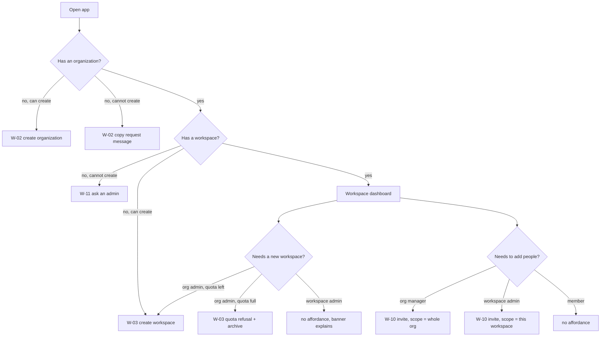

# Lens — UX / UI Designer

Parent: [README](../README.md) · Spec: [09](../09-ux-ui-spec.md) · [11](../11-design-system.md)

## The experience principles

1. **A person always knows which two things they are inside.** Organization and workspace, both
   named, both switchable, both showing their role. The chip does this in 30 characters.
2. **Rights are never a surprise.** If a control cannot succeed, it is not drawn. The one
   exception is quota, which is drawn disabled *with the fix*, because the person can act on it.
3. **Short is respectful.** Three decisions create a workspace. Everything else is inherited and
   printed, or one drawer away.
4. **Deleting is a ceremony, not a click.** Type the slug, see the counts, watch the planes.
5. **Empty is designed.** Every "nothing here" is a drawn state with exactly one action.

## The twelve journeys as flows

Every branch is designed. There is no branch that shows a spinner forever, an error boundary, or
a button that 403s.

## The refusal taxonomy (the most important table in this file)

| Situation | Element | Why this shape |
|-----------|---------|----------------|
| You lack the role | **absent** | A disabled button with a "you can't" tooltip is a dead end that teaches nothing. Absence plus a group heading that changes shape teaches the model. |
| You lack the role, but you are *in* the section | **drawn state with a sentence** ([W-12](../09-ux-ui-spec.md#w-12-workspace-scoped-members-workspace-admin)) | The person navigated here deliberately; silence would be a lie. |
| Quota is full | **disabled + fix** | The person can archive. So we say so, and we link to the fix. |
| Server refused (race, slug) | **inline, field-scoped** | The error belongs next to its cause, and the fields must survive. |
| Server failed (500) | **dialog stays open, banner + retry** | Losing a filled form to a transient error is unforgivable. |
| The scope was deleted under you | **full state, selection cleared** | Not a toast on a broken page. |

## Screen inventory with the primary action

| Screen | Primary action | Secondary | Never present |
|--------|---------------|-----------|--------------|
| [W-01](../09-ux-ui-spec.md#w-01-header-switcher) switcher | switch | new organization / new workspace | a create row you cannot use |
| [W-02](../09-ux-ui-spec.md#w-02-empty-state--no-organization) no-org | create organization | copy request | — |
| [W-03](../09-ux-ui-spec.md#w-03-create-workspace--the-three-decision-dialog) create workspace | Create | Tune later | a stepper |
| [W-04](../09-ux-ui-spec.md#w-04-create-organization) create org | Create | Advanced | a stepper |
| [W-05](../09-ux-ui-spec.md#w-05-confirmation-after-create) confirmation | Invite people | Upload documents | a toast that replaces the dialog |
| [W-06](../09-ux-ui-spec.md#w-06-organization-page-organization-owner) organization | New workspace | Invite | Delete unless Owner |
| [W-07](../09-ux-ui-spec.md#w-07-platform-admin--deployment--organizations) organizations | New | row menu | — |
| [W-08](../09-ux-ui-spec.md#w-08-delete-organization--typed-confirmation) delete | Delete (typed) | Cancel | an enabled Delete before typing |
| [W-09](../09-ux-ui-spec.md#w-09-grant-editor) grants | Add grant | Remove | a role above your rank |
| [W-10](../09-ux-ui-spec.md#w-10-invite--scope-first) invite | Create invite link | — | Owner in the role list |
| [W-11](../09-ux-ui-spec.md#w-11-members--one-person-many-grants) members | Invite | row menu | a single-role column |
| [W-12](../09-ux-ui-spec.md#w-12-workspace-scoped-members-workspace-admin) ws members | Invite to this workspace | Ask Marc | any org-wide control |

One primary action per screen. That is the calm.

## Density and rhythm

| Element | Value | Reason |
|---------|-------|--------|
| Row height (desktop) | 30px | a tool, not a brochure; matches gr8r-studio's `--side-row` |
| Row height (mobile) | 44px hit area, 36px visual | touch target without a sparse list |
| Dialog max width | `max-w-lg` (512px) for both creates | 3 decisions do not need 896px |
| Dialog max height | `min(88vh, 44rem)` | one scroll region, sticky footer |
| Content gutter | 24px | shared with the header (`eq-gutter`) |
| Field gap | 16px | |
| Section gap | 24px | |
| Body type | 13.5px / 1.5 | |
| Row description | 12.5px, `--muted-foreground` | |
| Group heading | 11px, uppercase, `letter-spacing .06em` | one per scope |

## Microcopy rules

1. **Second person, present tense.** "Create a workspace", not "Workspace creation".
2. **No exclamation marks.** Ever.
3. **Name the consequence, not the feature.** "This is permanent" next to retrieval type, not
   "Retrieval configuration" as a label.
4. **A refusal names who can.** "Only an organization owner or admin can create workspaces", not
   "Insufficient permissions".
5. **Numbers are exact.** "3 of 10 workspaces used", never "a few".
6. **Inheritance is stated with its source.** "Inherited from Acme · vision".
7. **A destructive dialog states the count.** "3 workspaces · 412 documents".

## Accessibility contract

| Requirement | Implementation |
|-------------|----------------|
| Dialog labelled | `aria-labelledby` on the title, `aria-describedby` on the lead |
| Focus on open | first editable field, text selected |
| Focus trap | Radix `DialogContent` handles it; the drawer gets its own on open |
| Focus on close | the trigger |
| Refusal announced | `role="alert"` region, focused |
| Quota announced | `aria-live="polite"`, text not just a bar |
| Meter | numbers as text, bar `aria-hidden` |
| Contrast | 4.5:1 body, 3:1 non-text, verified by axe in CI |
| Motion | `prefers-reduced-motion` removes transforms |
| Keyboard | every action reachable; `Esc` with edits → discard confirm |
| Errors | `aria-invalid` + `aria-describedby` on the field |

## What I would draw next if given the time

| Idea | Why it is not in this pack |
|------|---------------------------|
| A setup checklist on a new organization ("invite 3 people · upload 1 document · ask 1 question") | Valuable, but it is onboarding, and [SPEC-101](../../101-wizard-mode-tenant-workspace/) owns that surface |
| An audit feed on the organization page | The data exists after W1; the surface is a second spec |
| Drag a document between workspaces | Moving data between scopes is explicitly out of scope |
| Bulk member import (CSV) | Enterprise ask; needs a validation UI of its own |
