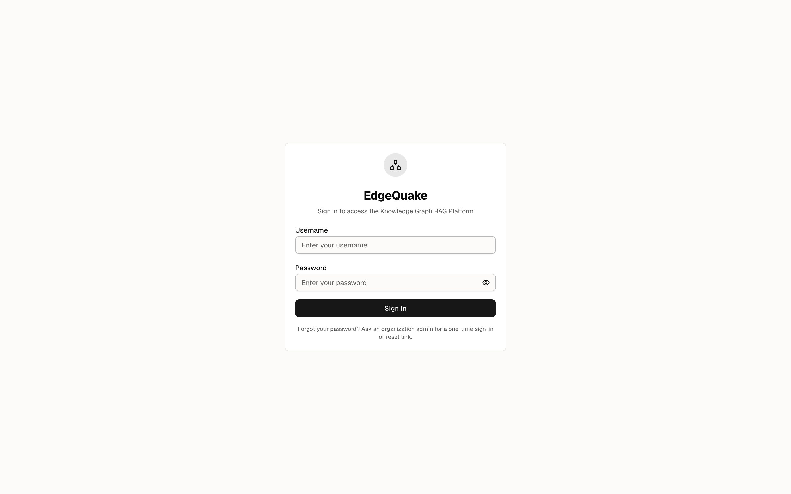
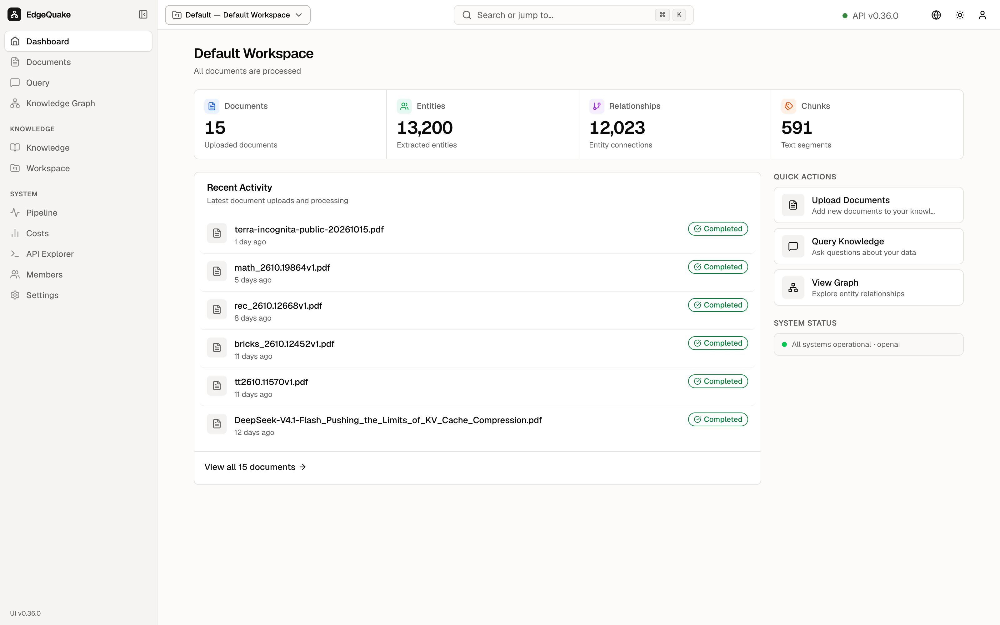

[Contents](README.md) · Previous: [What this is](01-what-this-is.md) · Next: [Dashboard](03-dashboard.md)

# Sign in and getting around

Open [https://demo.edgequake.com/](https://demo.edgequake.com/). If you are not signed in, you get a single card.

The card has two boxes and one button:

- **Username** is the account name. On this demo the administrator account is `admin`.
- **Password** is the secret that matches that name. The eye on the right of the box shows or hides what you typed. Leave it hidden.
- **Sign In** checks those two values and opens the [Dashboard](03-dashboard.md).

Type the username and password you were given. This tour does not print a password.

## The sidebar

After you sign in, a column stays on the left on every page. The top is the EdgeQuake logo, which always returns to the Dashboard. Then four everyday items: **Dashboard**, **Documents**, **Query**, **Knowledge Graph**. Under the label **KNOWLEDGE** are **Knowledge** and **Workspace**. Under the label **SYSTEM** are **Pipeline**, **Costs**, **API Explorer**, and **Settings**.

The black pill is the page you are on. **Collapse**, at the bottom of the column, shrinks the names to icons. The footer of the column shows **EdgeQuake** and **UI v0.36.0**, which is the website build in these pictures.

## The header

The thin bar across the top has four things:

- The chip **Default — Default Workspace** is the organization and the collection you are looking at. Click it to switch.
- The green **API v0.36.0** is the server. Green means it answered a health check.
- The globe changes the language of the labels.
- The sun or moon switches light and dark.
- The person icon is the user menu, including sign out.

## Switching organization or workspace

Click the chip. A small panel opens over the Dashboard.

The panel has a search box, then two lists:

1. **Organization.** This is the tenant. **Default** is checked, with the subtitle **System Default Tenant**. **Create New Tenant** starts a new organization. On a shared demo, leave that alone.
2. **Workspace.** **Default Workspace** is checked. The short name under it is `default`. **Create New Workspace** starts another collection of files inside the same organization.

A checkmark is the one you are in. Pick a row to move. Press Escape, or click outside the panel, to close it without changing anything.

The rest of this tour stays inside **Default — Default Workspace**.

## Keep going

Next: [Dashboard](03-dashboard.md). The same sidebar is on every later page, so later chapters name only what is new on that screen. The [Workspace](09-workspaces.md) page is where you change how that collection is read.
