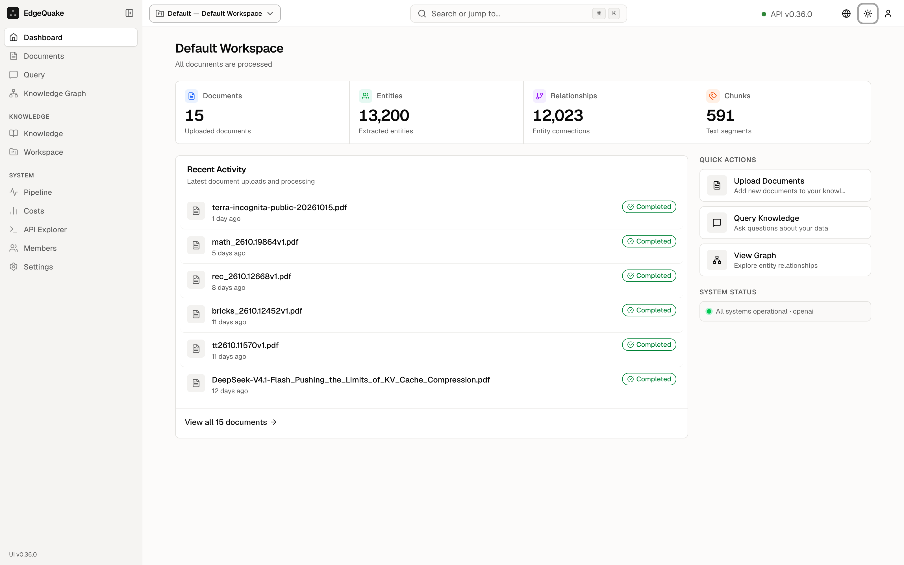

[Contents](README.md) · Previous: [Sign in and getting around](02-sign-in-and-getting-around.md) · Next: [Documents](04-documents.md)

# Dashboard

The Dashboard is the home page. It answers one question: how big is this workspace, and is it healthy?

The title is the workspace name, **Default Workspace**. The line under it, **All documents are processed**, means every file has been read. If something were still running, that line would say so and you would open [Pipeline](10-pipeline.md).

## The four counts

- **Documents** — **15**. These are the uploaded files. The caption says **Uploaded documents**.
- **Entities** — **13,200**. These are the things pulled out of the files. The caption says **Extracted entities**.
- **Relationships** — **12,023**. These are the lines between those things. The caption says **Entity connections**.
- **Chunks** — **591**. These are the short pieces the files were cut into. The caption says **Text segments**.

The numbers are for the workspace in the header chip. Switch workspace and the cards change.

## The three shortcuts

- **Upload Documents** — "Add new documents to your knowledge base." This opens [Documents](04-documents.md).
- **Query Knowledge** — "Ask questions about your data." This opens [Query](06-ask-a-question.md).
- **View Graph** — "Explore entity relationships." This opens [the map](07-the-map.md).

## Recent activity

**Recent Activity** lists the latest uploads. Each row is a file name, how long ago it arrived, and a green **Completed** pill. On this day the top rows included `terra-incognita-public-20261015.pdf` and `math_2610.19864v1.pdf`.

The green pill at the right of the heading says **All systems operational · openai**. That is the model provider the server is using for answers right now.

**View all 15 documents** at the bottom jumps to the full file list.

## Keep going

Next: [Documents](04-documents.md). If you would rather ask a question first, go to [Ask a question](06-ask-a-question.md).
