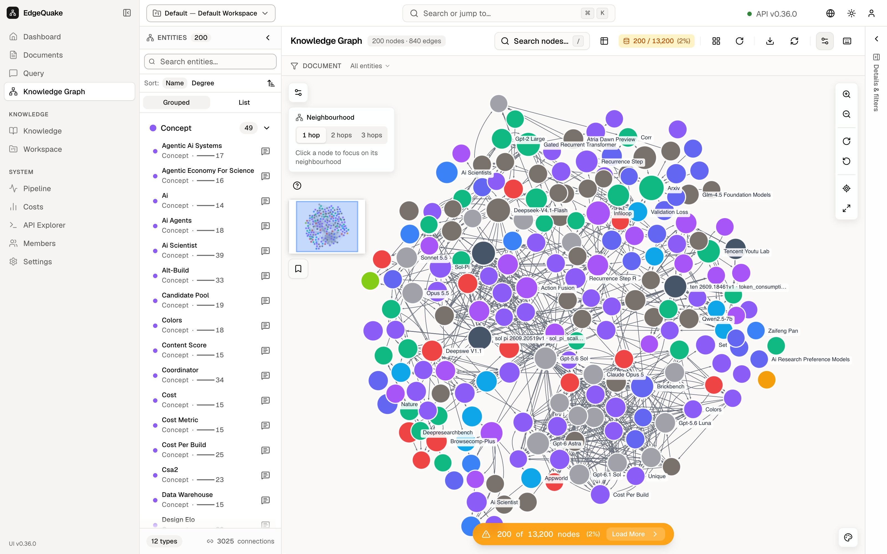
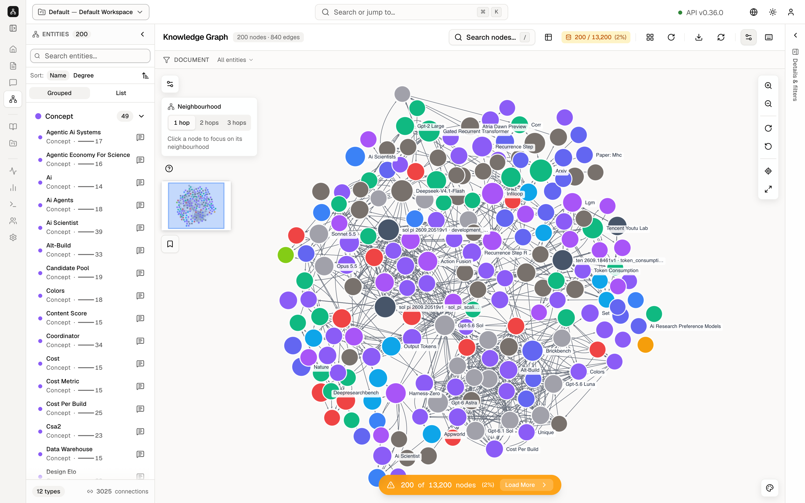

[Contents](README.md) · Previous: [Ask a question](06-ask-a-question.md) · Next: [Extra knowledge](08-extra-knowledge.md)

# The map

Knowledge Graph is the picture of the workspace. Each dot is an entity. Each line is a relationship. The sidebar calls this page **Knowledge Graph**.

The demo map is large: **13,200** dots and many thousands of lines. The page draws a sample so the browser stays usable. The orange bar at the bottom says **200 of 13,200 nodes (2%)**. **Load More** asks for the next batch.

## The entity list

The left column is titled **ENTITIES** with the count **200** (the ones currently drawn). **Search entities...** filters that list as you type. **Sort** is **Name** or **Degree**. Degree is how many lines touch that dot. **Grouped** bunches them by kind. **List** is one flat list.

Each row is a name, a kind such as **Artifact**, and a number. **Deepseek-V4.1-Flash** is an Artifact with **130** connections. Click a row to select that dot. The right-hand **Details** panel fills in, and the map moves to that dot.

## The canvas

The center title is **Knowledge Graph**, with **200 nodes · 549 edges** for the sample on screen.

The toolbar on that title row, from left to right after the title:

- **Search nodes...** finds a dot by name. The **×** clears the search.
- The table icon switches the dots to a table. Click it again to come back to the picture.
- The badge **200 / 13,200 (2%)** is the same "how much is drawn" count as the orange bar.
- The layout control and **Apply Layout** place the dots again.
- **Export** downloads a picture of the map.
- **Refresh** reloads the dots from the server.
- The settings icon opens picture options for this view (the same ideas as **Graph Visualization** on [Settings](13-settings.md)).
- The keyboard icon lists shortcut keys.
- **Zoom in**, **Zoom out**, and **Fit to screen** change the camera. The same three sit on the right edge of the picture.

Around the canvas:

- The **+** and **−** buttons zoom in and out. The fit button scales the map so the drawn dots all fit.
- **Neighbourhood** chooses how far to walk when you focus on one dot. **1 hop** is the dots one line away. **2 hops** and **3 hops** go further. The card says **Click a node to focus on its neighbourhood**.
- The small overview square in the corner is the whole sample, with a rectangle for the part you are looking at.

Colors match kinds of entity. The right-hand **FILTERS** list is the legend:

- **Search entities or types...** filters the legend.
- **ENTITY TYPES** says **11 types** and **200 of 200 nodes visible**.
- Each row is a color, a name, a count, and an eye. The eye hides or shows that kind. On this day the counts included **Artifact 45**, **Concept 33**, **Content 30**, **Method 28**, **Organization 16**, **Other 16**, **Person 13**, **Event 8**, **Data 6**, **Drawing 4**, and **Creature 1**.
- **Hide all** turns every kind off. Click the eyes again to bring them back.

**DOCUMENT** and **All entities** above the canvas limit the dots to one file or show every file.

Until you click a dot, **Details** says **Select a node** and **Click any node to explore its connections and sources**.

## One dot

Click **Deepseek-V4.1-Flash** in the list. The row turns black, the map centers on that dot, and **Details** fills in.

The panel shows:

- The name **Deepseek-V4.1-Flash** and a pill **Artifact**.
- **DESCRIPTION**. Here it is a short line about a multimodal model from DeepSeek.
- **PROPERTIES**. **description** repeats that line. **source_chunk_ids** and **source_document_id** are the ids of the chunk and the file this fact was read from. **logical_node_id** is the map's own name for the dot, in capitals: `DEEPSEEK-V4.1-FLASH`. **entity_type** is **ARTIFACT**.
- **Copy All** copies those properties.

The icons next to the name open the same entity in other views, including the file it came from. That is the same trail you see on a [document](05-one-document.md) and on an [answer](06-ask-a-question.md).

The Neighbourhood card may still be open. **0 nodes in reach** on a tight zoom means the walk has not been applied yet. Pick **1 hop** to pull in the neighbours.

## Keep going

Next: [Extra knowledge](08-extra-knowledge.md). The models that decide which kinds of dots exist are set on [Workspaces](09-workspaces.md).
