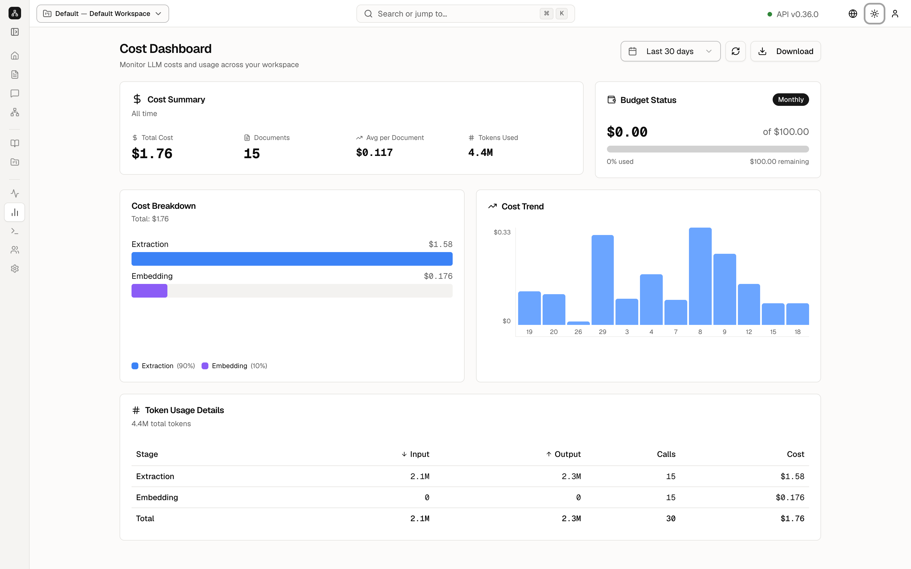

[Contents](README.md) · Previous: [Pipeline](10-pipeline.md) · Next: [API Explorer](12-api-explorer.md)

# Costs

Costs is the bill for model calls in this workspace. Reading a file and answering a question both call a model, and both show up here.

The title is **Cost Dashboard**. The subtitle on the screen is **Monitor LLM costs and usage across your workspace**. LLM is the language model: the program that reads files and writes answers.

**Last 30 days** is the range for the trend chart. The refresh icon reloads the numbers. **Download** saves the table.

## The summary

**Cost Summary**, labeled **All time**, has four figures for this demo:

- **Total Cost $1.76**
- **Documents 15**
- **Avg per Document $0.117**
- **Tokens Used 4.4M**

A token is a small piece of text the model is billed on. A short sentence is a handful of tokens. 4.4 million is the sum of everything sent in and everything the model wrote back.

**Budget Status** is a monthly cap. It shows **$0.00 of $100.00**, **0% used**, and **$100.00 remaining**. The **Monthly** pill and **Resets in** tell you the cap is per month. The $1.76 in the summary is all-time spend, so it can be higher than the month-to-date number in the budget card. On this day the current month had not added new spend.

## Where the money went

**Cost Breakdown**, total **$1.76**:

- **Extraction $1.58**, the blue bar, about **90%**. This is the work of reading files and listing entities.
- **Embedding $0.176**, the purple bar, about **10%**. This is the work of turning chunks into vectors.

**Cost Trend** is a chart of spend across days. The labels along the bottom are dates. A flat chart means little new work in that window.

## The token table

**Token Usage Details** says **4.4M total tokens**. The columns are **Stage**, **Input**, **Output**, **Calls**, and **Cost**.

| Stage | Input | Output | Calls | Cost |
| --- | --- | --- | --- | --- |
| Extraction | 2.1M | 2.3M | 15 | $1.58 |
| Embedding | 0 | 0 | 15 | $0.176 |
| Total | 2.1M | 2.3M | 30 | $1.76 |

Input is text sent to the model. Output is text the model returned. Embedding shows zeros in the token columns and still shows a cost, because that provider bills the vector step differently. **Calls** is how many times that stage ran: 15, once per document, and 30 in total.

These figures belong to the public demo. Your own workspace will show your own bill.

## Keep going

Next: [API Explorer](12-api-explorer.md). The queue that generates most of this bill is [Pipeline](10-pipeline.md).
