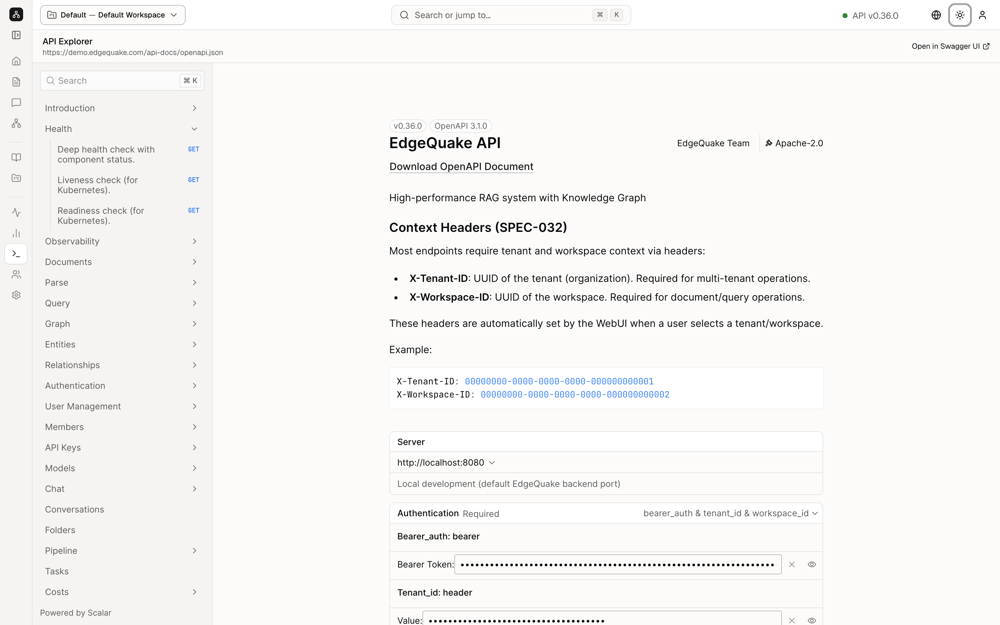

[Contents](README.md) · Previous: [Costs](11-costs.md) · Next: [Settings](13-settings.md)

# API Explorer

API Explorer is the same product, written as requests a program can send. You do not need it to use the website. Open it when you want to see the exact call behind a button, or when you are writing a script.

The title is **API Explorer**. Under it is the address of the description file, `https://demo.edgequake.com/api-docs/openapi.json`. **Open in Swagger UI** opens the same description in another layout, in a new tab.

**Search**, with the hint **⌘K**, filters the list on the left.

## The list

Each row is a group of calls. A chevron opens the group. **Health** is open in the picture. Inside it:

- **Deep health check with component status**, a **GET** (a read-only request). This is the check behind the green **API v0.36.0** dot in the header.
- **Liveness check (for Kubernetes)**, also a **GET**. A simple "the process is up". Kubernetes is the system that runs the demo server.
- **Readiness check (for Kubernetes)**, a **GET**. A simple "the process can take work".

Other groups match the screens you have already seen: **Documents**, **Query**, **Graph**, **Entities**, **Relationships**, **Pipeline**, **Tasks**, **Costs**, **Tenants**, **Workspaces**, **Conversations**, **Authentication**, **API Keys**, and more. Click a row to read the inputs and outputs of that one call.

The footer of the list says **Powered by Scalar**, which is the component that draws this page.

## The introduction

The right-hand pane is the overview:

- A badge **v0.36.0** and **OpenAPI 3.1.0**. OpenAPI is the standard format of the description file.
- **EdgeQuake API**, **Download OpenAPI Document**, and a one-line summary.
- **Context Headers**. Almost every call needs two headers. **X-Tenant-ID** is the organization. **X-Workspace-ID** is the workspace. The website sets both when you pick **Default — Default Workspace** in the header. The example box shows the all-zero sample ids used in the documentation, not a secret.
- **Server** is a menu of base addresses. **http://localhost:8080** is the usual address on your own machine. The demo you are looking at is `https://demo.edgequake.com`.
- **Authentication** says what the call must carry. On this server that is a bearer token (the proof you signed in) plus the tenant id and the workspace id.

You can try a call from this page. A call that creates, deletes, or reprocesses data will change the demo. Stick to the **GET** health calls if you are only looking.

## Keep going

Next: [Settings](13-settings.md). Asking a question from the website, which is the same idea as the Query calls in this list, is covered in [Ask a question](06-ask-a-question.md).
